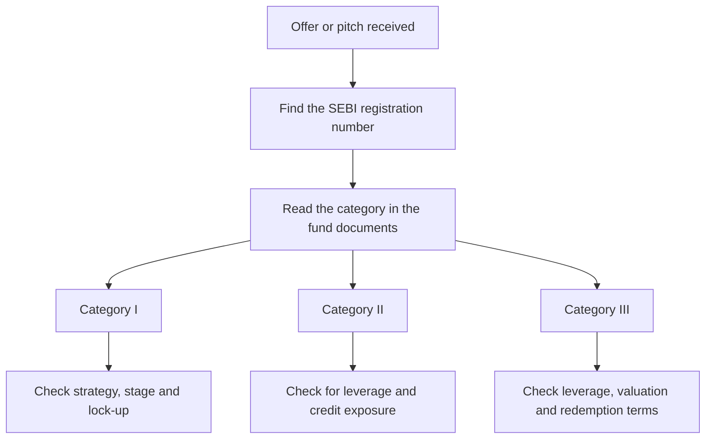

An offer document for an Indian alternative investment fund is long, and the first thing worth locating in it is not the return target or the fee. It is a single word that fixes the rules for everything else: the category. Category I, II or III decides which strategies the fund may pursue, how much leverage it may take, whom it may admit as an investor, and how long an investor's money can be locked up before the scheme winds down.

This article explains what the three categories are, what each one accommodates, and how to read the label when an AIF is put in front of you. It is a reading guide to a regulatory framework, not an assessment of any fund.

## Explain simply

An AIF is a private pool of money from a small number of investors, managed by a professional manager under a SEBI registration, and used to run a stated strategy. When the fund registers, it must pick one of three categories. Category I is for funds that back young, small or infrastructure businesses and get some regulatory concessions for it. Category II is for private equity, private credit and similar strategies that do not borrow to juice returns. Category III is for hedge-fund-style strategies that do use leverage. The category is a rule about what the fund is allowed to do — it tells you the lane, not how well the driver performs.

## What an AIF is, and what it is not

An alternative investment fund is a privately pooled investment vehicle that collects commitments from sophisticated investors and invests them under a defined strategy, governed by the AIF Regulations that classify vehicles into three categories with differing permitted strategies, leverage rules and investor bases. Three features define it:

- **Private placement.** An AIF may not solicit the public. It is sold through a private placement memorandum to a restricted set of investors, and that constraint is a core part of the design rather than a marketing choice.
- **A minimum commitment and a capped investor base.** The regulations prescribe a minimum investment per investor and limit how many investors a scheme may have, with the limits differing by category. Both are mechanisms the regulations impose; the current figures should be read from the consolidated text.
- **A structure around a manager.** The fund is typically constituted as a trust, a company or a limited liability partnership, with a manager that runs the portfolio, a trustee or board that oversees it, and a sponsor that stands behind it. Where the fund form is a company or an LLP, its entity filings sit in the public corporate registry alongside its other annual filings.

The line between an AIF and other pooled structures is regulatory, not conceptual. A mutual fund is offered to the public under a different regime with daily liquidity. A portfolio management service is a privately placed managed account under its own rules and minimum. An AIF sits in its own lane: privately placed, pooled, illiquid by design and registered in a category.

## The three categories at a glance

| Category | Typical strategies | Leverage | Character |
| --- | --- | --- | --- |
| I | Start-ups, SMEs, infrastructure, social impact | Not for return enhancement | Long-dated assets, specified regulatory concessions |
| II | Private equity, private credit, special situations | Not beyond operational needs | The broad residual lane for non-hedge strategies |
| III | Hedge-fund and other complex strategies | Permitted, within limits | Highest operational and disclosure expectations |

The table is a simplification, and the regulations are the authority. Two things about it are worth holding onto. First, the categories are a partition of the whole AIF space: a registered scheme must sit in one of them, and the choice is made at registration and recorded there. Second, the divisions are drawn around *strategy and leverage*, not around risk or expected return. A Category I scheme and a Category III scheme can both lose money permanently; they simply lose it in different ways.

## Category I: the concessional lane

Category I is where the regulations place funds whose activity the policy framework wants to encourage because it is long-dated and difficult to fund through ordinary channels. The funds in this category deploy money into start-ups, small and medium enterprises, infrastructure and social impact, and in exchange they enjoy specified regulatory concessions.

The design logic is worth understanding, because it explains the trade. These assets are illiquid by nature: a venture investment may not produce a cash exit for years, and an infrastructure asset is funded against a future revenue stream rather than a ready market. A fund that holds such assets cannot offer redemption, so the category pairs long-dated holdings with the long-dated lock-up and concession framework appropriate to them. The concession is not a subsidy for return; it is an offset for the illiquidity that the strategy carries as a matter of course.

For an investor, the practical question in Category I is not the label but the strategy inside it. Two schemes in the same category can differ completely in the stage they invest at, the sectors they touch and the diversification of their portfolios. The category tells you which regulator's lane the fund is in; the private placement memorandum tells you the actual bets.

## Category II: everything that is not hedge

Category II is the residual lane: it takes the funds that do not fall into Category I and do not need the leverage that defines Category III. In Indian practice that means the funds that invest in unlisted businesses, lend privately against them, or take positions in assets in special situations. It is where private equity funds, private credit and debt funds, and distressed or special-situations strategies are registered.

Two points distinguish Category II and are easy to miss.

**No leverage for return enhancement.** A Category II fund may not borrow to enlarge its positions; borrowing is confined to what the regulations allow for meeting operational requirements. This is a real constraint: it means a Category II stable return must come from the underlying assets rather than from a financing structure layered on top of them.

**It carries no Category I concession.** The trade that justifies Category I — long-dated assets against a concession framework — is not made here. Category II funds simply operate within the general AIF rules, which is why they tend to be judged on their investment discipline rather than on their category.

## Category III: leverage and complex strategies

Category III is defined by what it permits. A Category III fund may employ leverage, including through derivative instruments, subject to limits and disclosure requirements set in the regulations. This is the category in which hedge-fund-style strategies — long and short positions, event-driven trading, relative-value positions and other complex approaches — sit.

The leverage is why the category carries the sharpest operational expectations. Leverage amplifies outcomes in both directions, so a Category III fund's disclosure, valuation and risk-management obligations matter more than in a fund that holds its assets unlevered. Two consequences flow to the investor:

- **The category permits a strategy, it does not describe its risk.** Within Category III, leverage can be small and carefully bounded or material and central. The number that matters is the fund's actual leverage and its investment mandate, both of which belong in the documents.
- **Redemption terms differ.** Schemes in this category may be structured to permit periodic redemption, unlike the closed-ended funds typical of Categories I and II, subject to what the regulations allow. That flexibility comes with a valuation question: a fund whose holdings are not continuously priced must estimate them, and an estimate is not a transaction.

## Rules common to all three

Whatever the category, three mechanisms shape the investor's experience and deserve attention before signing.

**Commitment and capital calls.** An AIF does not usually collect the full investment at the start. The investor *commits* a sum, and the manager *calls* it in tranches as investments are found. The commitment is a standing obligation: the entire uncalled amount must remain available, and failing to meet a call carries penalties and can cost the investor the fund interest. An investor who can cover the first call but not the ninth has mis-sized the position.

**Tenure and extension.** Categories I and II schemes are typically close-ended with a defined tenure, and extensions are permitted only with investor consent at a threshold the regulations prescribe. Category III schemes may be structured differently. The tenure is not a formality: it is the length of time the money is beyond the investor's reach, and it should be set against the investor's own horizon.

**Fees and carried interest.** The fund's economics sit in two places. A management fee covers the manager's cost of running the fund, charged on committed or deployed capital, together with fund expenses. A carried interest pays the manager a share of profits, typically above a hurdle rate and often subject to a catch-up and a clawback if later losses reverse earlier gains. Because carried interest pays only after the investors receive their capital and hurdle, it aligns incentives — but the value of that alignment depends on how profit and hurdle are defined. Those definitions are in the fund documents, and they are where two funds that look similar separate.

## The J-curve, briefly

A private fund's return path over its life has a characteristic shape. Early years tend to show weak or negative returns, because management fees are charged from the start while the capital is only gradually deployed and the investments have not yet matured. Value then builds as assets develop and exits occur. This pattern is the J-curve, and it has one direct consequence for the investor: an interim net asset value is not a verdict. Judging a fund before its investment programme has matured mistakes the early part of the curve for the whole. The subject is treated in its own article later in this series.

## How to classify an offer you are shown

A short procedure, in the order the questions should be asked.

Concretely:

1. **Confirm the registration.** Look up the scheme on the regulator's records before reading anything the seller has written. A registered category is the foundation; without it, the rest is marketing.
2. **Locate the category and the strategy.** The category constrains what the fund may do; the strategy statement says what it intends to do within that constraint.
3. **Check the leverage claim against the category.** If a Category II fund is describing returned-enhancing borrowing, that is a question to resolve, not a feature to admire.
4. **Check the commitment, the tenure and the extension mechanism.** These define how long and how much of the money is out of reach.
5. **Check the fee and the carried interest definitions.** The hurdle and the catch-up decide what the manager is paid for, and against what.

The procedure does not judge the fund. It tells you which rules apply to it, which is the precondition for judging anything else.

## Worked example: the same ₹1 crore, read three ways

An illustrative scenario, not a return calculation or a projection. Suppose an investor is considering committing a sum — say, ₹1 crore, used only to make the arithmetic concrete — to funds in each category, and wants to compare what the label actually obliges them to.

- **Commitment risk.** In all three cases the ₹1 crore is usually a commitment, not a payment. If the manager calls a quarter of it in year one, the investor must fund that call and keep the rest available. The category does not change this mechanism, so the cash-flow shape is set by the fund rather than by the label.
- **Time out.** In a close-ended Category I or II scheme, the money is committed for the fund's tenure, with extension only on investor consent at the prescribed threshold. A Category III scheme may offer a different redemption profile, and the value of that difference to the investor depends on whether the redemption prices are reliable.
- **Leverage.** A Category II fund must earn its return from its assets; a Category III fund may earn part of it from leverage. The same stated target return therefore means different things in the two lanes, because one of them is taking exposure the other is not permitted to.

The label does not answer which is the better investment. It tells the investor which set of rules they are agreeing to, which is the only honest place to start.

## What the category does not tell you

- **It is not a quality or safety rating.** It is a boundary on strategy and leverage.
- **It does not predict the return.** Nothing in the framework sets an expected return, and no category guarantees one.
- **It does not describe the manager.** Track record, team and alignment are separate questions the category is silent on.
- **It does not fix the fee or the carried interest.** Those are terms in the documents, negotiated fund by fund.
- **It does not remove illiquidity.** That is a property of the assets, and it persists in every category.
- **It does not make an investment suitable.** Eligibility is decided by the investor's own capacity to hold a long-dated, illiquid position, not by the registration.

## Open questions

- What does the investor actually hold when a Category III scheme reports a net asset value it has estimated rather than observed, and how should that be weighed?
- How should a retail-adjacent investor reason about a category that prescribes a minimum commitment and an investor cap but sets no ceiling on losses?
- Where a scheme's stated strategy and its category both point to illiquidity, what is the honest way to size the position against a household's other obligations?
- How much of the taxonomy will change if fund structures continue to converge, and would a category label still be the right place to look?

The category is the first thing to read and the last thing to trust on its own. It sets the rules; the documents and the record decide whether the rules are being used well.
