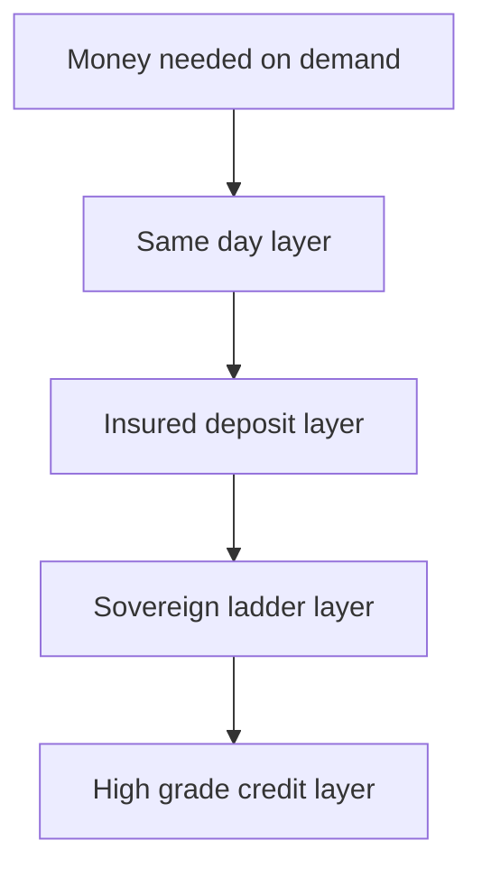

Most first fixed-income portfolios are assembled backwards. The investor meets a product — a corporate deposit quoting an attractive rate, a long-dated government security offered at a discount, a bond fund advertised as safe — and works out afterwards how it fits. The sequence that actually survives contact with a market runs the other way: start with when the money is needed, fix the layers that must never fall in value, and only then decide how much risk is worth taking above them.

This article sets out that sequence for an Indian retail investor moving from deposits towards government securities and, cautiously, towards corporate credit. It is about structure. It offers no recommendation on what anyone should hold.

## Explain simply

Think of fixed income as a stack of buckets, ordered by how soon you need the money. The bottom bucket is cash you might need tomorrow, sitting in a bank account; the next is money you need within a year or two, held in insured deposits. Above that is money you will not touch for three, five or ten years, which can be held in government securities — the safest rupee asset — where the price moves but the repayment does not. The top bucket is money you can afford to lose part of, lent to companies in return for a higher rate. The mistake is to fill the top bucket first because its rate looks best, then discover that a bill arrives while the money is tied up in something whose price has fallen. Layers are about time, not about products.

## Build from the obligation, not the product

Three questions decide the shape of the portfolio, and none of them mentions a yield:

1. **When is the money needed?** An obligation with a date — a fee, a tax payment, a planned purchase — belongs in an instrument that matures on or before that date. An obligation without a date belongs in something available on demand.
2. **What happens if the price falls?** If a fall in price would force a sale to meet the obligation, the money is in the wrong layer regardless of its yield.
3. **What is the penalty for being wrong?** The layer that cannot be wrong should be the largest one early on. Layers where a mistake is survivable can be grown later.

## Layer 1: the same-day layer

This is the buffer that prevents the rest of the portfolio from being sold at the wrong moment. It is a savings account or an overnight-access deposit, and its yield is close to irrelevant; its job is availability. Its size is set by the size of the surprises the household can actually absorb — an unreimbursed medical bill, a job transition, a large repair. Two features matter more than the rate: the account must be in the investor's own name and reachable without notice, and it must not be in the same institution that holds the rest of the money.

## Layer 2: the insured core

Bank deposits are the standard second layer because they are contractually dated, nominally fixed, and insured by the DICGC up to a statutory limit per depositor per bank — presently ₹5,00,000, covering principal and interest together for deposits held in the same right and same capacity. That last clause does the work. The cover applies **per depositor per bank**, so a single large deposit is protected only up to the limit and the remainder is an unsecured claim on the institution. Concentrating deposits to chase a slightly higher rate raises the exposure to that institution's failure without raising the protected amount.

Three mechanical points follow directly from the DICGC framework. Deposits held at **different branches of the same bank are added together** for the purpose of the limit. Deposits held at **different banks are insured separately**, because the limit is applied bank by bank. And the framework defines which deposits are covered, which are excluded, and how claims are settled — conditions a depositor should read before relying on the cover, because they are the terms on which a claim would actually be paid.

Two practical consequences follow:

- **Spreading is structural, not cosmetic.** If the amount above the per-depositor limit is significant, the only fix is more institutions, each holding no more than the limit.
- **The extra rate is a price for risk.** A small finance bank or a cooperative paying more than a large bank is not offering a better version of the same contract; it is offering a different credit. The comparison belongs with the corporate deposit article and the cooperative bank article, not with the savings-account rate.

## Layer 3: the sovereign ladder

Above the insured core sits money with a real horizon, and here the sovereign curve does the work. A government security is a dated obligation of the central government, issued through RBI auctions with periodic coupons and a repayment of principal at maturity. Because the sovereign can raise taxes and borrow in its own currency, G-secs are treated as the domestic risk-free asset, and their yields form the benchmark curve against which every other rupee debt is priced.

Retail investors reach this market directly. **RBI Retail Direct** provides an account route and bidding mechanism for participating in primary-market auctions of dated government securities, Treasury Bills, State Development Loans and Sovereign Gold Bonds. The account has its own opening conditions, and the bidding mechanics — what is bid, at what price convention, and how allotment works — are set out by the scheme rather than by the investor's broker.

A **maturity ladder** converts this layer from a yield decision into a structure. Principal amounts are spread across successive maturity dates so that known sums return each year, which reduces the risk that all reinvestment happens at one moment in the rate cycle. The ladder planner linked with this article shows the shape; the dated G-sec and State Development Loan articles cover how the instruments themselves are priced and what fiscal risk an SDL adds to a sovereign coupon.

Two honest qualifications:

- **Risk-free refers to credit, not price.** A dated G-sec sold before maturity can lose value if yields have risen. Its price moves with the policy rate and with the market's expectations, and the repo rate is the RBI's principal signal for that short end.
- **Holding to maturity is easy; selling may not be.** Primary-market access through Retail Direct is a different question from secondary-market liquidity. Anyone who might need the money earlier should size the position for that possibility rather than assume a frictionless exit.

## Layer 4: high-grade credit, sized small

Only above the sovereign layer does credit risk enter, and it should enter deliberately. A corporate bond pays more than a comparable government security because the issuer may fail to pay, or may pay late. That difference is the **credit spread**, and it is compensation rather than free income.

The logic of whether the compensation is adequate is a single multiplication. Expected credit loss over a year is approximately the probability of default multiplied by the loss given default:

$$ \text{Expected loss} \approx PD \times LGD $$

The probability of default is the likelihood the borrower fails to meet its obligations within the horizon. The loss given default is the share of the exposure expected to be lost if default occurs, equal to one minus the recovery rate, and it depends on seniority and security. A spread smaller than the expected loss is not an opportunity; it is a subsidy from the bondholder to the issuer.

Ratings are a filter at this layer, not a guarantee. They compress a large amount of analysis into a label and can change; the label is also not a promise about the investor's own holding period or about recovery in a specific workout.

## How much duration risk is reasonable

Duration is the part of the decision that beginners take by accident. Yield to maturity states a level; **modified duration** states how much the price moves when that level changes. A modified duration of 3 means a rise of one percentage point in yield costs roughly 3% of value, with the sign reversed — and the approximation understates the effect for large moves unless a convexity term is added.

The reasonable test is not "how much duration can I tolerate" but "when do I need the money". Duration should be bounded by the horizon. If the money is needed in two years, a position with a modified duration of seven has made a rate forecast the investor did not intend to make, and a fall in prices would arrive exactly when the money is required. Locking a rate for longer is a real benefit when the horizon is genuinely long; it is a liability when the horizon is short and unstated.

## Worked example: an illustrative layered allocation

An illustrative construction, not a recommendation and not an observation of any market. Suppose ₹10,00,000 is to be allocated.

| Layer | Purpose | Illustrative amount | Share |
| --- | --- | --- | --- |
| Same-day access | Surprises, no notice | ₹1,00,000 | 10% |
| Insured bank deposits | Dated needs within the horizon, spread across banks | ₹3,00,000 | 30% |
| Sovereign ladder | Money not needed for years, held to maturity | ₹4,50,000 | 45% |
| High-grade credit | Explicit, bounded credit exposure | ₹1,50,000 | 15% |

Two derived figures follow, and both are illustrative calculations rather than forecasts.

**Portfolio duration.** If the sovereign layer has an average modified duration of 2.5 and the credit layer 2.5, while the first two layers are treated as having no price sensitivity, the portfolio's modified duration is about $0.45 \times 2.5 + 0.15 \times 2.5 = 1.5$. A one percentage point rise in yields would then cost roughly 1.5% of portfolio value, about ₹15,000, before any coupon income. That is the size of the interest-rate bet embedded in the structure.

**Expected credit loss.** If a name in the credit layer is assumed to have a 1% annual probability of default and a 60% loss given default, expected annual loss is $0.01 \times 0.60 = 0.6\%$ of that exposure, or about ₹900 on ₹1,50,000. The spread earned on that layer has to clear 0.6% before it compensates for expected loss at all, and it must clear more than that to compensate for the volatility of the outcome and for illiquidity. Both inputs are assumptions; they are printed next to the result precisely so they can be challenged.

## The four lanes, in this context

- **Contractual.** Deposit interest and bond coupons are promises with a legal basis, backed by a specific obligor. The insurance cover is a statutory promise with a limit.
- **Model-estimated.** The duration arithmetic and the expected-loss figure above are model estimates from stated assumptions. So is any ladder's projected reinvestment rate.
- **Historical realised.** What deposits, bond funds and gilt portfolios actually delivered over a past period. It describes a window, and it does not transfer.
- **Speculative.** The gain from a fall in yields or a narrowing of spreads, and the loss from the reverse. This lane is where a "safe" long-dated position turns out to be a position on the rate cycle.

## What this does not tell you

- **It does not select institutions.** Deposit limits and the credit standing of any specific bank, small finance bank or cooperative are facts about that institution and must be checked individually.
- **It does not value a secondary-market exit.** The cost of selling a G-sec or an SDL before maturity depends on market depth at the time.
- **It does not handle tax.** Coupon and deposit interest are taxed as they arise, and the treatment varies by instrument and holder. Post-tax comparisons need dated rates from the tax reference.
- **It does not cover inflation.** A nominal ladder can still lose purchasing power; the deposit comparison calculator in the links above does the post-tax, post-inflation arithmetic rather than the headline-rate version.
- **It does not extend to instruments that only look like this layer.** Perpetual bonds, additional-tier-one bank capital and market-linked debentures carry features — calls, deferral, equity-linked returns — that put them outside a starter structure entirely.

## Open questions

- How should the insured core be sized when the amount exceeds the per-depositor limit by a large multiple and the number of conveniently available banks is small?
- For a retail investor, what is the realistic cost of exiting a dated G-sec or an SDL before maturity, as against holding it to redemption?
- Across the full population of stressed Indian deposit-taking institutions rather than the well-publicised cases, how much of the extra yield on higher-rate deposits was ultimately recovered by depositors?
- For an investor with a short horizon, is a maturity ladder simply a proxy for a duration decision made in advance — and if so, which framing produces better decisions?
