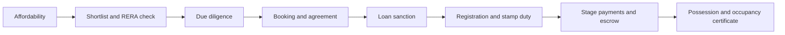

A home purchase fails at the seams. The price is agreed, the loan is around the corner, and then a title document turns out to be missing, an advance was paid before the agreement existed, the disbursement schedule does not match the construction stage, or possession is offered without an occupancy certificate. Almost none of these are matters of judgement; they are sequencing errors. The purchase is a chain of gates, and each gate commits money or rights that the next one assumes.

This article lays out the full sequence for an Indian home purchase, stage by stage, with the objective of making the order visible before the first rupee moves.

## Explain simply

Think of buying a home as eight checkpoints in a fixed order. First work out what you can truly afford, including all the taxes and charges around the price. Then find a project, and check its registration and disclosures on the regulator's portal. Then investigate the title and the approvals. Only then do you agree terms, sign, and register the document. The loan is sanctioned and released against those documents and against construction progress, not in one lump. Finally you take possession when the building is certified fit to occupy. Skip a checkpoint or do them out of order and a later one tends to fail.

## Stage 0: affordability, before anything else

The headline price is not the cost. Three layers sit on top of it, and all three are decided before the loan is: the statutory transfer charges, the transaction-cost stack, and the recurring cost of owning.

- **Statutory transfer charges.** State stamp duty and registration charges apply on the higher of the consideration or the notified minimum value for the locality, and they are paid at registration. Because they are set state by state and revised periodically, the charge on the same price differs across India, which is why the figure must be computed for the specific state rather than assumed.
- **Transaction costs.** Legal and title search fees, loan-processing charges, documentation and valuation charges, and any applicable goods and services tax on an under-construction unit. Each is individually modest; together they are material.
- **Recurring ownership cost.** Property tax, maintenance, insurance and, if the home is financed, the interest. This is the layer most first-time buyers underweight, because only the instalment is modelled.

Two affordability maths matter at this stage. The first is the loan-to-value position: how much of the price the lender will fund against the lender's own valuation, and how much therefore has to come from the buyer. The second is the instalment against income, allowing for the fact that the property tax, maintenance and interest all rise while a fixed instalment stays flat in nominal terms.

## Stage 1: shortlist, and check registration

Before visiting a site office in earnest, check the project on the state RERA portal. The real-estate framework requires promoters to register projects above the prescribed size before advertising or selling, disclose the project approvals, timelines and sanctioned plans, and deposit a mandated share of collections in a designated account to be drawn down in proportion to construction progress. That means a set of facts about the project is available before any money changes hands:

- whether the project is registered, and under which registration;
- the identity of the promoter and the declared completion timeline;
- the approvals and sanctioned plans relied upon;
- the carpet area of the unit, as the framework defines it for disclosure.

Registration is not a quality judgement. It confirms that the project is inside the regulated perimeter and that specific obligations now attach to the promoter. What the obligations are, and how to check compliance with them, is the subject of the next article in this series.

## Stage 2: due diligence before money moves

Registration on the portal answers questions about the project's status. It does not answer the questions that decide whether the transaction is sound. Those need documents.

- **Title.** A clear chain of title establishing that the seller can convey what is being sold, and the search of the records that supports it. For a resale, this includes the previous conveyance and the current holder's title; for a new project, it includes the land title and the development rights under which the promoter builds.
- **Encumbrances.** A certificate of encumbrance and a check that the property, and where relevant the promoter's land, is not charged in a way that survives the purchase.
- **Approvals.** The commencement and layout approvals, and the sequence of permissions the project needs to proceed lawfully.
- **The unit itself.** The carpet area, the floor and the exact unit as it will be described in the agreement.

This stage is deliberately placed before any booking amount. Due diligence that happens after money has moved has lost most of its leverage.

## Stage 3: booking, allotment and the agreement for sale

A booking amount is typically paid against an allotment of a specific unit. Two rules govern this stage and both are protective.

First, the regulations limit what a promoter may collect before the agreement for sale is executed, so that a buyer is not asked to fund a project on the strength of an allotment letter alone. Second, the agreement for sale must follow within a prescribed period and must reflect the statutory requirements — the carpet area, the declared timeline, the payment schedule and the consequences of delay on both sides.

The agreement is the document that converts a promise into an obligation. It is where the buyer should be able to see, in writing: what is being sold, in what area terms, by when, on what payment schedule, what happens if possession is delayed, and what happens if the buyer defaults. A term that appears only in a brochure or a conversation is not a term.

## Stage 4: loan sanction and disbursement

A home loan is sanctioned against the property and repaid from income, and the sanction is conditional. The lender will typically require its own valuation of the property, its own title and legal check, and KYC on the borrower, before releasing anything. The sanction letter states the amount, the interest basis, the tenure, the processing charges and the conditions, and those conditions are as much a part of the loan as the rate.

The interest basis deserves its own attention. Floating-rate retail home loans are commonly priced against an external benchmark linked to the central bank's policy rate, so the applicable rate resets as that benchmark moves. That arrangement makes the initial rate a starting point rather than a fixed cost, and it makes the spread a lender charges over the benchmark a negotiating point in its own right. The mechanics of comparing a fixed against a floating loan are treated separately in this series.

Disbursement for an under-construction property is normally staggered: the lender releases funds in tranches tied to construction stages and to the buyer's own payments, rather than paying the whole amount to the promoter at once. This protects the lender and, incidentally, the buyer — but only if the buyer tracks the tranches against the agreement's payment schedule. A disbursement that runs ahead of construction is exposure the buyer is carrying on a building that does not yet exist.

## Stage 5: registration, stamp duty and the transaction

The transfer of an interest in immovable property is completed by a registered instrument in most transactions. The instrument is stamped at the rate the state prescribes on the higher of the consideration or the notified minimum value, and registration then matches the document into the public record.

Three practical points recur:

- **The minimum value is a floor, not a price.** The stamp duty computation uses the notified minimum for the locality if the agreed price is lower, and a registered transaction below that floor generally requires approval and carries tax consequences. This is why the duty computation cannot be done from the agreement price alone.
- **Registration is what the record reflects.** An unregistered or under-stamped instrument can be inadmissible and exposed to penalty, so the completion of the stamping and registration step is not a formality.
- **Mutation follows.** Having the municipal record show the new owner is a subsequent administrative step that affects property tax and utilities, and it should be completed rather than deferred.

## Stage 6: construction, escrow and stage payments

For an under-construction property, the period between agreement and possession is where the buyer's exposure is largest and their visibility smallest. The framework addresses this by requiring a mandated share of the money collected from allottees to be deposited in a designated account, to be withdrawn in proportion to the construction actually completed. The mechanism is designed so that the buyer's payments track the building.

Making the mechanism work for the buyer requires three habits: paying strictly against the agreed schedule, keeping the receipts that document each payment, and matching the lender's disbursement tranches to the same schedule. Where a promoter asks for money outside the schedule or outside the designated-account mechanism, the correct response is to make that request formal and documented rather than to accommodate it informally.

## Stage 7: possession and the occupancy certificate

Possession is the stage at which the buyer's leverage is lowest and the consequences of a defect are largest, which is why it is the stage most often rushed.

- **Occupancy certificate.** A certificate from the local planning authority confirming that the building as built matches the approved plans and is fit for occupation. Possession offered without it exposes the buyer to property-tax penalties, difficulty obtaining utilities, and legal risk on resale. The framework places the responsibility for obtaining it on the promoter, and courts have treated handing over possession without it as a deficiency in service.
- **Inspection and snag list.** The unit should be inspected against the agreement before possession is accepted, with defects recorded in writing and a timetable for remedy agreed.
- **Handover documentation.** The completion certificate where applicable, the occupancy certificate, the share certificate or the equivalent, the maintenance agreement and the record of the society or association formation.
- **Conveyance.** In the case of a promoter project, the transfer of the common areas and the completion of the conveyance to the owners' association is a step that follows possession and should be tracked to completion.

## Worked example: the acquisition cost stack

An illustrative calculation, not a quotation. Suppose a home is agreed at ₹1,00,00,000 and the buyer funds 80% of it with a loan, keeping 20% as equity. The statutory and transaction charges are assumed, purely for the arithmetic, at a combined stamp duty and registration rate of 7% and loan-related charges of 1% of the loan; these assumptions are the arithmetic of the example and are not rates in force anywhere.

| Item | Basis | Amount |
| --- | --- | --- |
| Agreed price | — | ₹1,00,00,000 |
| Loan | 80% of price | ₹80,00,000 |
| Stamp duty and registration | 7% of price, assumed | ₹7,00,000 |
| Loan-related charges | 1% of loan, assumed | ₹80,000 |
| Cash needed at closing | Down payment plus charges | ₹27,80,000 |

The instructive line is the last one. The buyer who budgeted a 20% down payment of ₹20,00,000 has actually been asked for ₹27,80,000 at the point of registration, before furnishing, shifting, maintenance deposits or the first instalment. The gap between those two numbers — roughly ₹7,80,000 here, driven entirely by the assumed rates — is the reason the transaction stack is computed at stage zero rather than discovered at registration. Every figure in the table changes with the state, the property type and the date; only the structure of the calculation is stable.

## What this does not tell you

- **It does not value the property or judge the price.** Sequencing protects the transaction, not the buyer from overpaying.
- **It does not replace professional title search and legal advice.** The stages say what must be checked; they do not do the checking.
- **It does not fix the charges.** Stamp duty, registration, GST and local levies vary by state and change over time.
- **It does not resolve disagreements after possession.** Defects, delayed common areas and conveyance follow-up sit largely outside the pre-purchase stages.
- **It does not make the purchase an investment decision.** A home also provides shelter; where the exposure is sought purely as an investment, a listed real-estate vehicle is a distinct structure with its own liquidity and disclosure profile.

## Open questions

- What is the most useful order to run the lender's legal check and the buyer's own title search, given that each is nearly a duplicate of the other?
- How should a buyer verify that the construction-linked payment schedule genuinely reflects construction rather than a marketing timeline?
- What evidence should a buyer retain through the construction period so that a later dispute over delay or defect can be evidenced rather than asserted?
- How much of the completion-certificate and conveyance follow-up is realistically enforceable by an individual allottee, and how much depends on the collective action of the association?

The purchase is not hard. It is long, and every gate depends on the one before it having been done properly.
