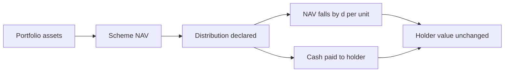

A dividend-yield fund occupies a comfortable corner of the market's imagination: it sounds like a fund that pays you. It is instead an equity scheme with a stock-selection style, grouped by regulation with the other equity categories and constrained by a portfolio rule. It has no coupon, no fixed payout and no obligation to distribute anything at all. Understanding that gap — between the name and the mandate — is the whole of this article.

Two beliefs are worth dismantling at the start. The first is that a scheme which pays cash has delivered a return the holder would not otherwise have had. The second is that the tax on that cash is a detail. Both are false, and the arithmetic in the middle of this article shows why.

## Explain simply

A dividend-yield fund buys shares of companies that pay relatively large dividends compared with their share prices. That is a way of choosing stocks, not a promise to hand you money. If the fund does decide to pay out cash, the money comes out of the fund itself: the fund's value drops by roughly the amount paid, and you receive the cash. Your units plus your cash are worth about the same as before, so nothing was created. The payments are also taxed in your hands now, which older investors may not expect, and the rate and the rules have to be checked rather than assumed.

## The category is a style, not a promise

The categorisation framework puts dividend-yield schemes inside the equity group, alongside large-cap, midcap, value and contra schemes. What separates them is the portfolio restriction each must respect: a dividend-yield scheme is required to orient its holdings towards shares with dividend characteristics, and the framework's operative threshold for how much of the portfolio must meet that orientation lives in the circular rather than in the scheme's marketing.

That distinction matters because a restriction on what a fund may hold is not the same as a promise about what it will pay. A bank deposit is a contract with a stated rate. A government bond is a contract with a stated coupon. An equity scheme is a pooled portfolio whose value moves with the shares inside it and whose fees are charged against that value every day. The dividend-yield label tells you which shares the manager tends to buy. It tells you nothing about what will land in your account, because nothing in the structure obliges it to land there.

The style itself has a defensible economic idea behind it. Companies that have paid steady dividends over long periods tend to be mature, cash-generative and less dependent on external funding, and their share prices can be less sensitive to changes in the growth narrative. Whether that translates into a durable advantage is a different and contested question, and it is not answered by the word "dividend" on the cover.

## A distribution is a movement, not a creation

Here is the mechanism, stated plainly. A mutual fund scheme holds assets. The per-unit value of those assets is the net asset value, computed as total assets less liabilities divided by the number of outstanding units. When a scheme declares a distribution, it takes cash out of the scheme and pays it to unitholders. The scheme's assets fall by the amount paid, the number of units does not change, so the net asset value per unit falls by approximately the amount paid per unit.

The value on the unitholder's side does not change at the moment of the payout:

$$ V_\text{before} = N \times \text{NAV} $$

$$ V_\text{after} = N \times \left(\text{NAV} - d\right) + N \times d = N \times \text{NAV} $$

where $N$ is the number of units held and $d$ is the distribution per unit. The algebra is not an opinion; it is an accounting identity. A distribution transfers value from the scheme's balance sheet to the holder's bank account. It does not add to the holder's wealth.

Two practical consequences follow. Because the payout reduces the scheme's assets under management, every subsequent percentage return is earned on a smaller base. And because the payout is a receipt in the holder's hands, it can be a taxable event — which is the part that changed.

## The name already admits it

Anyone who expected a distribution to be pure profit should read the option's full name. What most platforms still label a "dividend" option is now formally the income distribution cum capital withdrawal option. The phrase is a disclosure, not branding. It says that what is paid out can consist of income, of realised gains, or of a return of the holder's own capital. A distribution that is partly a return of capital is not a return on your investment; it is a partial return of it.

This is also why a portfolio dividend yield and a scheme distribution are not the same number. The portfolio yield is a property of the shares held — the dividends they are expected to pay relative to their prices. A distribution is a decision the scheme takes, is reduced by the expense ratio and other charges, and may include components that are not dividend income at all. Reading one as a proxy for the other is the most common error made about this category.

## What changed in the tax treatment of a payout

Historically the tax on a mutual-fund distribution was levied at the scheme level: the scheme settled it, and the amount that reached the holder had already borne the charge, so the holder received it without a separate tax event. The architecture now runs the other way. The scheme declares an amount, the amount is paid to the unitholder, and the charge is applied to the receipt in the unitholder's hands.

Two consequences follow even without a single rate. First, a distribution has become a taxable event for the recipient whether or not the recipient wanted the cash. A holder who is reinvesting the payout for the long term has been handed a tax liability they did not choose. Second, the charge falls on the individual holder rather than being absorbed at the scheme level, which means the same payout can have a different after-tax value for two holders of the same scheme.

The rate, the effective date and the precise classification of such a receipt are figures. This article states none of them. The packet for this brief carries no dated tax-rule entry for income-distribution-cum-capital-withdrawal receipts, and its source set does not include the tax statute, so the mechanism is described and the numbers are flagged as requiring verification against the current Act and against the scheme's own distribution statements. That is the honest position, and it is also the safe one: any article that quotes a single percentage without a financial year and an assessment year is describing a rule it has not verified.

## Four lanes, never blended

Wherever a return is discussed, four distinct lanes exist, and this category is a good place to see why they must not be merged.

| Lane | What it means here | Where the figure comes from |
| --- | --- | --- |
| Historical realised | What the scheme's NAV has actually done over a stated period | The published daily NAV series |
| Contractual | The terms the scheme is obliged to deliver | The expense ratio and any applicable exit load; there is no contractual coupon and no owed distribution |
| Model-estimated | The portfolio's trailing dividend yield, computed from disclosed holdings and prices | An arithmetic exercise on the monthly portfolio, which describes a tilt rather than forecasting a payout |
| Speculative | The expectation that distributions will continue and that high-yield shares will outperform | No evidential basis until the outcome is realised |

A distribution does not belong in any of these as a separate lane. It is a movement inside the historical realised lane: value that was already reflected in the NAV, relocated to cash. A scheme's trailing portfolio yield belongs in the model-estimated lane and nowhere else. The belief that next year's distribution will look like this year's is speculation.

## Worked example: the payout that changes nothing

The following arithmetic is an illustrative calculation, not a forecast and not the figures of any scheme. Suppose a holder owns 1,000 units of a scheme whose NAV is ₹100.00, so the holding is worth ₹1,00,000. The scheme declares a distribution of ₹2.00 per unit.

- NAV after the distribution, before any tax: $100.00 - 2.00 = 98.00$
- Value of units after: $1,000 \times 98.00 = $₹98,000
- Cash received: $1,000 \times 2.00 = $₹2,000
- Value immediately after: $$ 98,000 + 2,000 = 1,00,000 $$

So ₹1,00,000 before and ₹1,00,000 after, before tax. Nothing was created. Now add the tax layer: if the ₹2,000 receipt bears tax, the holder's total is ₹98,000 plus ₹2,000 reduced by the charge, which is strictly less than ₹1,00,000. Had the same holder instead redeemed ₹2,000 of units, the charge would fall on the gain element of those units rather than on the whole receipt, which is a different base entirely; the treatment of that redemption is a tax question this brief's sources do not cover, and it is flagged here rather than asserted.

The comparison to carry away is structural, not numeric. A distribution charges a receipt. A redemption realises a gain measured against cost. The two are not interchangeable, and neither is free.

## Why an income need is not solved by a distribution

If the underlying need is a cash flow, note what a distribution does and does not give you. It gives you an amount chosen by the scheme, paid on a date chosen by the scheme, received by every holder of that option whether or not each of them wanted it, and taxed in your hands when it arrives. It gives you no control over the amount and no ability to skip a payout in a year when you do not need it.

A systematic withdrawal plan works differently. The holder instructs the scheme to redeem a stated amount at stated intervals, the redemption is treated as an ordinary redemption subject to the scheme's exit load if the holding period has not been met, and the amount is chosen by the holder rather than by the scheme. For a holder whose objective is regular cash from an accumulated corpus, that is the instrument that puts the decision in the holder's hands. The SWP Calculator linked below shows how a withdrawal rate interacts with a return assumption over time, and the Post-Tax Return Calculator is the one to use when comparing a taxed payout against a taxed redemption.

## How to read a dividend-yield fund

Because the category mixes a real style with an unreliable expectation, the reading process has to separate them.

1. Confirm the mandate. Read the scheme information document to see the dividend orientation the scheme declares, and check the monthly portfolio to see whether the holdings match it.
2. Measure realised growth from the NAV series, on a total-return basis, over rolling windows rather than a single favourable start and end date.
3. Compare the NAV series with the distribution history. A scheme that has distributed heavily while its NAV barely moved has been returning capital, not compounding it.
4. Read the total expense ratio for both plans, because a fee charged daily against a portfolio is a certainty while a distribution is not.
5. Look at the portfolio's own dividend yield and its sector composition. A high portfolio yield that comes from one or two sectors is a concentrated bet dressed as an income characteristic.
6. Check the exit load and the holding period, since both decide what a switch or a redemption actually costs.

## What this does not tell you

None of this says a dividend-yield scheme is a poor investment. A valuation tilt can be a legitimate part of a portfolio, and a portfolio of mature, cash-generative companies is not an unreasonable thing to own. What the article says is that the category should be judged as a style and not as an income product, and that the distributions it makes should be judged as transfers and not as returns.

It also does not tell you the after-tax outcome, because that depends on rates and classification which are not established here. It does not tell you how the style will behave in the next downturn, because a style's past behaviour was observed under conditions that will not repeat exactly. And it does not resolve whether a dividend-yield mandate adds anything to a value mandate, since the two overlap substantially and the difference is in the detail of the screens rather than in a slogan.

## Open questions

- Does a dividend-yield mandate deliver anything a value or quality mandate does not, once sector composition and cost are held constant?
- Do schemes that distribute regularly attract a holder base that would be better served by a withdrawal plan, and would that show up in the data on flows and redemption patterns?
- Should a scheme be required to publish the split of each distribution between income and return of capital, so that its after-tax character is visible before the money is received rather than after?
- How much of a dividend-yield scheme's behaviour in a falling market is the style, and how much is a defensive sector tilt that merely happens to sit inside the same portfolio?

The habit to take away is narrow and useful. When a fund pays you cash, ask where that cash came from. If the answer is "out of the fund you already owned", then you have been moved, not paid.
