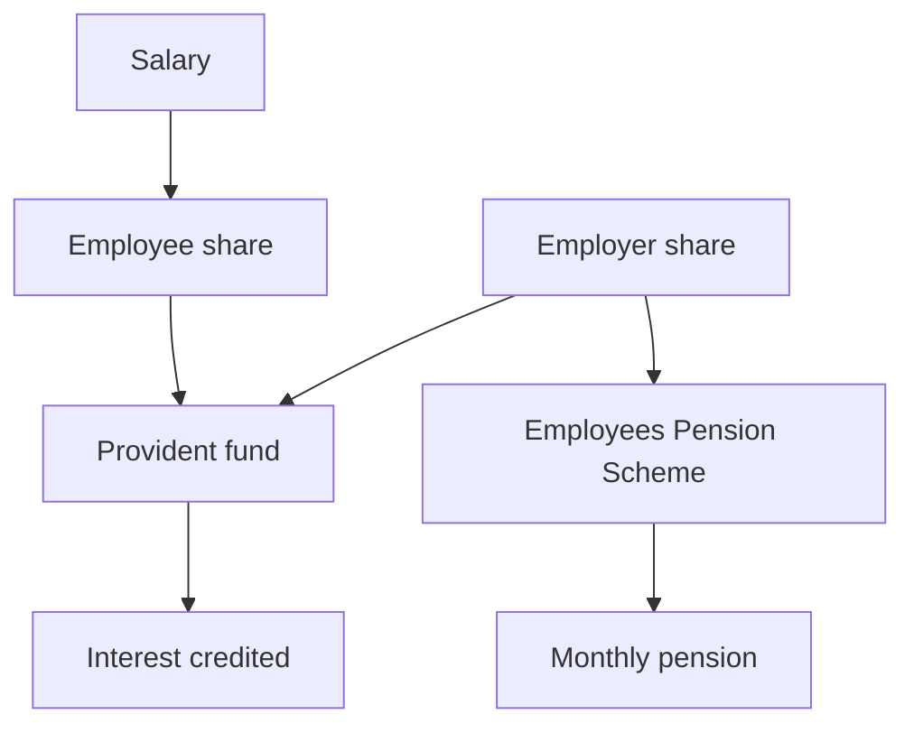

The Employees' Provident Fund is the largest retirement account that most salaried Indians will ever hold, and often the least understood. It is not a bank deposit and it is not a mutual fund. It is a statutory fund administered by the Employees' Provident Fund Organisation under the Ministry of Labour and Employment, into which a deduction from the salary and a contribution from the employer are paid every month, and to which interest is credited through a process the statute prescribes. What accumulates is the sum of the contributions plus the credited interest, less whatever has been advanced or withdrawn.

The operational failures in this account are rarely about arithmetic. They are about the split of the employer's contribution between two destinations, about what to do with the balance when the employer changes, and about the difference between transferring that balance and withdrawing it. Each has a rule, and the rules matter more than the headline interest rate.

## What the account actually is

Three structural features separate the provident fund from a savings product.

It is funded by **contribution** rather than by deposit. Both the member and the employer contribute at rates prescribed under the statute and revised from time to time, and the employer's contribution is not a gift: it is part of the cost of employment, which is why it is treated as a deduction from salary for the purposes of the Act rather than as income in the member's hands.

It is **administered**, not owned. The account is a record in a statutory system, identified by the member's Universal Account Number, rather than a balance that a company holds on its own books. The practical consequence is that a change of employer, of payroll vendor or of establishment does not by itself require the money to move anywhere.

Its return is **declared**, not discovered. The rate of interest credited to the fund is declared through a statutory process rather than set by competition for deposits, and it is credited to the balance. The rate is reviewed periodically rather than fixed once for the life of the account, so the declared rate for any year should be read from the organisation's notification instead of assumed. It is a notified rate, not a contractual coupon.

> Figures deliberately not stated: the employee and employer contribution rates, the proportion of the employer's share diverted to the pension scheme, the declared interest rate for the year, and the qualifying period for pension eligibility are all prescribed numbers that are revised. Each is flagged below and should be read from the current notification rather than from any summary, including this one.

## The contribution split and the two destinations

Every month, two streams of money enter the system, and the employer's stream does not go entirely to the member's provident fund balance.

The employee's share is credited to the provident fund account. The employer's share is divided: one part goes to the same provident fund account and, once credited, is indistinguishable from the employee's contribution; the other part is diverted to the Employees' Pension Scheme, which provides a monthly pension rather than an accumulating balance.

That split is the most misunderstood feature of the account. The money that goes to the pension scheme does not build up as a lump sum for the member in the way the provident fund does. It buys a pension entitlement, and the conditions for receiving that pension — including a minimum period of contributory service and an age condition — are set in the scheme rather than left to the member's choice. Where contributory service falls short of the prescribed period, the scheme's rules on the treatment of the pension component are specific, and they are worth checking before any decision to leave employment. The **retirement corpus calculator** is a reasonable way to size the gap such a decision can create.

The rates that govern the two streams, and the proportion in which the employer's share is divided, are prescribed figures and have been revised more than once. They are not restated here; the current values belong in the current notification.

## The Universal Account Number and why portability matters

The Universal Account Number is the mechanism that makes the account portable. It is issued to the member rather than to the employer and stays with the member across jobs. Accounts opened under different employers can be linked to the same number, which is what allows several past balances to be consolidated into a single member record.

Without that mechanism, every job would leave behind a small, unmonitored account and a separate set of withdrawal decisions. That is precisely the outcome the number is designed to prevent, and it is why the operational discipline for this account is stable across a whole career: keep the number and the member profile current, keep the nomination up to date, and consolidate rather than withdraw when moving between employers.

## Transfer or withdraw when the employer changes

When employment ends, the balance can be transferred to the new employer's account or withdrawn. The two options have very different consequences.

A **transfer** keeps the money inside the system. The balance continues to earn the declared rate, the continuity of the account is preserved, and the contributory record relevant to the pension component is not interrupted. The process is administrative: the transfer is initiated through the member's account and settled between establishments, using the prescribed form under the organisation's procedures.

A **withdrawal** ends the accumulation for that balance. The money leaves the system, the compounding stops, and if the member is re-employed shortly afterwards the accumulation restarts from zero in a new account. For a member in mid-career, the cost of that reset is not the amount withdrawn but the interest the withdrawn amount would have earned for the remaining years to retirement. The worked example below puts an order of magnitude on that forgone interest.

The general principle is that a withdrawal on cessation is appropriate at the end of a working life rather than in the middle of one. Where an employment gap is real and a new job is not yet arranged, the rules permit withdrawal in specified circumstances, and those circumstances are set out by the organisation rather than left to discretion.

## Withdrawals before retirement

Access before retirement is limited, and it is limited by category rather than by need. The scheme recognises specified purposes for which an advance or withdrawal may be made — among them housing, medical treatment, education and marriage — each with its own conditions and each requiring documentary support through the prescribed form.

Two points follow. The first is that the conditions are conditions on the purpose: an advance for a permitted purpose is a different application from a withdrawal on cessation of employment, and the two are not interchangeable. The second is that a withdrawal taken early reduces the base on which interest is credited in every later year, so the real cost is always larger than the amount taken. Anyone weighing an advance against a loan from another source should compare the two on that basis, not on the headline amount.

## Explain simply

Your provident fund is a retirement account run by a government organisation. Each month an amount is deducted from your salary, your employer adds its own share, and interest is credited to the balance. Part of the employer's share does not enter your balance at all: it goes into a pension scheme that pays a monthly pension instead. Your account has a permanent number that stays with you when you change jobs. When you leave a job, transferring the balance to the new account keeps it compounding, while withdrawing it stops the compounding and starts you again from zero. You cannot take the money out whenever you like — only for the purposes the rules list, or when you leave employment for good.

## Worked example: thirty years of contribution

An illustrative calculation, not a forecast and not a statement of the scheme's rate.

Assume that ₹15,000 a month is credited to the provident fund account — the employee's share plus the part of the employer's share that reaches the same account — and that this continues for thirty years. Assume, purely to demonstrate compounding, a credited rate of 8 per cent a year compounded monthly. The rate is an assumption chosen for the arithmetic; the actual rate is declared and must be read from the notification.

The balance at the end of the period is the future value of a monthly stream:

$$ FV = C \times \frac{(1 + i)^n - 1}{i}, \qquad i = \frac{0.08}{12}, \qquad n = 360 $$

With $C = 15000$, the accumulation factor works out to about 1490.4, giving a corpus of roughly **₹2.24 crore**. Total contributions over the period are **₹54,00,000**, so a little under half of the maturity value is contributed capital and the remainder is credited interest. That proportion is the whole argument for leaving the balance inside the system.

Now the withdrawal comparison, on the same assumptions. If a balance of ₹5,00,000 had been withdrawn at year fifteen and left outside, that amount would have been absent from the account for the final fifteen years. At the same assumed 8 per cent, ₹5,00,000 compounds to about **₹11,00,000** over fifteen years. That, as an illustrative calculation rather than a projection, is the cost of the transfer-versus-withdrawal decision: the cost of taking money out is not the money, it is the compounding the money never does.

## Lock-in and liquidity across the retirement schemes

| Scheme | Form of the money | When it is accessible |
| --- | --- | --- |
| Employees' Provident Fund | Contributory balance, plus a separate pension component | On cessation of employment, or on specified purposes before that |
| Public Provident Fund | Voluntary contributions to a fixed-horizon account | Partial withdrawal after a prescribed period and on prescribed conditions |
| Sukanya Samriddhi | Deposits during a deposit window, maturity later | Withdrawal only for the beneficiary's specified purposes |
| National Savings Certificate | Cumulative certificates | Encashment rules, with early encashment restricted |
| Kisan Vikas Patra | Cumulative certificates | On the maturity term prescribed for the certificate |
| Senior Citizens' Savings Scheme | A lump sum paying quarterly income | Principal returned at maturity, with an extension option |

The table is about structure, not about return. These instruments differ far more in when money can be taken out than in how the rate is set, and the small-savings schemes in particular are designed around long horizons and narrow exit routes. The **EPF corpus projection calculator** uses the same contribution-and-rate inputs as the worked example above.

## A sovereign-backed scheme is not a market product

None of these is a market product, and the difference is not cosmetic. In a market product — a mutual fund, a corporate deposit, a bond — the return is whatever the market pays, the price moves with demand and credit conditions, and the capital is genuinely at risk. In a statutory fund or a government small-savings scheme, the rate is notified rather than discovered, and the obligation rests on a government institution rather than on a private borrower. The Public Provident Fund is described in this site's glossary as carrying a sovereign guarantee; for the other schemes the backing and the terms should be read from the scheme rules.

Two consequences follow. First, the credit question is different: the concern is not whether a private issuer defaults but whether the notified rate will be revised down over time, which is a genuine risk in a fixed-rate instrument that has no maturity reset. Second, a notified rate has no upside. It cannot beat its own notification, and comparing it with an equity or a market-linked product on the headline number alone compares two different contracts as though they were the same one. The provident fund is the illiquid, administratively priced half of a household's balance sheet; a market product is the other half.

## The tax position, and its limits

A contribution to a recognised provident fund is the kind of payment dealt with under Chapter VI-A of the Income-tax Act, within a framework whose deduction limits the cited official guidance records for AY 2026-27. Withdrawals, transfers and the pension component each have their own treatment under the Act.

The tax registry accompanying this brief carries no tax rules, so this article does not restate the deduction ceiling, the conditions under which the accretion is exempt, or the treatment of a premature withdrawal, and it flags each of them as needing verification against the current provisions. What can be said without a figure is structural: a deduction on contribution, a conditional exemption on the accretion, and a taxed outcome on premature withdrawal is the shape the Act has taken, and each element has been amended more than once. Where a decision turns on the tax position, the current provisions should be read directly.

## What this does not tell you

This article describes how the account works. It does not state the current contribution rates, the declared interest rate, the proportion diverted to the pension scheme or the qualifying period for pension eligibility, because those are prescribed figures that belong in the current notification; it describes the mechanism instead. It does not compute a member's pension, which depends on the scheme formula, the length of contributory service and the age at exit. The worked example assumes a constant contribution and a constant rate, neither of which holds in practice. And nothing here is advice on whether to transfer, withdraw or claim an advance in any particular case.

## Open questions

- How often is a mid-career withdrawal from the provident fund actually reinvested at a comparable rate, rather than absorbed into current spending?
- What share of members reach the qualifying service for the pension component, and how is the balance treated for those who do not?
- Does the portability of the account work as designed when an employer is unregistered or the establishment closes?
- Should the declared rate be judged against notified small-savings rates or against a market benchmark, given that neither comparison captures the tax and liquidity differences between the instruments?
