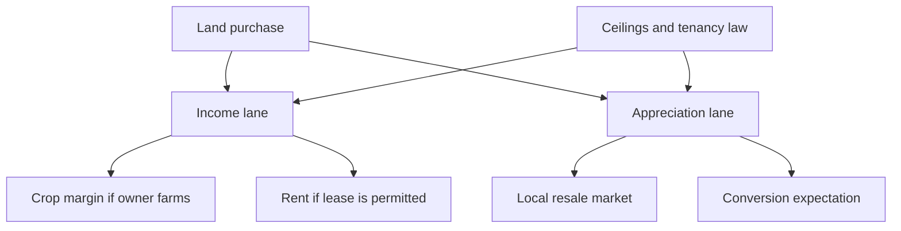

A farmland purchase is usually described as a purchase, not an investment. The buyer inspects a parcel, negotiates a price per acre, pays stamp duty and registration, and takes possession. Nothing in that sequence forces the buyer to write down what the land is expected to earn, what it costs to hold, or what has to happen for the money to come back out. This article takes a farmland decision apart into its two return lanes, the crop or lease income it produces while held and the price at which it can eventually be sold, and adds the layer that makes Indian farmland unusual: the state-level law that constrains who may own it, whether it may be leased, and how much one person may hold.

## Explain simply

Land can make money in two ways. It can produce a crop or be rented to somebody who does, which is income; and it can be sold later for more than it cost, which is appreciation. Farmland in India complicates both. Whether the land can be rented out at all depends on state tenancy law, so in some states the income lane only exists if the owner farms it personally. And because there is no exchange for farmland, there is no daily price, no index and no easy exit: the land is worth what one particular buyer will pay on one particular day. A farmland decision is therefore not a rate of return. It is an estimate of the income the parcel can produce, an estimate of the price at which it can be sold, and a legal question about whether either is permitted.

## Two lanes, and they are not independent

Most farmland return presentations collapse everything into one number, and that is the first mistake. The return has two components with different drivers, different time horizons and different risks:

- **The income lane** is what the land earns while it is held: a crop margin if the owner farms it, or a rent if it is leased. It is annual, seasonal and volatile, and it depends on prices, yields, water and weather.
- **The appreciation lane** is the change in the capital value of the parcel between purchase and sale. It is realised only on sale, and it is realised once.

The two lanes look separate but they are coupled, and the coupling is the interesting part. A buyer who intends to lease the land competes with other buyers who intend to farm it, and the rent a tenant can pay is bounded by the crop margin the parcel can generate, so a parcel that cannot produce a competitive margin locally cannot command a strong rent either. Conversely, where the appreciation lane is driven by expectations of eventual conversion to non-agricultural use, the crop margin becomes almost irrelevant to price and the two lanes decouple. Which regime applies is a local question, and it is worth knowing which one the buyer is buying into.

## The income lane: what the land earns while it is held

If the owner farms the parcel, the income lane is a crop margin, and its arithmetic belongs to the crop-economics method rather than to land. The margin is what remains of the gross value of the harvest after the paid-out cost of cultivation, stated per acre and per season. The practical difficulty is that the same parcel yields different margins under different crops, water availability and management, so the number is not a property of the land alone. Cost-of-cultivation studies published by the Indian Council of Agricultural Research and the state agricultural universities provide a structured way to build that budget, but they describe research conditions and are best read as brackets rather than as the buyer's expected outcome.

If the owner leases the parcel, the income lane becomes a rent. A rent is a residual: the tenant expects to keep a margin after paying it, so the rent a parcel can sustain is bounded by the crop margin the tenant can realistically earn on that land. That has two consequences worth stating plainly. First, rent is not a coupon; it falls when input costs rise, when the harvest fails, or when the commodity cycle turns against the tenant. Second, collecting it requires a tenant, and tenants require confidence in tenure, which is exactly what restrictive tenancy law undermines.

## The appreciation lane: a market with no screen

Financial assets trade continuously and their prices are observable, which makes their returns measurable. Farmland has none of those properties. Transactions are parcel-specific, infrequent and local. The registered consideration on a sale deed may differ from the consideration actually paid. The practical consequence is that no reputable continuous price index for Indian farmland exists that can be used the way a bond index or an equity index is used, and any claim that farmland as a category returned a particular percentage over a particular period should be treated as a claim about a sample of transactions, not about a market.

That does not make the appreciation lane unreal. It makes it unmeasurable until it is realised. The exit price is a negotiation rather than a market order, so the buyer should be able to name who would plausibly buy the parcel and why. The holding period is effectively chosen by the buyer, because there is no liquid market to sell into during a bad year. And a farmland holding cannot be marked to market for portfolio purposes, so its stated value is an estimate until a sale occurs.

Read in the four return lanes used throughout this series, the crop or lease income is an operating return for the period earned, the appreciation is speculative until realised and historical once realised, and any projected figure is a model estimate.

## The policy overlay: ceilings, tenancy and who may buy

Three instruments of state law matter most.

**Land ceilings.** Most Indian states enacted statutory limits on the amount of agricultural land a person or family may own, with the intention of redistributing surplus land. Ceilings, exemptions and enforcement differ by state and have been amended repeatedly. For a buyer it constrains how much contiguous land may be accumulated, how a holding may be structured across family members and entities, and what happens to land already held if the rules are revisited.

**Tenancy law.** Leasing of agricultural land is governed by state legislation, covering rent fixation, security of tenure for the tenant and resumption by the owner. Several states restrict or regulate informal leasing. A draft Model Land Leasing Act circulated in 2016 proposed legalising and documenting leases to encourage investment, but adoption has been uneven. Whether a parcel can be legally leased, and on what terms a lease can be terminated, decides whether the income lane exists in its rent form at all.

**Restrictions on purchase.** Several states restrict the purchase of agricultural land by non-agriculturists, with varying definitions of who qualifies. This is the threshold question: a buyer who cannot legally hold the parcel has no return to analyse.

Because these rules are state-specific, they cannot be summarised nationally, and they change. Establish the legal position for the specific state, parcel and buyer before working on the price at all.

## Agroforestry and the tree-farming trap

Agroforestry, the practice of growing trees alongside crops or livestock on the same land, is promoted in Indian agricultural policy for soil health, water retention and supplementary income from timber and fruit. As an investment it appears mainly through lease-and-plant models and tree-farming schemes that promise fixed returns from harvested timber. Many such schemes have collapsed, and the reasons are structural rather than accidental. The biological timeline is long, so money is committed for years before any harvest exists. The market for harvested timber is local and illiquid, so the sale price at harvest is not discoverable in advance. And in the typical structure the promoter, not the investor, controls both the land and the sale, which means the investor holds a contract with a company rather than title to an asset.

The research literature is genuinely useful here, but it must be read for what it is. The FAO forest-resources work and plantation-yield research supply forest-area statistics and plantation-yield ranges for international comparison, and Indian publications supply rotation guidance for species such as teak, bamboo and sandalwood. These are inputs to a feasibility assessment, not a promised return: the yield ranges quoted come from research plots under controlled conditions. Any specific rotation length, yield per tree or stumpage price used in a tree-farming pitch should be treated as needing verification against primary sources.

Where the intent is to hold a working interest in land rather than a contract, the regulated analogue is the small and medium REIT framework for fractional real-estate ownership, which sets minimum asset sizes, unit-holder counts and registration conditions. It does not extend to agricultural land, but the contrast is instructive: the difference between a scheme and a security is who holds the asset and who publishes the accounts.

## Worked example: an illustrative ten-year farmland cash flow

The following is an illustrative calculation, not a forecast and not a market example. It shows how the two lanes combine.

Suppose a buyer acquires one acre for an illustrative ₹10,00,000, all cash, with stamp duty and registration excluded for simplicity. The buyer puts the land under a crop or lease arrangement that yields a constant illustrative net ₹25,000 a year, with no reinvestment. After ten years the parcel is sold for an illustrative ₹18,00,000. The cash flows are therefore an outflow of ₹10,00,000 at the start, ten inflows of ₹25,000, and an inflow of ₹18,25,000 in the tenth year.

- Total nominal multiple: $(250000 + 1800000) / 1000000 = 2.05$ times.
- Money-weighted annualised return, being the rate that sets the present value of those cash flows to zero: approximately 8.02 per cent.

The same inputs can be described differently, and the description matters. The income lane contributes a quarter of a million rupees in nominal terms over the decade; the appreciation lane supplies the large majority of the return. Had the sale price equalled the purchase price, the ten-year investment would have returned only the rent, an annualised figure of roughly 2.5 per cent. Nothing about the parcel changed between those two cases; only the exit price did.

Two further adjustments belong in any honest version. First, the annual figure should be a net operating income after farm costs, water charges, repairs and management time. Second, the return must be compared with the alternative use of the same capital over the same period, because a decade of illiquidity has a real price that does not appear in the cash flows.

## Costs, frictions and the resale question

The gap between the price paid and the price received is wider for land than for most assets. On acquisition there is stamp duty and registration, plus title verification, survey and any mutation of revenue records. During holding there are land taxes, fencing, water and the cost of the management that keeps an absentee-owned parcel from being encroached upon. On exit there is the negotiation itself: the pool of buyers for an agricultural parcel is narrower than for a residential flat, and narrower still where restrictions on purchase by non-agriculturists apply. A buyer who needs money in a specific month cannot necessarily find a buyer in that month, which is the operational meaning of illiquidity.

Taxation of the sale of agricultural land, and of any rental income, depends on classification, use and holding period and belongs to the dated tax reference on this site rather than to this page. It should be checked, not assumed.

## Framing the decision as an allocation

The useful framing is not whether farmland is good but what role it plays. It is indivisible, so the minimum position is one parcel rather than one unit. It is illiquid, so it cannot be the emergency reserve. It has no reliable mark, so it cannot be rebalanced in the ordinary sense. And it requires management, whether by the owner or by a tenant whose tenure is governed by law. A holding that satisfies those constraints is a long-duration real asset with an operating component, sized with no assumption that the capital can be recalled on demand.

## What this does not tell you

- **No figure for farmland returns.** The packet behind this article carries research sources on crop economics and forest resources, not a farmland price index, so no historical farmland return is stated here.
- **No state-level legal position.** Ceilings, tenancy rules and purchase restrictions are state-specific and must be confirmed for the relevant state.
- **No tax position.** Agricultural income, land-sale gains and rental income are treated outside this article.
- **No forecast.** The appreciation lane is not projected, because a projection of land prices would be speculation dressed as arithmetic.

## Open questions

- How much of the historical rise in Indian land prices reflects agricultural productivity, and how much reflects the option value of eventual conversion to non-agricultural use?
- Where leasing is legally restricted, how much cultivated land is farmed by undocumented tenants, and who bears the risk when tenure is insecure?
- What discount should an illiquid, indivisible and unmanaged land holding carry against a mark-to-market financial asset in the same portfolio?

## The farmland due-diligence checklist

Worked in this order, the questions are answerable and the decision becomes an investment rather than a purchase:

1. **Legal capacity.** May this buyer hold agricultural land in this state, and up to what area?
2. **Leasing position.** May the parcel be legally leased, on what terms, and with what security of tenure for the tenant?
3. **Income lane.** What crop or lease margin can this parcel realistically produce after all operating costs, and who produces it?
4. **Appreciation lane.** Who is the plausible future buyer, on what basis would that buyer price the parcel, and what would have to change for the price to rise?
5. **Holding costs.** Taxes, water, repairs, fencing, management and the cost of absence.
6. **Exit frictions and tax.** Transfer costs, the width of the buyer pool, and the tax position on sale.
7. **Portfolio role.** What this holding does that no financial asset in the portfolio does, and what opportunity cost the illiquidity carries.
