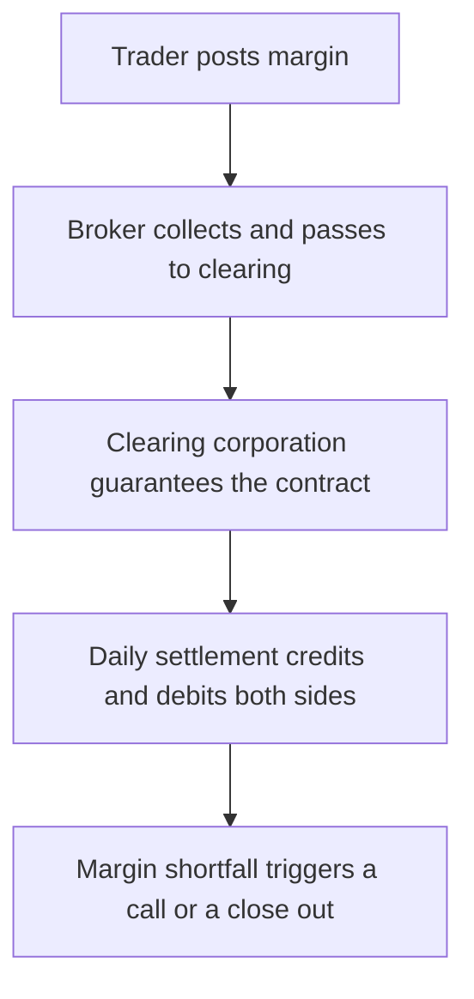

A futures contract is the simplest derivative and the one most often misunderstood. It looks like a bet on a price, and it is priced like one, but legally it is a pair of obligations: one side must buy and the other must sell, at an agreed price, on a stated date. Neither side has been given an option to change its mind. Everything distinctive about futures — the leverage, the margin, the daily cash flows, the possibility of losing more than was posted — follows from that single structural fact.

This article sets out what a futures contract obliges each side to do, how it differs from buying the underlying, and why the daily settlement machinery matters more than most participants expect. It describes payoff structure. It does not describe strategies, and it is not a case for trading derivatives.

## Explain simply

Buying a share means paying for it and owning it. Entering a futures contract means agreeing today on a price for something that will change hands later, without paying for it now. Instead, both sides put up a security deposit, called margin, and every evening the exchange works out who gained and who lost that day. The winner's account is credited, the loser's is debited, and if the deposit falls below the required level the loser must top it up — or have the position closed. Because the deposit is a fraction of the contract's value, small price moves produce large swings in the money at risk. And because the contract is an obligation, a move against the position keeps costing money; it does not stop at the deposit.

## A futures contract is a pair of obligations

The defining feature is that both sides are bound. A call option gives its buyer a right; a futures contract gives nobody a right. If the market moves against the position, the holder must settle at the agreed price, or close the position at the prevailing price and take the difference. That produces a **linear, symmetric** payoff:

$$ \text{Long position result} = (F_T - F_0) \times \text{Lot size} $$

$$ \text{Short position result} = (F_0 - F_T) \times \text{Lot size} $$

where $F_0$ is the futures price at entry and $F_T$ the price at which the position is closed or settled. There is no maximum loss built into the contract and no maximum gain: a fall of one unit costs the long position one lot's worth, without a floor, and a rise costs the short position the same, without a ceiling.

Contrast that with an option, where the buyer pays a premium up front and can lose no more than that premium. The absence of that floor is what makes the futures loss profile larger than intuition suggests. It is also why margin exists at all: the clearing corporation has to protect itself against a party who may not be able to pay later.

## Reading a futures quotation

A futures quotation names three things: the **underlying**, the **expiry month**, and a **price per unit** of the underlying. What it does not show is the lot size, and without the lot size the quoted price tells you nothing about the money at stake.

Contract value is arithmetic:

$$ \text{Contract value} = \text{Futures price} \times \text{Lot size} $$

The lot size, the tick size, the expiry date and the settlement convention are all part of the contract specification published by the exchange within SEBI's framework. Those parameters are revised from time to time, and the 2024 measures deliberately increased contract sizes for index derivatives. The practical consequence is a rule of reading: never take a lot size or an expiry convention from an article, a screenshot or a broker's summary. Read the current specification at the source, which the companion article on contract specifications and lot sizes walks through.

The number that remains after the multiplication is the exposure the position carries — the amount on which gains and losses accrue, not the amount that must be paid to enter.

## How it differs from buying the underlying

| Feature | Holding the underlying | Futures position |
| --- | --- | --- |
| Obligation | None; ownership | Both sides must settle at the agreed price |
| Cash outlay | Full value | Margin, a fraction of contract value |
| Income | Dividends or distributions received | Reflected in pricing through the cost of carry |
| Rights | Voting and corporate actions | None |
| Life | Indefinite | Fixed expiry; a roll is needed to continue |
| Settlement | Delivery settled at trade | Daily cash settlement of gains and losses |
| Loss floor | Value cannot fall below zero | No floor; loss can exceed the margin posted |

The row that changes behaviour most is the last one. A share can fall to zero, which is a total loss but not more than a total loss. A leveraged futures position can lose the whole deposit and still leave an amount owed, because the exposure was never limited to the deposit.

## Daily settlement, margin and the path

Every futures position is marked to market at the end of each trading session. Gains are credited and losses are debited in cash, so the position's profit or loss is realised continuously rather than only at expiry.

Margin has two layers of meaning here. The initial margin is computed by the exchange's portfolio-based risk system, which assesses a position's worst-case loss under a set of simulated price and volatility scenarios. That framework is portfolio-based, so offsetting positions attract less margin than the sum of their individual requirements. Margin is collected from both buyers and sellers of futures — not only from the side that looks riskier. On top of this sits the exposure margin and the broker's own requirements.

The consequence is path dependence. A position that will eventually be profitable can be removed first, if an adverse move along the way consumes the margin and the trader cannot or does not top it up. No view about the eventual level of the index survives a margin call that arrives before the move. This is the single most underrated feature of futures for anyone arriving from cash markets, where a temporary fall in price can simply be waited out.

## The fair-value relationship and the basis

A futures price is not a forecast. It is anchored to the spot price by a no-arbitrage relationship, because a synthetic long position can be assembled by buying the underlying with borrowed money and holding it to expiry. Ignoring frictions, the futures price is the spot price grown at the financing rate, reduced by whatever income the underlying pays along the way:

$$ F = S \times (1 + r)^{T} - D $$

where $S$ is spot, $r$ the financing rate, $T$ the time to expiry and $D$ the income expected over that period. The difference between the futures price and the spot price is the **basis**. When the futures price sits above spot, holding the long position and rolling it forward converts that premium into a recurring cost; when it sits below spot, the same roll produces a gain. This is a model-estimated relationship, not an observed return, and transaction costs, taxes, position limits and dividend uncertainty all drive the actual basis away from the ideal.

## Cash and physical settlement

Settlement is how the obligations are discharged. Index derivatives are settled in cash at the expiry settlement price prescribed by the exchange, because an index cannot be delivered. Stock derivatives in the current framework move to physical delivery, meaning the holder of a position that expires in the money must give or take shares, and fund their full value, rather than only the margin that was posted.

That distinction is not a technicality. A participant who has sized the position as a leveraged bet on a price can be surprised by a delivery obligation whose cash requirement is many times the margin. The specification states the settlement convention in advance; the obligation follows from the specification, not from anyone's intention at the time of entry.

## What the 2024 measures changed

SEBI's 2024 measures to strengthen the index derivatives framework altered several structural parameters at once: contract sizes were increased, weekly expiries were rationalised, option premium must now be collected up front, the calendar-spread margin benefit was removed, and position limits are monitored intraday. Each measure raises the cost, the minimum size or the monitoring intensity of holding index derivative positions. None of them changes the payoff mechanics described above; they change the conditions of access and the frictions around it.

## Worked example: the move that consumes the margin

An illustrative calculation. It uses hypothetical numbers chosen for the arithmetic and describes no actual contract.

Suppose an index futures contract has a contract value of ₹10,00,000, produced by a hypothetical index level and lot size, and the initial margin required is 12%, or ₹1,20,000.

- **Leverage implied:** ₹10,00,000 of exposure financed by ₹1,20,000 of margin — roughly 8.3 times.
- **A 2% adverse move:** ₹20,000 lost, about 16.7% of the posted margin.
- **A 5% adverse move:** ₹50,000 lost, about 41.7% of the posted margin.
- **A 12% adverse move:** ₹1,20,000 lost — the entire margin. Any further adverse move is money owed, not money at risk.

The arithmetic carries its own lesson. Because the margin is a percentage of contract value, the same percentage adverse move exhausts it. Diversification, a correct long-term view and patience are all irrelevant if the position is closed by a margin call three days after entry.

## Payoff structure, not strategies

This article describes what the payoff looks like. It deliberately does not describe which positions to take, and nothing here should be read as a suggestion that leveraged exposure is suitable for any particular investor. Two properties of the structure deserve to be stated plainly because they are the ones most often missed.

First, **futures can lose more than the amount committed**. The margin is a performance bond, not a cap. For the long side the theoretical loss is the whole contract value, since the underlying can in principle go to zero; for the short side the theoretical loss is unbounded, since the underlying can rise without limit. In practice the position is closed before that, but the closure happens at a price, and the difference is payable.

Second, **costs and frictions are certain while the edge is not**. Brokerage, exchange fees, taxes on transactions, the bid-ask spread and the roll cost of moving from one expiry to the next all accrue whether or not the view is right. The series examines the empirical record on retail derivative participation separately; this article makes no claim about any individual's results.

## The four lanes

- **Contractual.** The obligation to settle at the agreed price, guaranteed by the clearing corporation, which stands between the two sides and removes counterparty credit risk between members.
- **Model-estimated.** Fair value from the cost-of-carry relationship, and the imaginary future levels any projection implies.
- **Historical realised.** What an index actually returned over a past period — informative about the underlying, silent about a leveraged position's survival.
- **Speculative.** The gain or loss from the underlying moving, plus any change in the basis. This is the lane in which a futures position actually lives, and it is the only lane whose outcome is not knowable at entry.

## What this does not tell you

- **It does not state a lot size, tick size or expiry day.** Those are specification facts, they are revised, and they must be read from the current exchange publication.
- **It does not give a margin rate.** Margin depends on the exchange risk framework, the composition of the portfolio and the broker's requirements at the time.
- **It does not price a roll.** The cost of transferring a position to the next expiry depends on the basis at that moment.
- **It does not cover options.** Option payoffs are asymmetric and governed by different mechanics; they are treated in the companion articles in this series.
- **It does not discuss tax.** The tax treatment of derivative gains and losses is a dated, category-specific matter carried in the site's tax reference, not embedded in any price.

## Open questions

- For an investor whose portfolio is small relative to a single contract, is any use of exchange-traded futures genuinely a hedge rather than leverage by another name?
- How much of the aggregate loss record in retail derivatives comes from being directionally wrong, and how much from margin mechanics, rolls and costs while being partly right?
- Do retail participants systematically underestimate the delivery obligations that attach to stock futures at expiry?
- How much of the observed basis in Indian index futures is explained by the cost of carry, and how much by positioning and dividend expectations that the model cannot see?
