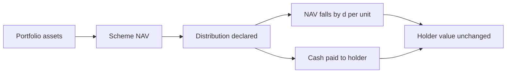

Two questions face every investor buying a mutual fund scheme in India: which plan, and which option. The plan question — direct or regular — decides what the scheme charges you. The option question — growth or income distribution cum capital withdrawal — decides where the scheme's gains sit until you choose to act. The second question is widely misunderstood. Many investors treat the income distribution cum capital withdrawal option, universally abbreviated IDCW, as a way to earn more from the same fund than the growth option pays. The mechanics say otherwise. The option changes the plumbing of a holding, not the engine.

## Explain simply

Under the growth option, everything the scheme earns stays inside the scheme. The net asset value — the per-unit value of the portfolio — grows over time, and you benefit by redeeming units later. Under the IDCW option, the scheme may declare a distribution: cash paid out to unitholders. When it does, the NAV falls by roughly the payout per unit, because that cash has left the scheme. The value of your units plus the cash you received is the same as before, so nothing extra has been created. If you need regular cash, an IDCW can supply some, but the amount and the date are the scheme's choice, not yours, and the receipt may bear tax in your hands — the rates are a separate question this article flags rather than answers. If you are accumulating wealth and need no cash, growth is the natural default, because no money leaves the compounding base without you choosing it.

## Two options, one portfolio

Growth and IDCW are not two funds. They are two classes of units over a single portfolio. The scheme buys and sells the same securities for both classes, and the same expenses — management, custody, administration, the total expense ratio — are charged against both. What differs is the route value takes: retained inside the scheme and reflected in a rising NAV, or paid out and reflected in cash in your bank account.

The option's formal name deserves attention. Investor-awareness material names it income distribution cum capital withdrawal, and that phrase is a disclosure rather than branding. It says the payout can consist of income, of realised gains, or of a return of the holder's own capital. A distribution that is partly a return of capital is not a return on your investment; it is a partial return of it. The name itself warns the holder not to read a payout as profit.

## What a distribution does to the NAV

The mechanism is arithmetic, not opinion. A scheme's NAV is its total assets less liabilities, divided by the number of outstanding units. When a distribution is declared, cash leaves the scheme, so assets fall by the amount paid. The number of units does not change. The NAV per unit therefore falls by approximately the amount paid per unit:

$$ V_\text{before} = N \times \text{NAV} $$

$$ V_\text{after} = N \times (\text{NAV} - d) + N \times d = N \times \text{NAV} $$

where $N$ is the number of units held and $d$ is the distribution per unit. This is an accounting identity. A distribution transfers value from the scheme's balance sheet to the holder's bank account; it does not add to the holder's wealth at the moment it is made. The daily NAV file makes this observable: on a distribution date, a scheme's NAV drops by roughly the declared amount, and the gap between the growth-option and IDCW-option NAV series of the same scheme is largely the accumulated history of such payouts.

## Worked example: the payout that changes nothing

The following is an illustrative calculation, not a forecast and not the figures of any scheme. Suppose a holder owns 1000 units of a scheme whose NAV is ₹100.00, so the holding is worth ₹100000. The scheme declares a distribution of ₹2.00 per unit.

- Cash received: $1000 \times 2.00 =$ ₹2000
- NAV after the distribution, before any tax: $100.00 - 2.00 = 98.00$
- Value of units after: $1000 \times 98.00 =$ ₹98000
- Total value immediately after: $98000 + 2000 = 100000$

So ₹100000 before and ₹100000 after, before tax. Nothing was created. A holder of the growth option of the same scheme still holds 1000 units, now at the same NAV of ₹100.00 — also worth ₹100000. The per-unit numbers differ; the value does not.

Now add reinvestment, still illustrative. If the ₹2000 payout is reinvested at the post-distribution NAV of ₹98.00, it buys approximately 20.41 further units, taking the holding to about 1020.41 units — still worth ₹100000. More units, lower NAV, identical value.

Extend the illustration by one year. Suppose the underlying portfolio grows 10 percent over the year and no further distribution is declared. The growth option's NAV goes from ₹100.00 to ₹110.00, and 1000 units are worth ₹110000. The IDCW option's NAV goes from ₹98.00 to ₹107.80, and 1020.41 units are worth ₹110000. Identical again. The only real differences in the year were that the IDCW holder received ₹2000 of cash — a receipt that may bear tax in the holder's hands — and had to act to keep that cash compounding, while the growth holder did nothing.

## Why switching creates no value

Switching from growth to IDCW midway through a holding is often sold, in the investor's own mind, as unlocking the fund's payouts. Consider what the switch actually changes. It does not change the portfolio: the same securities produce the same pre-expense returns. It does not change the costs: the expense ratio, the exit load, the tax on redemptions — all identical across options of the same scheme and plan. It cannot change the scheme's ability to generate returns.

What it changes is the route the value takes. After the switch, future surplus may arrive as cash instead of staying in the NAV. That has three consequences, all of them about flow rather than about amount. First, cash that leaves the scheme stops compounding unless the holder manually reinvests it, and reinvestment means deciding when and at what NAV to buy back in. Second, each payout is a receipt in the holder's hands and can carry a tax liability the holder did not choose; a holder accumulating wealth has accepted a cost for a flow they do not want. Third, if the switch happens inside the exit-load window, the switch itself costs money.

The same logic runs in reverse. A holder of the IDCW option who reinvests every payout is running an accumulation strategy with extra taxable events and extra decisions, and would have been structurally better served by holding growth all along. Neither direction of switching creates or destroys value at the moment it is made. Value comes from the portfolio's returns net of costs, and those are properties of the scheme and the plan, not of the option.

## Four lanes, never blended

Wherever a return is discussed, four distinct lanes exist, and this topic shows why they must not be merged.

| Lane | What it means here | Where the figure comes from |
| --- | --- | --- |
| Historical realised | What the scheme's NAV has actually done over a stated period | The published daily NAV series |
| Contractual | The terms the scheme is obliged to deliver | The total expense ratio and any applicable exit load; there is no owed distribution |
| Model-estimated | An estimate built from disclosed holdings or assumptions | Arithmetic on assumed growth, such as the 10 percent year in the worked example |
| Speculative | The expectation that distributions will continue or grow | No evidential basis until the outcome is realised |

A distribution is not a fifth lane. It is a movement inside the historical-realised lane: value that was already reflected in the NAV, relocated to cash. The belief that next year's payout will resemble this year's is speculation, and any projection of a scheme's future distributions from its past payouts belongs in the speculative lane until it is realised.

## When each option serves a need

The honest framing is needs, not merit. Growth serves an accumulation need: no cash leaves the scheme, no unrequested taxable receipt arrives, and the full corpus compounds at the NAV. It is the natural default for a holder with no cash requirement from this investment.

IDCW can serve a genuine cash-flow need, but only accidentally well. The amount paid is chosen by the scheme, the date is chosen by the scheme, the decision applies to every holder of that option, and the policy can change. A holder whose need is regular cash of a chosen size is better served by a systematic withdrawal plan, where the holder sets the amount and the interval and each withdrawal is an ordinary redemption subject to the scheme's stated exit load if the holding period has not been met. The comparison between the two is structural: distribution asks the scheme to decide, a withdrawal plan asks the holder to decide.

## What to check before switching

- The exit load and its holding period, because switching is a redemption followed by a purchase and may attract a charge.
- The scheme's distribution history against its NAV trend: a scheme that pays out heavily while its NAV stagnates has been returning capital, not compounding it.
- The expense ratio of both plans, direct and regular, because that — not the option — is the choice that changes what you pay.
- The tax character of distribution receipts under the current statute, because a payout's after-tax value depends on rates and classification this article does not state.

## What this does not tell you

None of this says IDCW is a poor choice or that growth is a superior one. The right option depends on the holder's cash needs, tax position and discipline, which vary by individual and are not established here. The article does not state tax rates, thresholds or effective dates, because the packet carries no dated tax-rule entry for distribution receipts and its sources do not include the tax statute. And it does not predict any scheme's future distributions: a payout history is a record of decisions already taken, not a promise of decisions to come.

## Open questions

- How many IDCW holders reinvest their payouts promptly, and how many let the cash sit outside the compounding base — is that visible in folio data?
- Do investors who switch from growth to IDCW understand that the switch changes cash-flow timing rather than return, or is the switch driven by the belief that it pays more?
- Would a published split of each distribution between income, realised gains and return of capital change how holders respond to payouts?
- How much of the observed gap between growth-option and IDCW-option NAV series of the same scheme reflects distributions rather than any difference in underlying investment?

The habit to take away is narrow and useful. When a scheme pays you cash, ask where the cash came from. If the answer is "out of the fund you already owned", then you have been moved, not paid.
