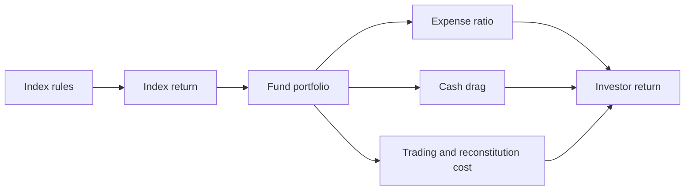

An index fund makes a single promise: deliver the return of a stated index, minus the small cost of holding it. The promise is unusually checkable, which is why index funds are the cleanest place in mutual-fund land to learn how to read a fund at all. Everything interesting sits in the words "minus the small cost", because two funds that print the same benchmark on the cover are not the same product.

This article is about the machinery of that promise: what an index actually is, how a fund reproduces it, what the residual gap between fund and index consists of, and a repeatable process for comparing two funds that track the same thing. It belongs to the Mutual Fund Atlas series and assumes only what an ordinary investor already suspects — that the fund's job is not to beat the index, but to be the index.

## Explain simply

An index is a published recipe for a basket of shares, and an index fund is a fund that buys that basket so that your return matches the basket's return. The fund cannot match it exactly, because it charges a fee, keeps a little cash, and pays a small cost whenever the recipe changes. The gap between the basket and your fund is called tracking difference, and how steadily the fund stays near the basket is called tracking error. Two funds with the same index on the cover can have different gaps, so the fund's name is a starting point, not an answer.

## An index is a set of rules, not a list of favourites

An index is a portfolio defined by published rules rather than by a manager's judgement. The rules answer four questions: which securities are eligible, how much of each is held, when the constituents are reviewed, and how changes are announced and applied. For the Indian benchmarks used by index funds — the large-cap Nifty 50, the midcap and smallcap indices, and the sectoral and factor indices — those rules are published by NSE Indices in methodology documents and fact sheets.

Eligibility rules typically turn on listing history, liquidity and free float; weighting rules determine how much of each eligible security the index holds; and review rules set how often the constituent list and the weights are refreshed. None of this is secret. The replicability of the rules is precisely what makes an index fund possible: a manager who knows the rules can reconstruct the portfolio without needing to outguess anyone.

That is the structural difference from an actively managed fund. An active manager is paid to hold something different from the benchmark and to be right often enough to overcome the cost of doing so. An index fund is paid to hold what the benchmark holds. When the second job is done well, the fund's return and the index's return differ by a small, mostly explainable amount.

## Free float decides what counts

The weighting rule is the one most investors never look at, and it has the largest effect on what the index — and therefore the fund — actually is. Broad Indian equity benchmarks are weighted by free-float market capitalisation, which counts only the shares available for trading after excluding holdings that are effectively locked up with promoters and strategic investors. The reasoning is practical: an index meant to be investable should measure the market capitalisation that is actually investable.

Two consequences follow. First, because weights are proportional to size, a cap-weighted index is concentrated by construction — the largest constituents carry the largest weights, and their movement drives the index more than the movement of the many small ones combined. Second, because free float can change through corporate action, index weights drift between reviews even when prices do not move.

A replicating fund inherits both properties. Delivering an index faithfully means delivering its concentration too. This is why "the tracking is excellent" and "this is a diversified holding" are separate statements that should never be merged.

## Two wrappers: the index fund and the ETF

The same index can be held through an open-ended index fund or through an exchange-traded fund, and the wrapper changes the mechanics of buying and selling even when the holdings are identical.

An open-ended index fund transacts at the declared net asset value, computed once daily from the market value of the scheme's assets. The investor gets the same price as everyone else who transacts on the same side of the same cut-off, and there is no intraday market for the units. An ETF holds the same kind of basket but its units trade on an exchange, so the price paid is set by supply and demand and can sit above or below the underlying net asset value — a premium or a discount that a patient open-ended buyer never experiences.

Inside either wrapper, the fund has to decide how to replicate. Full replication buys every constituent in the index weights. Sampling — sometimes called stratified or optimised replication — deliberately holds a subset chosen to mimic the index's risk characteristics, which is a defensible choice when the index is large or its smaller constituents are hard to trade but is more likely to drift away from the benchmark. Both approaches are used in practice, and the choice is disclosed.

## Why two funds tracking the same index diverge

The gap between a fund and its index is not a mystery; it is the sum of a small number of identifiable frictions. In rough order of persistence:

- **The total expense ratio.** This is charged against the scheme's assets, so it reduces the fund's net asset value growth by construction, year after year. It is the largest predictable component of the gap, and the direct-versus-regular plan difference is the clearest example of a single fee decision compounding over decades.
- **Cash drag.** A fund keeps a cash buffer to meet redemptions and to hold subscriptions not yet deployed. Cash earns the money-market rate rather than the index return, so during a rising market the buffer is a drag proportional to its weight.
- **The replication choice.** A sampling fund that holds fewer securities than the index is not making the same bet as a full-replication fund, even if the label is the same.
- **The benchmark convention.** Index providers publish price-return and total-return variants. A price-return index excludes dividends; a total-return index includes them. A fund's gap to its stated benchmark is only meaningful when the benchmark's convention matches the comparison being made.
- **Rebalancing and reconstitution cost.** When the index adds, removes or reweights constituents, every replicating fund has to trade. Those trades cost money, and the cost lands on the fund precisely on the dates the index changes.
- **Scale and flow.** A very small scheme carries the risk that the fund house closes or merges it, forcing redemptions at an inconvenient time; a very large scheme in a less liquid segment may move prices when it trades.

None of these can be read off the fund's marketing name. All of them are visible in disclosure documents and in the daily NAV record.

## Tracking difference is a gap; tracking error is a wobble

The two terms are used interchangeably in conversation and mean different things. Tracking difference is a simple gap over a period:

$$ TD = R_\text{index} - R_\text{fund} $$

Tracking error is the volatility of that gap, usually measured as the standard deviation of the periodic return difference and annualised:

$$ TE = \sqrt{\frac{1}{N-1}\sum_{i=1}^{N}\left(d_i - \bar d\right)^2} $$

where each $d_i$ is the fund's excess return over the index on day $i$. A fund can sit a steady fraction of a percent below its index with excellent tracking error, or average close to zero while swinging widely around it. For an index fund both matter: a small persistent gap is money not earned, and a large wobble means the fund is not reliably doing its job.

The two numbers also answer different anxieties. Tracking difference answers "how much am I giving up?" Tracking error answers "how predictable is this relationship?" An investor building a long-horizon allocation cares about both, in that order.

## A process for comparing funds on replication quality

The following procedure uses only public data — the index methodology and the machine-readable daily NAV file that all Indian schemes report — and can be run on any candidate fund. It is deliberately mechanical, because the point is to replace impressions with a record.

1. **Fix the benchmark and its convention.** Confirm which index the scheme declares and whether it is a price-return or total-return variant. Everything downstream depends on this being right.
2. **Read the index methodology.** Note the eligibility rules, weighting method, review frequency and the timing of constituent changes. This tells you when to expect extra trading in the fund.
3. **Assemble the series.** From the daily NAV file, compute the fund's daily returns. Obtain the matching index series on the same convention. You now have a daily difference series $d_i$.
4. **Compute tracking difference over rolling windows.** One, three and five years on a rolling basis, not a single window. A single window is a single ending date dressed up as a conclusion.
5. **Compute annualised tracking error** from the same daily series.
6. **Compare expense ratios — both plans.** Record the direct and regular ratios and the gap between them.
7. **Check scale and age.** AUM and the number of years the scheme has run. Tiny, shrinking schemes carry closure risk; this is context, not a target.
8. **Check turnover and holdings count.** Low turnover is characteristic of a buy-and-hold replication mandate. Spikes should line up with index reconstitution, not with manager activity.
9. **Check cash weight and the number of securities held against the index.** These are the raw ingredients of drag.
10. **Read the exit load and the scheme's behaviour around reconstitution dates**, where the gap should widen and then recover.

A compact comparison table makes the result legible:

| Check | Where it comes from | What you are looking for |
| --- | --- | --- |
| Benchmark convention | Scheme documents | Total return, consistently applied |
| Tracking difference, rolling | Daily NAV file plus index series | Small and stable across windows |
| Tracking error, annualised | Same series | Small and stable |
| Expense ratio, both plans | Scheme disclosure | Low, and a known direct-versus-regular gap |
| Turnover and holdings count | Monthly portfolio | Low turnover, holdings close to the index |
| Cash weight | Monthly portfolio | Small and explained |
| AUM and scheme age | Industry disclosures | Large enough to be durable |

## Worked example: decomposing a tracking difference

The following arithmetic is an illustrative calculation, not observed data for any scheme. Suppose, for the sake of the demonstration, that an index's total return over a year was 12.00% and the fund's return over the same period was 11.42%. The tracking difference is then:

$$ TD = 12.00\% - 11.42\% = -0.58\% $$

Now attribute the gap. Assume an expense ratio of 0.20%, an average cash weight of 1.5% held at about 6% yield against an index return of 12%, and transaction and reconstitution costs of about 0.15%:

- Expense ratio: $0.20\%$
- Cash drag: $1.5\% \times (12\% - 6\%) = 0.09\%$
- Transaction and reconstitution cost: $0.15\%$
- Residual, unexplained by the three: $0.58\% - 0.20\% - 0.09\% - 0.15\% = 0.14\%$

The exercise is worth doing because it converts a vague worry into three named costs and one residual to investigate. A residual of 0.14% on its own is small; over a decade it is not. On an illustrative ₹10,00,000 holding, a persistent 0.58% annual shortfall is roughly ₹5,800 in the first year and materially more by the tenth, before any tax treatment is applied. The Expense Ratio Impact calculator linked below shows the same compounding from the fee side alone, and the Tracking Difference calculator decomposes the gap the way the arithmetic above does.

## What this does not tell you

A good tracking record is a statement about the past and about a process, not a promise. The index itself can be redefined — a change in eligibility or weighting rules changes what the fund holds and what "tracking" means — and the fund's replication approach can change without a change of benchmark.

Tracking quality also says nothing about whether the index is suitable. A fund can track a narrow or concentrated index perfectly, and perfect replication of a concentrated index is still concentrated exposure. Nor does tracking capture the tax position: two funds with identical pre-tax tracking can have different post-tax outcomes because of the timing of realised gains inside the scheme, which is why the post-tax return calculation is a separate question from the tracking question. Finally, a low tracking error measured over a quiet period is a weak test; the number is most informative when the underlying market has actually moved.

## Open questions

- How much of the persistent gap at Indian index funds comes from cash drag versus rebalancing cost, and is that split stable across market conditions?
- Do large index funds in the midcap and smallcap segments face measurable capacity constraints that show up as widening tracking difference?
- How should an investor weigh a tiny persistent tracking difference against a slightly larger tracking error, and is there a principled trade-off or only a preference?
- Would standardised disclosure of tracking difference and tracking error, on a fixed convention, make provider comparisons meaningful rather than rhetorical?

The useful habit this article is trying to install is modest: when a fund says it "tracks the Nifty", ask which variant, over what window, with what fee, and against what index convention. The answers are all public. The gap is never zero, and it is never random.
