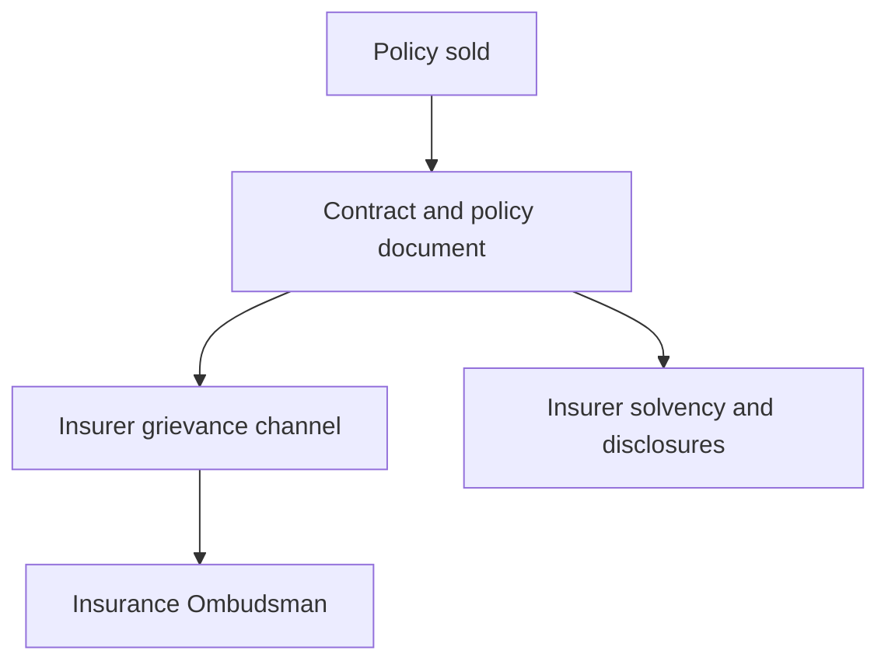

A household buys insurance against an event it hopes will not happen, and the payment, if it comes, arrives long after the premium was paid. That gap — between the money handed over today and the promise to be tested in the future — is the whole reason insurance is regulated. A bank depositor can withdraw and see the balance; a policyholder cannot see the insurer's balance sheet, cannot test its reserving, and often cannot tell whether the product sold was protection, a savings plan, or a blend of the two. Regulation exists to make that promise enforceable rather than merely asserted. In India the body that carries most of this work is the Insurance Regulatory and Development Authority of India, and its design mirrors the problem: it supervises both the product that is sold and the capital that stands behind it.

This article, part of the Indian Financial System series, sets out what IRDAI regulates, how products reach the market, what solvency supervision protects, where commission and charges enter, and where a policyholder's grievance actually belongs.

## Explain simply

The insurance regulator does two jobs. First it decides what insurers are allowed to sell and how honestly they must describe it, so that a policy means what the brochure says it means. Second, it watches the money — requiring each insurer to hold capital against the promises it has made, because a policy is only worth what the insurer can pay years from now. If something goes wrong with a policy, the wronged customer complains to the insurer and then, if unresolved, to the Insurance Ombudsman. The regulator does not promise that any policy is a good deal; it promises that the insurer is solvent enough to be held to the contract and transparent enough to be checked.

## What IRDAI is, and the powers behind it

IRDAI is the statutory regulator for the insurance industry. Its authority covers four broad groups, and each is supervised differently.

- **Insurers.** Life, general, health and reinsurance companies must be licensed, hold capital, report their financial position, and sell only products that conform to the applicable product rules.
- **Intermediaries.** Insurance agents, brokers, corporate agents, web aggregators and third-party administrators each have entry conditions and conduct rules, because the point of sale is where mis-description does most of its damage.
- **Product design.** The terms on which a policy may promise benefits, the charges it may levy and the disclosures it must make are set in product regulations, so that what reaches the buyer is constrained before the buyer sees it.
- **Policyholder grievances.** The regulator, alongside the Insurance Ombudsman machinery, is where a complaint escalates when the insurer's own channel fails.

The pattern is familiar from the rest of this series: the regulator combines rule-making, supervision and a grievance route, and the value of the arrangement depends on the rules being clear, the supervision being real, and the grievance route being reachable.

## The product pipeline: how a policy reaches the market

An insurance product is not invented freely and then sold. Its permitted design, its benefit structure, the assumptions on which it may be illustrated and the commissions it may pay are all constrained by product regulations before it can be offered. Two distinctions matter more than any other to a buyer.

The first is **protection versus savings**. Some products are pure risk transfer, paying a benefit only if an insured event occurs. Others bundle a savings element, so that part of every premium accumulates toward a maturity or survival benefit. The two are sold inside one premium, which is why they are so often confused. The design rules determine how much of the premium may go to each element and how the savings element may be described.

The second is **linked versus non-linked**. A linked product's value moves with the performance of funds chosen by the policyholder, so its return is a market return less charges. A non-linked savings product, such as a traditional endowment or money-back plan, promises a guaranteed benefit plus bonuses that depend on the insurer's declared experience. The distinction sets how much of the outcome is contractual and how much is contingent, and it is the single most useful question to ask of any savings-oriented policy.

## Solvency: the capital behind the promise

A life policy may be paid three or four decades after it is bought. Over that horizon the insurer can make losses, misjudge mortality, or mismanage investments, and the policyholder cannot monitor any of it. The protection the framework supplies is capital adequacy: insurers must maintain a solvency margin — a measure of available capital relative to the liabilities and risk they carry — at or above a prescribed minimum, and they must report their financial position so the regulator can act before the shortfall reaches policyholders.

This is the insurance analogue of the banking capital regime. Banks are required to maintain a capital-to-risk-weighted-assets ratio, and the ratio measures the bank's ability to absorb losses before depositors are exposed. The insurance solvency margin plays the same role for the insurer's ability to pay claims before policyholders are exposed. In both cases the measure relies on the institution's own valuation of its risks, which is precisely why the supervisor also inspects and reviews, rather than trusting a single ratio. The precise solvency figure is set by regulation and is revised from time to time; it should be read from the rule, not from a summary.

## Commission, expenses and the price of distribution

Every savings-oriented policy embeds a cost of distribution. Part of the premium pays the commission to whoever sold the policy, part pays the insurer's own expenses, and part funds the life cover. What remains is what can accumulate. Because those deductions occur early, while the accumulation occurs late, they weigh heavily on the return a policyholder actually earns over the term.

This is not hidden in the sense of being illegal — the charges are prescribed and disclosed under the product rules — but they are easy to miss, because the buyer sees a maturity amount rather than a cost structure. The regulator constrains commission and expense levels, particularly on linked products, precisely because those costs compete directly with the policyholder's benefit. The exact caps change by regulation and are not quoted here; the structural point is durable, which is that a policy's value to the buyer is its benefits net of the mortality cost, the expenses and the commission taken to deliver it.

## Policyholder protection: grievance and the ombudsman

Two obligations sit on the insurer once a policy is sold. It must service the contract — collect premiums, maintain records, pay claims and benefits — and it must run a grievance channel for disputes that arise. When a policyholder is dissatisfied, the sequence is the same one used across Indian financial regulation: complain to the regulated entity first and allow it its stated period to respond.

If the insurer does not resolve the matter, the Insurance Ombudsman is the free escalation route for eligible complaints, and an award binds the insurer up to a statutory limit. This is a materially different mechanism from deposit insurance: it resolves a dispute about conduct or a claim, rather than compensating for the failure of the institution. It is worth noting the shape of the banking analogue, where the integrated ombudsman scheme requires the complainant to approach the regulated entity first, sets a waiting period before escalation, caps consequential-loss compensation, and provides a further window for appeal. Insurance has its own version of that architecture, with its own rules.

## Reading an insurer's disclosures

Because the promise is long-dated, the insurer's published financial disclosures are not marketing collateral but part of the buyer's due diligence. Three questions belong in the reading:

1. **Capital position.** How comfortably does the insurer's reported solvency sit above the prescribed minimum, and has it been stable or deteriorating?
2. **The book and its claims record.** What does the insurer say about the claims it receives and pays, and about the persistency of its policies? Claims settlement behaviour is the behaviour that ultimately matters.
3. **The policy's own documents.** The guaranteed benefits, the surrender terms, the exclusions, the grace period and the revival conditions are all in the policy document and the benefit illustration, and they, not the sales presentation, define what the insurer owes.

## Where IRDAI stops

Insurance has its own perimeter, and a common source of avoidable confusion is expecting one authority to own every financial question. The pension framework, the securities market, bank deposits and insolvency each belong to a different part of the state.

| Question | Authority | What protects the household |
| --- | --- | --- |
| Bank or non-banking lender conduct and deposits | RBI | Prudential supervision, an ombudsman route, and deposit insurance at insured banks up to a prescribed limit |
| Securities, mutual funds and listed-company conduct | SEBI | Disclosure, market-conduct rules and enforcement orders |
| The National Pension System | PFRDA | Scheme rules, investment guidelines and exit conditions |
| Insurance products and claims | IRDAI | Product and conduct rules, insurer disclosures and the Insurance Ombudsman |
| Failure of a company or intermediary | Insolvency framework | A creditor-triggered process and a distribution waterfall |

Deposit insurance is the useful contrast because it is the one place where a statutory compensation scheme exists. It covers deposits, as defined, up to a prescribed limit per depositor per bank, and it does not extend to insurance policies or securities. A household that treats a policy as if it carried the same protection as an insured deposit has misidentified which promise it is holding.

## Worked example: three layers of one policy problem

The example below is illustrative of the structure of a complaint, not legal or financial advice, and the operative procedure is always the one published by the insurer, the ombudsman or the regulator.

Suppose a policyholder believes a claim was wrongly rejected, and trace the layers:

- **The contract layer.** First, the policy document decides. If the event is excluded, or a disclosed fact was misstated at proposal, or premiums had lapsed, the answer is in the contract terms and the underwriting record, not in the sales conversation.
- **The grievance layer.** The insurer's own channel must be given its period to respond. This is the same first step required across Indian financial regulation, and skipping it typically only delays the matter.
- **The escalation layer.** If the insurer's response is unsatisfactory, the Insurance Ombudsman is the free route for eligible complaints, with an award binding on the insurer up to a statutory limit.

The lesson is that three different questions — what did the contract say, what did the insurer do, and who decides when the two disagree — sit at three different layers, and conflating them is what turns a resolvable dispute into a prolonged one.

## What this does not tell you

This article describes the architecture of insurance supervision; it does not quantify it. It does not state current solvency ratios, commission or charge caps, surrender formulas, or claims-settlement percentages, because those are set and revised by regulation and should be read at the source. It does not judge whether any particular policy is good value — that requires computing the actual cash flows of the specific contract against the buyer's real alternatives, which is the subject of a separate article on endowment returns. And it does not resolve the grey areas where a distribution channel or a product is designed to sit at the edge of the perimeter, which is exactly where the protections this article describes are weakest.

## Open questions

- How much of a policyholder's outcome is fixed by product design at the point of sale, and how much is decided later by the insurer's realised claims and investment experience?
- Does disclosing charges and commissions change what households buy, or does the discipline come only when the internal rate of return of the actual contract is worked out?
- Where should the boundary sit between a savings product sold by an insurer and a market product sold by a securities intermediary, given how closely the two can be made to look alike?
- As insurance is increasingly sold through digital and embedded channels, what supervision actually reaches the moment at which the sale is made?
