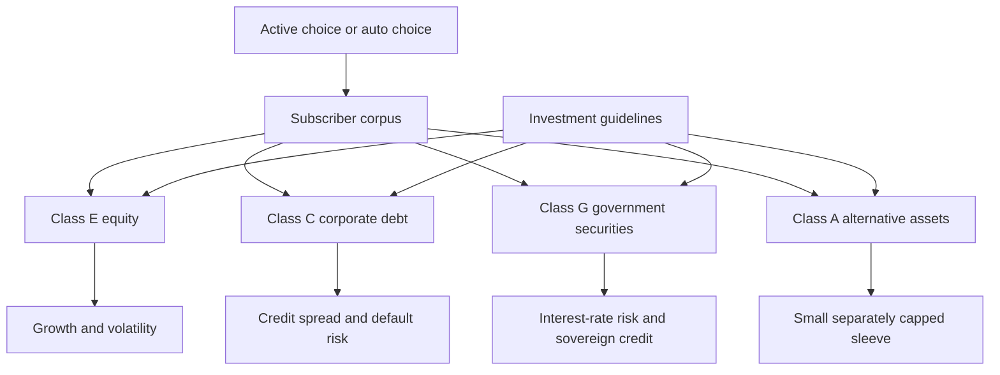

The National Pension System offers a subscriber a set of schemes, and each scheme is built to invest within one of four defined asset classes. That structure is easy to miss, because the choice is presented as a menu of funds. It is really a choice of mandate first: a decision about which kind of asset the money is exposed to, made before any question of manager or cost arises. The four classes — equity, corporate debt, government securities and alternatives — do different jobs, carry different risks, and are constrained in different ways. Reading an NPS scheme properly means reading its class first.

This article, part of the Insurance and Pensions Decoded series, covers the four asset classes, what each holds, what constrains it, and how to read a scheme's result against the mandate it was given. The mechanics of choosing and revisiting the mix are covered in the companion treatment of allocation and auto choice.

## Four mandates, not four funds

The framework defines the classes so that the money in each is doing a defined job.

Each scheme name and its net asset value belong to one of these classes. When a subscriber compares two schemes, the first question is whether they sit in the same class; if they do not, the comparison is between asset classes rather than between managers, and the published returns are not directly comparable.

| Class | What it holds | The risk it carries | The job it does |
| --- | --- | --- | --- |
| E | Equity shares | Market and price risk | The growth engine of the corpus |
| C | Corporate bonds and debt instruments | Credit and default risk, plus interest-rate risk | A spread over government debt |
| G | Government securities | Interest-rate risk, with sovereign credit | The closest thing to a risk-free rupee asset |
| A | Alternative assets | Liquidity and valuation risk | A small, separately limited sleeve |

## Class E: equity

Class E is the equity sleeve. It holds shares, and its value moves with the equity market. In a defined-contribution pension account held over decades, equity does the work that nothing else does: it provides the expected growth that makes a long accumulation phase possible, and it is also the source of the volatility that makes the final decade before retirement dangerous.

The important consequence of the mandate is that a class E scheme is not free to de-risk. It is built to hold equity, and within the guidelines it stays invested. A subscriber who wants less equity exposure does not ask the equity manager to hedge; the subscriber changes the allocation. This is why the class structure and the allocation decision are two halves of one design.

## Class C: corporate debt

Class C is the corporate-debt sleeve. It holds bonds and debt instruments issued by companies rather than by the government. It earns a spread over government debt, and it earns that spread by accepting credit risk — the risk that an issuer does not pay.

The constraint that matters most here is not a cap but a mandate: a class C scheme's return depends on the credit quality of the book it holds and on how the manager behaves when a credit deteriorates. Two class C schemes can differ materially because one holds higher-rated paper while the other reaches for yield lower down the credit curve, even though both sit in the same class. That is why a class C scheme should be read alongside what it is permitted to hold under the guidelines rather than on past return alone.

## Class G: government securities

Class G is the government-securities sleeve. It holds central and state government debt, which carries the sovereign's credit rather than a company's. The risk it carries is not default but interest rates: when yields rise, the price of the securities held falls, and the net asset value moves accordingly.

Class G is the ballast of a pension portfolio. Over long horizons its expected return is lower than equity's, and its value is that it is far less likely to be down when the corpus is about to be used. In the language of the design, class G is the asset the taper moves toward as retirement approaches, because the time available to recover from a fall has shortened.

## Class A: alternative assets

Class A is the alternative-asset sleeve. It holds instruments outside the three core classes, and it is the smallest and most tightly constrained part of the framework. The reason is structural: alternative assets are typically less liquid and less transparently priced, so allowing them a large share of a retail pension corpus would introduce valuation and liquidity risk that the rest of the design works to avoid. Confining them to a small, separately limited sleeve lets the framework acknowledge them without letting them reshape the portfolio.

The practical reading is that class A is not a place to seek return. It is a marginal sleeve, and its contribution to the long-run outcome is correspondingly marginal. A subscriber considering it should understand that it is fenced off precisely because it is different in kind from the core three.

## What actually constrains each class

The constraints on each class come in two layers, and keeping them apart avoids a common error.

The first layer is the **investment guidelines**, which define what a scheme in a class may hold: which instruments qualify, what quality they must meet, and how they must be valued. This is what makes a class E scheme an equity scheme rather than a mixed fund.

The second layer is the **position limits** prescribed for each scheme — the ceiling on how much of a class's corpus may sit in a particular kind of instrument or issuer, and the separately prescribed caps on the class's share of a subscriber's overall allocation. These are the numbers that change from time to time, and they are deliberately not restated here. A subscriber who needs the current caps should read them from the PFRDA framework rather than from any summary.

The two layers together mean that a scheme's return is partly the asset class's return and partly the manager's implementation within the limits. Attributing the whole result to the asset class, or the whole result to the manager, misreads the structure.

## Choosing and revisiting the mix

Because the classes are mandates, choosing among them is the allocation decision. The framework gives the subscriber two routes.

**Active choice** lets the subscriber set the allocation across the classes and pick the schemes, subject to the prescribed caps. It suits a subscriber who will monitor the mix and revise it.

**Auto choice** delegates the allocation to a life-cycle option that tapers the higher-risk exposure as the subscriber ages, so the mix shifts without any action being taken. Where no choice is made, a default applies.

Between the two sits the mechanism for change. The framework permits a limited number of switches between schemes, and beyond that number charges apply. A switch is a redemption of units in one scheme and an issue of units in another at the applicable net asset values, which is why the timing of a switch changes the outcome and why switches are best made as a deliberate reallocation rather than as a reaction to a news cycle.

The companion article on allocation and auto choice takes this further. The point to carry from here is that the classes are the building blocks, and the allocation is the plan for combining them.

## Explain simply

Your NPS money is invested through schemes, and each scheme must stay inside one of four asset classes. Class E is shares and does the growing. Class C is company bonds and pays a little more than government debt in exchange for the risk a company might not pay. Class G is government securities, which are safer but still move when interest rates change. Class A is a small, tightly limited sleeve of alternatives. You can divide your contributions across these classes yourself, or let an automatic option shift the mix as you age. You can switch between schemes, but only a limited number of times for free. The rule of thumb is to read a scheme by its class first, because two schemes in different classes are not really comparable.

## Worked example: how allocation blends

An illustrative calculation, not a forecast. The returns used are invented assumptions chosen to make the arithmetic visible; they are not NPS returns and they are not predictions.

Suppose a subscriber builds an illustrative mix of 50 per cent class E, 30 per cent class C and 20 per cent class G. Assume, purely for the arithmetic, that over the period measured class E returns 11 per cent, class C returns 7 per cent and class G returns 6 per cent.

The blended outcome is the weighted sum:

$$0.50 \times 11 + 0.30 \times 7 + 0.20 \times 6 = 5.5 + 2.1 + 1.2 = 8.8$$

So the illustrative blended return is 8.8 per cent a year. Change the weights and the answer changes: a mix of 30 per cent E, 40 per cent C and 30 per cent G gives, on the same assumed class returns, an illustrative blended return of 7.9 per cent. The shift in the mix moves the result by nearly a full percentage point without any change in the assumed class returns at all.

What the example does not do is predict anything. The assumed class returns will not occur in that pattern in any particular period; in a bad year for equity, class E can subtract from the blend rather than add, and the weighted average of realised annual returns is not the same as the compound return of the portfolio over time. The example shows only that a portfolio's outcome is a weighted blend of its parts — which is the reason the allocation decision, not the choice of any single scheme, is the larger lever.

## What this does not tell you

This article describes the asset-class framework and deliberately states no cap percentage, position limit, charge or return. Those parameters are prescribed in the framework, change over time, and should be read from the current PFRDA guidelines and from the NPS Trust's published scheme information. Where the text refers to a cap or a limit without a number, the omission is intentional.

The article also does not rank schemes or managers. A published return for a scheme in one class says nothing about a scheme in another, and it says nothing about the future. Tax treatment of contributions, accretion and withdrawals is governed by the Income-tax Act as amended and is not restated here. Nothing in this article is advice, and no corpus or pension amount is promised.

## Open questions

- Does the alternative-asset sleeve add diversification a retail subscriber can actually use, or does it mainly add cost and complexity?
- How much of the return dispersion within a single asset class is manager skill, and how much is a different use of the same position limits?
- Is comparing schemes across asset classes so misleading that any published comparison should be class-adjusted?
- Do the constraints protect subscribers, or do they mostly prevent the system itself from behaving in ways that would be uncomfortable at scale?
