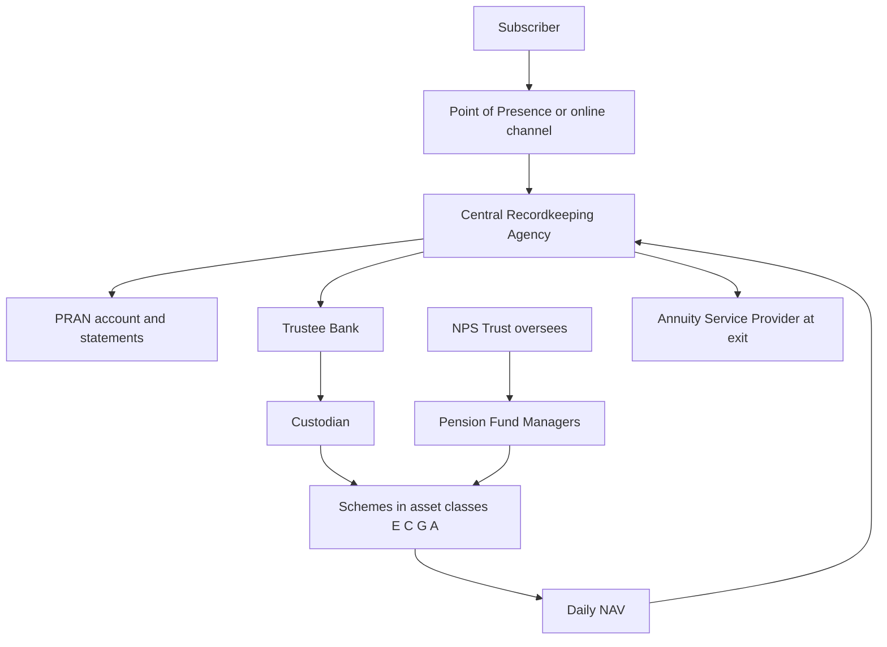

The National Pension System is usually discussed as a product — a fund you put money into and a pension you take out. The more useful way to read it is as a piece of administration. A Tier-I account is not held by a company that might merge, close or be sold; it is a number in a record-keeping system, surrounded by a chain of regulated entities whose duties are defined by the framework. Learning the chain is what makes the account navigable, and it is also what makes the risks visible.

This article is part of the Insurance and Pensions Decoded series and covers the Tier-I architecture: the account number, the record-keeper, the pension funds, the charge structure, the lock-in, and the annuitisation rule at exit.

## A defined-contribution account, not a pension promise

The first structural fact determines everything else. NPS is a **defined-contribution** system: what accumulates is the sum of the contributions plus the investment returns of the chosen funds, less charges. The member carries the investment risk, and the account contains no general promise to make up a shortfall — the assured-payout arrangements available to certain government employees are a separate layer over the same architecture, not a feature of the Tier-I account itself.

That is a different contract from a **defined-benefit** arrangement, where the sponsor promises an income based on salary and service and absorbs the investment risk. The distinction is not technical — it decides who is exposed when markets fall or when a funding formula proves too generous. In a defined-contribution account, a poor sequence of returns in the final decade before retirement has no mechanism that repairs it. That is why the asset-allocation decision described below carries so much weight, and why the account's design spends considerable effort on the default option.

## The chain of entities behind one account

A single account is serviced by several entities, each with a distinct duty. The architecture exists so that no participant holds both the assets and the records.

- The **subscriber** instructs, contributes and chooses the allocation.
- The **point of presence** and the online channel are the front door: enrolment, contribution and service requests.
- The **central recordkeeping agency** issues the account number, maintains the units held in each scheme, processes switches and produces the statement of transactions.
- The **trustee bank** and the **custodian** handle the money and the securities.
- The **pension fund managers** invest each scheme in its mandated asset class and declare the NAV.
- The **NPS Trust** holds the assets in trust for the subscribers and oversees the managers, and **PFRDA** regulates the framework.

The practical benefit is continuity. The account survives a change of employer, a change of pension fund manager and a change of the service channel, because none of those entities owns the account. The practical cost is that a query may have to travel through the chain — which is why the statement of transactions, not a phone call, is the primary instrument of account management.

## The PRAN, and the two accounts

The **Permanent Retirement Account Number** is unique and portable. It follows the subscriber across employers, across the government, corporate and voluntary sectors, and across service channels. Where an employer's payroll arrangement changes, the contributions change channel; the account does not change identity. That portability is the feature that distinguishes the design from employer-tied retirement arrangements, and it is the reason a subscriber can consolidate rather than accumulate orphan accounts.

Alongside Tier-I sits **Tier-II**, a voluntary account with the same investment choices under the same regulated managers, but no pension lock-in: withdrawals are permitted, and there is no exclusive tax deduction for most investors. Its uses are disciplined saving in named schemes and parking contributions beyond the Tier-I deduction ceiling.

The two accounts are a single design idea applied twice. The investment machinery is identical; only the access rules and the tax position differ. Tier-I is the pension; Tier-II is the same engine without the pension rulebook.

## Contributions, channels and the statement

Contributions can be made through an employer's payroll arrangement where one applies, through the point of presence, or online. The framework prescribes minimum amounts per contribution and per year, and those amounts change over time; they should be read from the current framework rather than assumed.

Three operational habits pay for themselves.

1. **Read the statement of transactions.** It shows each contribution, the units allotted at the applicable NAV, charges deducted and the current value. A contribution that does not appear is a problem to be raised while it is recent.
2. **Keep the nomination current.** The nomination determines who receives the corpus on death, and it is easy to leave years out of date after a marriage, a birth or a change in circumstances.
3. **Keep contact and bank details accurate.** Tier-I is a decades-long relationship, and the failure modes are administrative as often as they are financial.

## Investment choice: four asset classes, and who decides

The framework defines four asset classes for the schemes:

| Class | What it holds | What it does in the portfolio |
| --- | --- | --- |
| E | Equity | The growth engine, and the source of most short-term volatility |
| C | Corporate bonds | Credit exposure that pays a spread over government debt |
| G | Government securities | The closest thing to a risk-free rupee asset, with interest-rate risk |
| A | Alternative assets | A small, separately capped allocation to other instruments |

Within that grid there are two ways to decide the allocation, and the choice is the subscriber's.

**Active choice** lets the subscriber set the allocation across the classes, subject to caps prescribed for each class, and select the specific schemes. It suits a subscriber who will actually monitor and revise the allocation.

**Auto choice** delegates the allocation to a life-cycle option that tapers equity exposure as the subscriber ages, reducing the exposure precisely as the remaining time available to recover from a fall gets shorter. Where no choice is made at all, a default option applies.

The design decision embedded here is worth naming. Because the account is defined-contribution and locked in, the person who never returns to the account still gets an allocation — the default. That makes the default's shape, and the taper in particular, more consequential for more households than any individual subscriber's active choices.

## Switches and charges: what the architecture costs

Two levers keep the system competitive, and both are prescribed rather than negotiated.

**Switching.** The framework permits a limited number of switches each year between pension funds and between schemes at no charge, with charges applying beyond that. A subscriber unhappy with a manager's investment approach or cost has a route out, which is a discipline that most employer-tied arrangements lack.

**Charges.** Every entity in the chain is paid from a charge prescribed under the framework: the record-keeper, the trustee bank, the custodian, the pension fund manager, and the point of presence. The amounts are published and change from time to time, and this article deliberately does not quote them; the structural point is that a regulated, ring-fenced cost structure makes the product cheap relative to the distribution-heavy alternatives, and that the total cost is knowable in advance.

Because charges are levied on the corpus every year, they compound in exactly the way returns do. The worked example below puts a number on that, and also shows why the return assumption matters more than the charge level.

## What the lock-in permits

Tier-I is a pension account, and access is restricted by design.

- Contributions are locked until exit, subject to the partial-withdrawal facility.
- **Partial withdrawal** is permitted only after a minimum period of subscription and only for purposes specified in the framework — typically housing, education, medical treatment and marriage — and it is capped as a share of the subscriber's own contributions. The employer's contribution is not a source for it.
- **Borrowing against the account is not permitted.** The design offers no loan facility, which is one of the respects in which the pension account differs from long-tenure small-savings schemes.
- The restrictions are the product. An unrestricted account is a savings account, and the reason a pension architecture accepts the illiquidity is that retirement money is the easiest money in a household to spend early.

## Exit: annuitisation and the lump sum

At exit the framework splits the corpus into two destinations, and the proportions are prescribed.

- At **normal exit** — attainment of the prescribed retirement age or superannuation — a minimum share of the accumulated corpus must be applied to purchase an annuity, and the balance is available to the subscriber as a lump sum.
- The annuity is bought from an **annuity service provider** empanelled under the framework, and the annuity contract itself is written by an insurer regulated by IRDAI. This is where the architecture hands the subscriber's longevity risk to an insurance company: the annuity converts a corpus that could be exhausted into an income that cannot be outlived, at the cost of the residual capital.
- On **early exit**, permitted only in prescribed circumstances and after a minimum subscription period, the share that must be annuitised is higher and the lump sum correspondingly smaller. The rule is deliberately shaped to discourage using the pension account as a general savings vehicle.
- On **death before exit**, the corpus is paid to the nominee, with the option to purchase an annuity instead of taking the amount as a lump sum.
- Where the corpus is **small**, the framework permits the whole of it to be withdrawn rather than annuitised, because the administrative cost of an annuity would overwhelm a tiny income.

The practical reading is that two decisions determine the retirement outcome: the allocation made through the accumulation phase, and the annuity purchase made at the end. The first is inside the subscriber's control subject to caps; the second is a market price at a single point in time.

## Explain simply

Your NPS Tier-I account is a pension account with a permanent number, run by a chain of regulated companies instead of one firm. Money goes in through your employer or directly, a record-keeper keeps count of the units, pension fund managers invest them in equity, corporate bonds, government securities or alternatives, and the regulator caps what the whole chain can charge. You cannot take the money out early except in narrow circumstances, and when you retire a set share has to be turned into a monthly annuity with an insurer. Nothing is guaranteed: the corpus is whatever the funds earn, and the pension is whatever the annuity rate is on the day you buy it.

## Worked example: what charges do over thirty years

An illustrative calculation, not a forecast. No return is being predicted here; the gross return is an assumption chosen to isolate the effect of charges.

A subscriber contributes ₹10,000 a month for thirty years, which is ₹36,00,000 of contributions in total. Assume the schemes earn 8 per cent a year gross, compounded monthly, before charges.

- At a total charge of 0.05 per cent a year, the corpus works out to about ₹1,47,50,000.
- At a total charge of 0.50 per cent a year, the corpus works out to about ₹1,34,74,000.

The difference of 0.45 percentage points a year compounds into roughly ₹12,76,000 — about 8.7 per cent of the low-charge corpus, for a charge difference that looks negligible in an annual table. That is the case for treating the prescribed cost structure as a feature of the architecture rather than a footnote.

The same calculation also shows the limit of the point. With no charges at all, the corpus at an 8 per cent gross return would be about ₹1,49,04,000. Total charges of half a per cent therefore cost roughly ₹14,30,000, while the difference between an 8 per cent and a 7 per cent gross return over thirty years is far larger than that. Cost discipline is real and cumulative; the investment outcome is what actually decides the retirement.

## What this does not tell you

This article describes the account's architecture. It does not predict a corpus, recommend a pension fund or an allocation, or judge the annuity options available at exit. The worked example assumes a constant gross return, which no fund produces; the purpose is to isolate the charge effect, not to model a portfolio. The prescribed thresholds — minimum contribution, the withdrawal ceiling, the annuitised share, the switching limit — are set in the PFRDA framework and are revised, so they should be read there rather than taken from any summary, including this one.

Tax is not restated here. The treatment of contributions to Tier-I and Tier-II, of the accretion in the account, and of the lump sum and annuity at exit is governed by the Income-tax Act as amended by successive Finance Acts, and the rules have changed repeatedly. Where a decision rests on the tax position, the current provisions should be read directly, with the renumbering introduced by recent Finance Acts treated as pending verification. Nothing here is advice, and no return, corpus or pension amount is promised.

## Open questions

- How much of the difference between NPS outcomes and those of other retirement vehicles comes from the charge structure, and how much from asset allocation?
- Does the compulsory annuitisation of a share of the corpus transfer value from subscribers to insurers at the point of purchase, and how would that be established with data?
- What share of subscribers never revisit the default allocation, and does that make the default design the single most consequential decision in the framework?
- Should the life-cycle taper be calibrated to years remaining to retirement, or to the size of the corpus relative to the income it must replace?
- Does portability across sectors work in practice as well as it does in design when a subscriber moves between a payroll arrangement and voluntary contributions?
