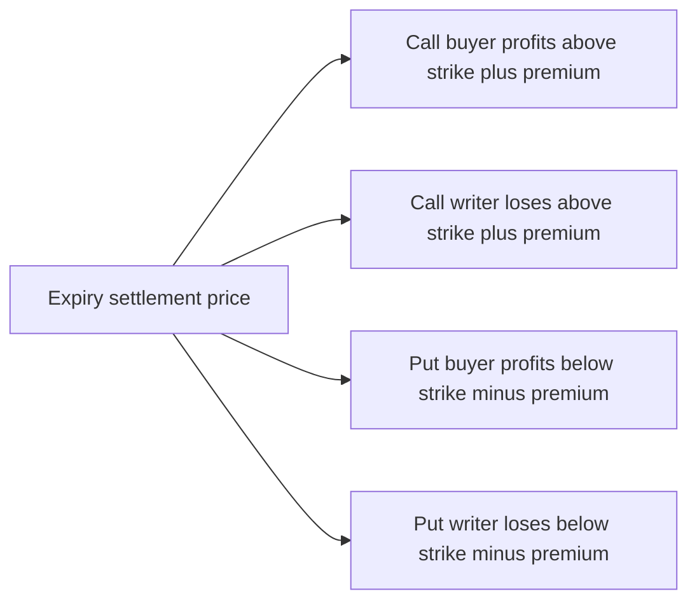

An option is a right that is bought and an obligation that is sold. That single sentence contains the whole structure. The buyer of a call purchases the right to buy the underlying at a fixed price; the buyer of a put purchases the right to sell at a fixed price. The writer of either contract receives cash — the premium — and accepts the obligation to perform if the buyer exercises. Everything else about options follows from that asymmetry: the capped loss on one side, the large and sometimes unbounded exposure on the other, and the steady erosion of value as expiry approaches.

This article sets out what each side owes, how to construct and read a payoff diagram at expiry, and where the four positions break even. It describes payoff structure. It does not describe strategies to sell, and nothing here should be read as a case for trading options.

## Explain simply

An option is a contract that gives you the choice to buy or sell something at a price agreed today, before a stated date. If you buy a call, you have locked in a buying price and can walk away if the market never reaches it. If you buy a put, you have locked in a selling price. For that choice you pay a fee, called the premium, and the fee is gone whether or not you use the choice. The person on the other side of the trade receives your fee and must honour the deal if you choose to use it. So the buyer's worst case is known in advance and small, and the writer's worst case is not; the writer's compensation is the fee.

## What each contract confers

| Contract | Buyer receives | Writer accepts | Whatever happens |
| --- | --- | --- | --- |
| Call | Right to buy the underlying at the strike | Obligation to sell at the strike if exercised | Buyer's loss is limited to the premium paid |
| Put | Right to sell the underlying at the strike | Obligation to buy at the strike if exercised | Writer's obligation arises only if the buyer acts |

The call is a hedge against or a substitute for buying the underlying; the put is a hedge against or a substitute for selling it. In both cases the buyer decides whether to exercise, and the writer must respond.

## Payoff at expiry

The payoff of an option at expiry depends only on where the underlying settles relative to the strike, because no time remains for anything else to matter. Writing $S_T$ for the settlement price and $K$ for the strike:

$$ \text{Call buyer payoff} = \max(S_T - K, 0) $$

$$ \text{Put buyer payoff} = \max(K - S_T, 0) $$

The writer's payoff is the arithmetic negative of the buyer's. To turn payoffs into profit, subtract the premium paid by the buyer, or add the premium received by the writer, denoted $p$:

$$ \text{Call buyer profit} = \max(S_T - K, 0) - p $$

$$ \text{Writer of that call} = p - \max(S_T - K, 0) $$

The same two equations with the put payoff substituted describe the put side. The structure is worth reading carefully, because it is where all the intuition lives:

- A call buyer loses the premium whenever $S_T$ is at or below $K$, and profits only once $S_T$ exceeds $K + p$.
- A call writer keeps the premium in the same region and starts losing above the same level, with no upper bound as $S_T$ rises.
- A put buyer profits once $S_T$ falls below $K - p$; the loss is again the premium, capped at a total loss of the stake.
- A put writer keeps the premium above $K - p$ and loses below it, with the maximum loss reached at $S_T = 0$.

## Reading and drawing a payoff diagram

A payoff diagram is a graph with the underlying's price at expiry on the horizontal axis and the profit or loss on the vertical axis, drawn per unit or per contract. Four features carry the information:

1. **The flat region.** Where the line is horizontal, the option expires worthless and the result is the premium, lost or kept.
2. **The kink.** The point where the line changes slope sits at the strike. It is the boundary between intrinsic value being zero and positive.
3. **The slope.** A long call and a long put rise by one unit of profit for each unit of underlying movement; a written position falls by the same. This is why the diagrams are straight lines with corners, not curves.
4. **The break-even.** The zero-crossing, which is the strike adjusted by the premium, and which appears neither at the strike nor at the current price.

Two refinements matter when reading a diagram rather than constructing one. First, the diagram holds the premium fixed: it shows the payoff at expiry given a premium already paid, so it says nothing about whether that premium was a good or bad price for the risk. Second, it says nothing about the path. An option can be profitable at expiry and lose the buyer money beforehand if it is sold early at a lower premium, and time decay moves the whole curve against the holder as expiry approaches.

## Intrinsic value and time value

The price of an option decomposes into two parts:

- **Intrinsic value**: the amount by which the option is in the money — the excess of the underlying over the strike for a call, or of the strike over the underlying for a put. It is never negative for the buyer.
- **Time value**: everything above intrinsic value, reflecting the possibility of further favourable movement before expiry.

Before expiry, an out-of-the-money option has zero intrinsic value and a positive premium entirely made of time value. As expiry approaches, time value erodes, and at expiry it reaches zero, so the option is worth exactly its intrinsic value. That erosion is measured by **theta**, which is typically negative for a long option position: the buyer loses value each day for no movement in the underlying, while the writer collects the same erosion. It is not a forecast; it is a sensitivity of a pricing model, in the same family as delta, which measures how the premium changes with the underlying. Both are partial derivatives of a pricing function under stated assumptions — an idea that comes from the option-pricing literature — rather than predictions about direction.

## Premium is paid up front

Option premium is settled in full at the outset, and under SEBI's framework exchanges collect it from buyers up front. The buyer's maximum loss is therefore the premium multiplied by the lot size — a known, bounded number.

The writer's position is different in kind. Because the writer carries an obligation rather than a right, the writer posts margin — computed by the exchange's portfolio-based risk framework and collected alongside exposure margin and any broker requirement — and is marked to market as the premium and the underlying move. A written position that moves against the writer generates margin calls, and failure to meet them can result in the position being closed at a price the writer did not choose.

## Worked example: a call and a put from quote to settlement

An illustrative calculation using hypothetical numbers. Nothing here is a quotation of a listed contract.

Suppose a hypothetical index level of 20,000, a lot size of 50 units, so that one index point equals ₹50 on one contract, and a notional exposure of ₹10,00,000. An at-the-money call with a strike of 20,000 is quoted at ₹120 per unit, and an at-the-money put with the same strike at ₹100 per unit.

**The call buyer.** Premium outlay: $120 \times 50$ = ₹6,000. Break-even: strike plus premium, $20000 + 120$ = 20,120.

| Settlement | Intrinsic value | Payoff on 50 units | Profit or loss |
| --- | --- | --- | --- |
| 19,000 | 0 | ₹0 | −₹6,000, the full premium |
| 20,000 | 0 | ₹0 | −₹6,000 |
| 20,120 | 120 | ₹6,000 | ₹0 |
| 20,500 | 500 | ₹25,000 | +₹19,000 |
| 22,000 | 2,000 | ₹1,00,000 | +₹94,000 |

**The writer of that call.** Same numbers, opposite sign, plus the premium received:

| Settlement | Writer keeps or pays | Result |
| --- | --- | --- |
| 19,000 | Keeps ₹6,000 | +₹6,000 |
| 20,500 | Pays ₹25,000 | −₹19,000 |
| 22,000 | Pays ₹1,00,000 | −₹94,000 |
| 30,000 | Pays ₹5,00,000 | −₹4,94,000 |

The last row is the point. The writer received ₹6,000 and now owes ₹4,94,000, because a written call has no ceiling on its loss: the underlying can in principle rise without limit.

**The put buyer.** Premium outlay: $100 \times 50$ = ₹5,000. Break-even: strike minus premium, $20000 - 100$ = 19,900. At a settlement of 19,000 the intrinsic value is 1,000 points, or ₹50,000, giving a profit of ₹45,000; at 20,000 or above the option expires worthless and the loss is the ₹5,000 premium.

**The put writer** collects ₹5,000 and loses below 19,900. The maximum loss is bounded, but not small: if the underlying settled at zero, the writer's obligation would be $20000 \times 50$ = ₹10,00,000 against ₹5,000 collected.

## Why options can lose more than intuition suggests

Three statements deserve to be made plainly, because the payoff diagrams make them easy to miss.

First, **buying an option usually means losing the whole premium**. The payoff is asymmetric, which is the point, but the asymmetry is achieved by paying a fee that is gone under most outcomes. A diagram that shows a small, capped loss makes that outcome look moderate; in cash terms it is a total loss of the amount committed.

Second, **writing an option exposes the writer to far more than the premium received**. For a call there is no upper bound. For a put the loss is bounded by the strike, which is a very large number relative to a premium that may be a fraction of a percent of the underlying. The writer's margin is a performance bond against that exposure, not a limit on it.

Third, **margin mechanics can end a position independently of the writer's view**. A written position that moves against the writer draws margin calls; if they are not met, the position is closed. Being right in the end does not protect a position that has already been closed.

## Payoff structure, not strategies

This article describes what the payoff of a single option looks like at expiry. It does not describe which options to buy or write, does not combine legs into structures, and makes no suitability assessment for any investor. Every number in the worked example is hypothetical and intended to expose the arithmetic. The companions in this series take the moneyness, intrinsic value and time-value vocabulary further, and treat implied volatility separately.

## The four lanes

- **Contractual.** The writer's obligation to perform at the strike, and the clearing corporation's guarantee of settlement standing between the two sides.
- **Model-estimated.** The premium itself, as produced by a pricing model from the underlying, the strike, the time remaining, rates and volatility. Delta, theta and the other sensitivities are outputs of that model.
- **Historical realised.** What comparable positions have actually returned over a past window, including expiry outcomes and transaction costs.
- **Speculative.** The gain or loss from the underlying moving, or from volatility expectations changing, before expiry. This is the lane an option position lives in, and it is unknowable at entry.

## What this does not tell you

- **It does not value an option before expiry.** The diagrams above are payoff structures at expiry; pricing before expiry depends on volatility and time remaining.
- **It does not state a lot size, strike scheme or expiry day.** Those are specification facts, revised from time to time, and must be read from the current exchange publication.
- **It does not state transaction costs or taxes.** Brokerage, exchange charges and the tax treatment of option gains and losses are separate, dated matters.
- **It does not imply that a diagram is a plan.** The diagram shows the result conditional on a settlement price in a world with no costs, no margin calls and no early exit.

## Open questions

- What proportion of bought options expire worthless in full, and how does that distribution compare with the premium paid to obtain the payoff described above?
- How much of the observed difference between option buyers and writers is explained by time decay alone, and how much by volatility pricing and costs?
- What fraction of written option positions are closed by margin pressure rather than by the writer's own decision?
- How should a payoff diagram be amended to reflect the fact that the premium itself moves with implied volatility while the diagram holds it constant?
