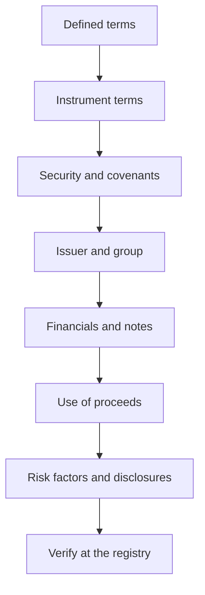

A debt offer document is written by the party that wants the money, disclosed because the regulations require it, and read by almost nobody in full. That is not a comment on investor laziness so much as on the document's shape: it is long, repetitive, cross-referenced and formatted so that the legally necessary sits beside the commercially persuasive. The investor's task is not to read every word. It is to read it in an order that answers a small number of questions, and to know which sections are structurally more likely to hide something material.

This article sets out that order for the disclosure document of an Indian bond issue — whether it is the offer document of a public issue or the information memorandum of a non-public placement. The method is general. No issuer, instrument or issue is named or assessed.

## Explain simply

Think of the document as a loan interview written down. It should tell you who is borrowing, on what terms, against what, for what purpose, and what could go wrong. The problem is that the answers are spread out and the invitation to lend is repeated many times. Read it like a checklist rather than like an article: find each answer, write it down, and note whether the document actually supplies it or only gestures at it. Anything the document does not answer is an open question about the borrower, not a gap in your reading.

## What the document is for

Disclosure documents exist to move information from the issuer to the investor so that the price can be formed. The instrument terms describe the promise; the accounts describe the ability to keep it; the security and covenants describe what happens if it is broken; the risk factors describe what the issuer is willing to say could go wrong; and the annexures carry the underlying paperwork. Everything in the document is a statement by the issuer or a reproduction of an underlying record, and the underlying record is where it should be verified.

The label on the document depends on the route. A public issue proceeds on an offer document in the prescribed form, while a non-public offer uses an information memorandum or private placement memorandum. The regimes are not identical, the required contents are not identical, and the exact labels and contents should be checked against the current SEBI framework for debt securities rather than assumed.

## A reading order that works

The order below is not the order of the document. It is the order in which questions get resolved.

1. **Defined terms first**, because every later clause is written in the document's own vocabulary.
2. **Instrument terms**, which fix the cash.
3. **Security, guarantee and covenants**, which fix the fallout if the cash stops.
4. **Issuer and group**, which fix who is actually on the hook.
5. **Financial statements and the notes**, which test the ability to pay.
6. **Use of proceeds**, which tells you what risk the money is adding.
7. **Risk factors and statutory disclosures**, read last and read critically.
8. **Verification**, which happens outside the document, at the registry.

## Defined terms, then the instrument

The definitions section is where a document's meaning is decided. A covenant that protects "Indebtedness" protects whatever the definition says, and a cap expressed as a multiple of "EBITDA" is worth only what the definition of EBITDA is. Read the defined terms before the clauses that use them, and note which definitions are narrower than their ordinary business meaning.

Then read the instrument terms and write down six things:

| Item | What to check |
| --- | --- |
| Face value and issue price | Whether the debenture is issued at par, discount or premium |
| Coupon and frequency | Fixed or floating, the benchmark if floating, and the reset mechanics |
| Tenure and redemption | The maturity date, the redemption amount, and any premium on redemption |
| Payout option | Periodic interest or cumulative, and how the cumulative amount is computed |
| Call and put | Who can redeem early, when, at what price, and with what notice |
| Ranking | Where the claim sits relative to other creditors and to any earlier issue |

Two of these deserve emphasis. A floating rate is only as good as its benchmark definition and its reset frequency. And a rank stated as "senior" means senior among the issuer's unsecured obligations, which is not the same as secured.

## Security, guarantee and covenants

This section decides what a holder receives after a default, and it is where the document's language is at its most formal and least informative. Extract:

- **What is charged** — a specific asset, a class of assets, or a floating pool — and whether the charge is fixed or floating.
- **In whose favour** the charge is created, which is normally the debenture trustee acting for the holders.
- **The security cover** stated at issue, and whether it is expressed on a gross or net basis.
- **Prior charges** on the same assets, disclosed in the encumbrance section or discoverable at the registry.
- **Any guarantee** — who gives it, for how much, for how long, and whether it is conditional.
- **Covenants**, particularly the negative pledge, restrictions on further borrowing and asset sales, and any financial ratio that must be maintained.
- **Events of default**, including cross-default, and what the trustee may do when one occurs.

The distinction between a stated cover and a realisable cover is the one that matters, and it is drawn out in the worked example below.

## The issuer, the group and the guarantors

Identify the legal entity issuing the debenture, not the brand. Then look up the group: the parent, the subsidiaries, the joint ventures and the entities with which the issuer transacts. The document should disclose related-party transactions, and the registry should confirm the group's structure and the directors. Two questions are worth answering explicitly:

1. **Is the issuer a holding vehicle or an operating company?** A borrowing entity whose cash arrives only as dividends from a subsidiary has a different risk profile from one that collects its own receivables.
2. **Is any support assumed but not guaranteed?** A group's history of funding an entity is not a contractual obligation. If the credit rests on an expectation of support, the document should say so, and the expectation should be treated as such.

## The financial statements and the notes

Read the financials against the definitions in the document, because the covenant ratios will be computed on definitions that may differ from the reported figures. Then read the notes, which is where the useful material sits:

- **Contingent liabilities and guarantees** given to others, which are debts in waiting.
- **Related-party transactions**, in volume and in nature.
- **Auditor qualifications, emphasis of matter and changes of auditor**, which are the document's own account of what is uncertain.
- **Debt maturity schedule**, which shows whether the refinancing assumption is plausible.
- **Off-balance-sheet items and any securitisation or factoring**, which move debt off the stated balance sheet without removing the risk.
- **Working capital and receivable ageing**, which show whether reported revenue is arriving as cash.

The accounts are additionally useful for a negative test: what the document does not say about an item that its own definitions make material.

## Use of proceeds, and what it implies

The stated objects of the issue tell you what the money does to the risk profile. Repaying existing debt reduces leverage and changes the creditor mix. Funding capacity expands the asset base and adds execution risk. Funding working capital is comparatively short-cycle. Financing an acquisition adds consolidation risk, goodwill and integration uncertainty. Funding a group entity adds a layer of separation between the holder and the cash flow. The document should state the objects and the intended deployment; where the statement is broad, the specificity is part of the assessment.

## Risk factors, read critically

Risk factors are drafted to be comprehensive and defensive, which means that the most consequential item is usually not the first. Read them with three filters:

- **Specific versus generic.** A risk that names a customer, a plant, a licence, a covenant or a counterparty is a disclosure. A risk that could apply to any company in the country is drafting.
- **Ordering and emphasis.** Where an issuer puts specific risks relative to general ones is itself a choice.
- **Which risk the accounts corroborate.** A disclosed risk that the notes also quantify is live. A disclosed risk with no support anywhere else in the document is a warning about the limitation of the disclosure.

## Where things are commonly buried

- **In the definitions**, which quietly narrow or widen the clauses that depend on them.
- **In annexures and schedules**, which carry the trust deed summary, the guarantee, the valuation of the charged asset and the consents.
- **In cross-references**, where a clause says the consequences are as set out elsewhere.
- **In the notes to the accounts**, where contingent liabilities and related-party exposures sit.
- **In the description of the charge**, where the difference between fixed and floating is described in a sentence that reads like a formality.
- **In the exit terms**, where the existence of listing is stated without any statement about secondary-market liquidity.

## Worked example: an illustrative security-cover calculation

The following is an illustrative calculation, not an observation about any document or issuer.

Suppose a debenture issue of ₹5,00 crore is stated to be secured by a first charge on assets valued at ₹7,50 crore, giving a gross cover of 1.5 times. The cover ratio is:

$$ \text{Cover} = \frac{\text{Charged asset value}}{\text{Outstanding debentures}} = \frac{750}{500} = 1.5 $$

Now apply what the document and the registry disclose. If ₹2,00 crore of the charged value is already subject to a prior charge that ranks ahead, the residual is ₹5,50 crore, for a cover of 1.1 times. If enforcement and realisation costs are assumed at 10 per cent of the residual, ₹55 crore, the amount available falls to ₹4,95 crore — marginally below the outstanding. And if a portion of the charged assets is a floating charge over receivables that the issuer has been collecting, the realisable figure depends on what remains when the charge crystallises, not on the value at issue.

The gross figure was in the summary. The qualifiers are in a schedule and at the registry. Both are part of the document set, and only one of them appears in the headline. Every number here is an assumption chosen to show the arithmetic.

## What this does not tell you

- **It does not recommend.** No issuer is named, and nothing here is an assessment of any instrument.
- **It does not substitute for the registry.** Charges, filings and accounts are verified at the corporate registry, with the trust deed filling in the trustee's powers.
- **It does not price the risk.** The document describes the promise; whether the yield compensates for it is the investor's own calculation.
- **It does not cover tax.** The post-tax outcome depends on the holder and on provisions that are not in the offer document.
- **It does not anticipate amendment.** A document is a statement as at its date, and the issuer's position changes thereafter.

## Open questions

- How many retail holders of a listed Indian debt instrument read the offer document in full before applying, and does the proportion differ between public issues and non-public placements?
- When a security cover is stated gross, what is the realistic net realisation after prior charges, enforcement costs and statutory priority claims?
- How often do disclosed related-party transactions and contingent liabilities turn out to be the items that explain a later default?
- Does the length of a risk-factor section correlate with any observable outcome, or does it mainly reflect drafting convention?
