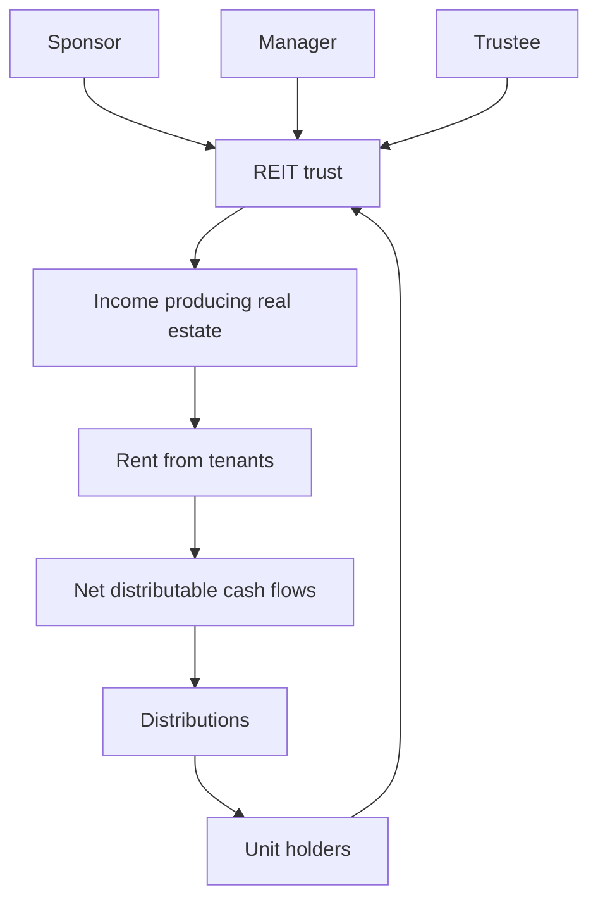

A modern office tower, a shopping centre or a warehouse park is too large for most individuals to buy outright and far too illiquid for most to sell in part. The Real Estate Investment Trust exists to bridge that gap: it owns the property and issues listed, transferable units that carry a share of the income the property produces. Tenants rarely notice anything, the rent keeps arriving, but the money now travels through a structure with a rulebook.

This article is about that structure — the trust, its four parties and the regulations that bind them. A REIT is not a company with shareholders, and it is not a mutual fund in the familiar sense. It is a trust, and a trust is defined by the duties of the people inside it. Read those duties correctly and a REIT offer document becomes legible rather than intimidating.

## Explain simply

Picture a locked box that owns buildings. The box collects rent and pays most of it out to the people who hold cards to the box, which are the units. Someone had to place the buildings inside the box and keep a meaningful stake in it. Someone has to run the box day to day: find tenants, sign leases, arrange borrowings, decide what to buy and sell. Someone else has to stand outside the manager and check that it is not quietly favouring itself. The unit holders hold the economic claim on whatever the box earns. SEBI, the market regulator, writes the rules that keep the box open, independently valued and paying out most of its cash.

## A trust, not a company

A company is a legal person separate from its shareholders. It owns its assets, its board owes duties to the company, and profits can be retained or distributed at the discretion of the board. A trust works differently. Legal title to the assets sits with a trustee, who holds them for the benefit of identified beneficiaries. In a REIT the beneficiaries are the unit holders, and a unit is the evidence of that beneficial interest.

The practical consequence is that a REIT is built to pass cash through rather than accumulate it. Because the vehicle is not designed to hoard earnings, the regulations make distribution a requirement rather than a choice. That single design decision shapes almost everything a unit holder experiences: income is frequent, retained capital is thin, and growth usually has to be funded by issuing more units or by borrowing rather than by reinvesting rent. A REIT is therefore best understood as an income instrument with a capital-markets engine attached, not as a growth company that happens to pay out.

## Who does what

Four parties appear in every Indian REIT, and each has a different job.

| Party | Role | Accountable for |
| --- | --- | --- |
| Sponsor | Establishes the trust, contributes assets and seed capital, and typically retains a stake | The suitability of the assets placed in the trust, and the alignment created by its own continuing holding |
| Manager | Day-to-day operations: leasing, financing, acquisitions and disposals, disclosures | Operating performance, capital allocation and the accuracy of disclosure |
| Trustee | Holds the assets for the benefit of unit holders and oversees the manager | Independent review of valuations, related-party transactions and distributions |
| Unit holders | Provide the capital and hold the beneficial interest | Nothing operational; the remedies are the market price and, where the regulations provide one, the vote |

The table is the whole architecture in miniature. Now take each row in turn.

## The sponsor: the party that establishes the trust

The sponsor establishes the trust and seeds it with assets. In practice it is usually a property developer or an institutional investor that has either built the assets or accumulated them, and now wishes to monetise part of the value while keeping exposure to the rest. The stake the sponsor retains is the primary alignment mechanism: a sponsor that keeps a meaningful holding receives the same distributions as everyone else, which is a stronger bond than a promise.

Two things are worth separating here. The first is eligibility. The sponsor must satisfy the fit-and-proper and financial conditions SEBI prescribes, and the trust itself must clear a minimum asset base before registration — a REIT is not a small private arrangement. The second is the pipeline. Because the sponsor typically owns other properties, unit holders will periodically be asked to approve or absorb the purchase of assets from the sponsor. That is not improper in itself; it is the natural consequence of a structure in which the founder also builds. It is precisely the kind of transaction the trustee exists to scrutinise.

## The manager: where day-to-day governance actually sits

The manager is the SEBI-registered entity that runs the trust. It negotiates and administers leases, manages the property and its service providers, refinances debt, identifies acquisition and disposal opportunities, commissions and submits valuations for the trustee to test, and produces the disclosures that unit holders read. The regulations require the manager to meet eligibility and experience criteria, and the manager earns a fee set out in the trust documents.

This is the party to study hardest. The manager decides which assets the trust owns, how much it borrows and when capital is raised. Its fee structure reveals what it is being paid to do. A fee charged on assets under management rewards growth in the size of the trust, while a fee linked to distributions rewards the income you actually receive. Neither design is illegitimate, but they push decisions in different directions, and the difference compounds over a decade of operations. The manager and the sponsor are frequently related, often within the same corporate group, and the regulations require the conflicts that flow from that relationship to be disclosed and handled at arm's length through the trustee.

## The trustee: the counterweight

The trustee is what makes the trust a trust. It holds the assets for the benefit of unit holders and has an obligation to act in their interests, independently of the manager. In day-to-day terms the trustee reviews and signs off on valuations, tests related-party transactions, checks that distributions conform to the regulations and the trust documents, and can escalate or block decisions that fall outside them.

The trustee is not a portfolio manager and does not choose buildings. Its value is as a check, and the honest question to ask of any REIT is not whether a trustee exists — the regulations require one — but whether it has the independence, the resourcing and the record to say no. That is a judgement about institutions rather than about arithmetic, and it is not something a distribution figure can capture.

## What the regulations require of the structure

The regulatory perimeter, rather than the business plan, is what distinguishes a REIT from an informal property pool. The framework presupposes, among other conditions:

- A minimum asset base and minimum unit-holder spread before the trust can be registered.
- Distribution to unit holders of at least 90 per cent of net distributable cash flows.
- Disclosure of net distributable cash flows at least once every six months.
- Limits on borrowing, which constrain how much leverage the trust may carry.
- A cycle of valuations of the underlying assets, so that reported values are reviewed rather than asserted once.

The distribution rule deserves a note in its own right, because it explains a term you will meet constantly. Net distributable cash flows, usually shortened to NDCF, are the cash a trust has available after operating expenses, interest and debt service, maintenance capital expenditure and any mandatory reserves. NDCF is a cash measure, not an accounting-profit measure, so it can diverge from reported net profit, especially where depreciation or fair-value movements are large. A trust can report a profit and still have thin NDCF, or the reverse. The distribution you receive is a claim on cash, not on the profit line.

## The structure at a glance

Read the diagram downward and you have the cash path; read it across and you have the accountability path. The manager touches the assets and the trustee touches the manager, which is the entire point of separating them.

## Small and medium REITs

For most of the structure's history, a REIT had to be large. That changed with the small and medium REIT framework, which SEBI introduced by amendment to bring fractional-ownership platforms inside the regulatory perimeter. Under that framework, portfolios in the band of roughly fifty crore to five hundred crore rupees of real estate assets can be offered through a SEBI-regulated SM REIT rather than as a private contractual arrangement. SM REITs list their units, must distribute most of their net distributable cash flows and are overseen by a trustee in the same way as a full REIT.

The structural logic is identical; the economics are not. An SM REIT typically holds fewer and smaller assets, so a single vacancy or a single tenant default weighs more heavily on its cash flow, and its units trade far less often. The wrapper is the same, which means the governance expectations are the same, but liquidity and concentration are materially different and should be treated as such.

## Worked example: tracing a unit-holder claim

The following is an illustrative calculation, not a description of any listed trust, and none of its figures are drawn from a market.

Suppose a trust has issued 10,00,00,000 units and an investor holds 25,000 of them. The beneficial share of the trust is:

$$ \frac{25,000}{10,00,00,000} = 0.00025 = 0.025\% $$

If the trust declares a distribution of ₹2 per unit for the year, that investor receives ₹50,000, before any tax:

$$ 25,000 \times 2 = 50,000 $$

Now apply the same share to the trust assets. If the trust reported net assets of ₹10,000 crore, a 0.025 per cent interest would correspond to ₹2.5 crore of net asset value. But the market price of a unit need not equal its proportional share of net asset value, and frequently does not, because the market is pricing the manager, the debt, the lease maturities and its own sentiment alongside the buildings.

Notice what the arithmetic refuses to tell you. It says nothing about whether ₹2 per unit is generous or thin. That judgement needs the issue price, the prevailing unit price, the composition of the distribution and its tax treatment — the subject of the next article in this series.

## What this does not tell you

Structure is necessary context, not an assessment. This article cannot tell you whether a particular manager is competent, whether a particular portfolio is well leased, or whether a given unit price is cheap. It does not cover the tax treatment of the three components inside a distribution, which this series handles separately, and it does not quantify the leverage a specific trust is carrying or the refinancing risk embedded in it. It also says nothing about tenant concentration, which is often the single largest driver of a REIT's cash-flow stability and is visible only in the underlying disclosures.

What it does give you is a map. When you open a REIT offer document or annual report, you should now be able to place every paragraph: this is the sponsor speaking, this is the manager reporting, this is the trustee certifying, and this is the disclosure the regulations compel.

## Open questions

- How much should unit holders rely on a trustee to push back on a manager whose remuneration grows with the size of the trust rather than with the cash distributed per unit?
- When a sponsor sells assets into the trust it founded, what evidence would show that the price was fair rather than merely defensible?
- For small and medium REITs, does a listing that rarely trades provide a real exit, or only the appearance of one?
- As the framework matures, will the market reward governance quality — independent trustees, conservative leverage, fee structures tied to distributions — with a visible pricing difference, or will distribution alone continue to drive unit prices?
