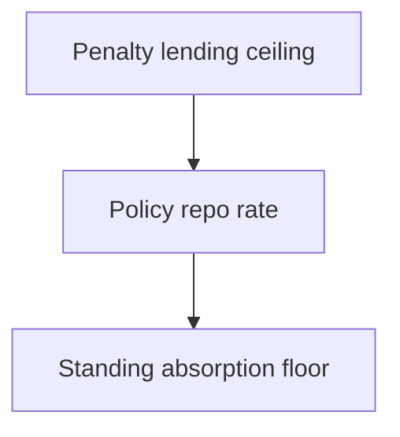

Every quarter a committee announces a number and the financial press explains that borrowing will become cheaper or costlier. The number is the policy repo rate, and the mechanism that gives it force is a corridor: a floor and a ceiling inside which the overnight money market is expected to trade. Most investors never need the corridor directly, yet almost every short-term rate they touch, from a liquid fund to a floating-rate loan and a savings account, is connected to it. This article explains what a repo is, how the floor and ceiling are constructed, why the band holds most of the time, and where the connection to deposit and lending rates is looser than the announcement suggests.

## What a repo actually is

A repo is a short-term collateralised borrowing arranged as a sale and repurchase. One party sells securities, usually government securities, to another and simultaneously agrees to buy them back at a later date at a slightly higher price. The difference between the sale price and the repurchase price is the repo interest, which is quoted as a rate. Economically the transaction is a secured loan: the cash provider holds the securities as collateral, and the cash borrower pays interest for the use of the money.

The structure matters more than it appears. Because ownership of the securities moves, the cash provider is protected against the borrower failing to repay: the collateral can be kept. That is why repo rates are close to a risk-free rate for the tenor of the transaction, and why the market regards repo as the plumbing through which central-bank liquidity reaches the rest of the system. The same transaction viewed from the cash provider's side is called a reverse repo, so the terms are two directions of one arrangement rather than two different instruments.

## The corridor and its three anchors

The central bank does not set every short rate. It sets a band around the one that matters most and lets arbitrage keep the others inside it.

- **The policy repo rate.** This is the rate at which the central bank lends short-term funds to banks against eligible securities. It is the principal policy signal and the rate the market treats as the operating target.
- **The floor, or absorption rate.** The central bank offers to absorb surplus liquidity from banks at a standing rate. A bank with idle cash can take that rate rather than lending it to another bank for less, which places a practical floor under overnight lending. The instrument that performs this function, and its design, has been revised over time, so the current arrangement should be read from the latest policy statement rather than assumed.
- **The ceiling, or penalty rate.** The central bank also lends to banks at a facility above the policy repo rate, at a penalty, so that a bank which needs funds urgently can obtain them without bidding the market arbitrarily high. The facility is secured against eligible securities and is typically subject to limits, and both the rate and the limits are set in the current framework.

At the centre of the band is the operating target. Around the target are the two standing facilities, and between them the money market does its work.

## Explain simply

Imagine a school canteen that will always buy back a token at one price and will always sell a token at a slightly higher price, and in between students trade tokens with each other. No student will sell a token for less than the canteen's buying price, because the canteen will pay that. No student will pay more than the canteen's selling price, because the canteen will sell at that. So the price at which students trade stays inside the two canteen prices. The central bank is the canteen, the tokens are overnight money, and the two prices are the corridor. The policy repo rate is where the central bank would like the trading price to sit, and the canteen's two prices are what keep it from wandering too far.

## Why the band holds

The corridor rests on a simple comparison, applied by banks that can use either the market or the standing facility.

If a bank with surplus cash could lend overnight at a rate below the absorption rate, it would rather use the facility, so it lends in the market only at or above that rate. If a bank needing cash could borrow at the penalty facility at a rate below what the market is demanding, it would rather use the facility, so it borrows in the market only at or below that rate. Those two comparisons place a floor and a ceiling on the price of overnight funds, and they hold without anyone coordinating them.

Two qualifications keep the band from being absolute. The penalty facility is a penalty, so it is available but not attractive, and it is subject to limits on how much a bank can borrow against eligible securities. And the market for short money is not frictionless: a bank that lacks spare eligible collateral, or that faces an intraday timing mismatch, may pay above the ceiling rather than fail to settle. The corridor is therefore a strong tendency rather than a legal maximum, and the market rate can spend periods near one boundary or another depending on whether the system is short of liquidity or long on it.

## Variable-rate operations and the wider toolkit

Between the standing facilities, the central bank manages the quantity of liquidity. Variable-rate repo and reverse repo auctions let banks obtain or place funds at rates determined by auction, which means the cut-off can sit anywhere inside the band depending on how much liquidity the central bank wants to add or drain. Outright purchases and sales of securities from the portfolio change the amount of durable liquidity in the system. Together these operations determine whether the market trades near the floor, near the policy rate, or near the ceiling, and they are the reason the corridor is best understood as a pair of boundaries plus a set of levers.

The instruments used have been redesigned more than once, and their names, tenors and mechanics are a live part of the policy framework. Anyone using the corridor to interpret current market behaviour should take the instrument set from the latest statement and from the operating procedure in force at the time.

## What trades inside the band

The overnight money market includes call money, which is typically unsecured interbank lending, and repo and tri-party repo, in which the lending is collateralised. The weighted average of these transactions is the quantity most closely watched as the corridor's practical centre, and it is the number a market participant would compare with the policy rate to see whether conditions are tight or easy. Short-term rates further out along the money-market curve, including the yields on very short government paper, are influenced by the same liquidity conditions, though they also reflect expectations of the policy path rather than the current stance alone.

For a retail holder, the corridor reaches ordinary life in two places. The first is the return on cash-like products that hold short money-market instruments. The second, and larger, is the pricing of floating-rate borrowing, where the reference benchmark is tied to the policy rate so that a change in the announcement resets the borrowing rate with little delay.

## When rates leave the band

A corridor that is respected does not mean a corridor that is always occupied. Two situations push the market rate outside.

The first is an excess or a shortage of reserves large enough to overwhelm the authorities' capacity to offset it in the window available. If the system is long liquidity and the absorption facility has limits, or if the central bank is content to let the rate trade below the operating target, the overnight rate can sit under the policy rate for an extended period. This is a deliberate stance as often as it is a failure of the mechanism.

The second is collateral scarcity. Repo borrowing requires eligible securities, and a bank that has lent out or pledged its holdings may be unable to use the standing facility. In that case the market rate for uncollateralised money can spike above the ceiling until the collateral constraint passes. Collateral scarcity is the reason the corridor has a ceiling built from a secured facility rather than from a promise.

## Transmission to deposits and lending rates

The corridor sets the price of very short money. What a household sees is the price of much longer obligations and deposits, and the journey between the two is where most of the variation lives.

On the lending side, a floating-rate retail loan tied to the policy rate resets almost mechanically when the policy rate changes, so a borrower on such a benchmark feels the change promptly. Other loans priced off a bank's own cost of funds pass through more slowly, and loans at fixed rates may not move at all.

On the deposit side, transmission is weaker and more discretionary. A bank's term-deposit rate depends on its own funding needs, its competition for deposits and its alternative sources of funds, not only on the policy rate. Published deposit and lending rate statistics are the way to observe how far transmission has actually gone in a period, and the observation is necessarily backward-looking. The relevant point for a saver is that a change in the policy rate announces a direction, not a schedule.

## Worked example

The following corridor is a constructed illustration built only to show the arithmetic. None of these levels is a current policy rate, and none should be read as one.

| Facility | Illustrative rate |
| --- | --- |
| Absorption floor | 5.00 per cent |
| Policy repo rate | 5.50 per cent |
| Penalty lending ceiling | 6.00 per cent |

The width of this illustrative corridor is 100 basis points, with the policy rate 50 basis points above the floor and 50 basis points below the ceiling.

Now suppose a bank with surplus cash is offered overnight money at 4.90 per cent by another bank. It declines, because the absorption facility pays 5.00 per cent for the same overnight placement with the central bank, so the market rate is bid up to at least the floor. Suppose a bank needing cash is asked to pay 6.10 per cent. It declines if it can use the penalty facility at 6.00 per cent, so the market rate is capped. If a variable-rate operation clears at 5.60 per cent, the system is being supplied with funds at a rate inside the band, above the policy rate, which tells a careful observer that money was in demand at that moment. Every figure in this paragraph is illustrative and none is a forecast.

## The four lanes

- **Contractual.** The repo rate agreed on a given transaction, and the coupon and reset terms of a floating-rate loan, are contractual terms of those arrangements.
- **Historical realised.** Past overnight rates and past deposit rates are recorded observations, and they say what conditions were, not what they will be.
- **Model-estimated.** Any statement that a given policy change will produce a specific change in a deposit rate is an estimate built on an assumed transmission, and it should be labelled as such.
- **Speculative.** Any view that the committee will cut, hold or raise at a future meeting is a forecast and belongs in the speculative lane, however confidently it is expressed.

## What this does not tell you

- **Any current rate or corridor width.** Take these from the latest monetary policy statement and the operating procedure in force.
- **The facility limits.** How much a bank may borrow at the penalty facility, and against which securities, is a regulatory detail that should be checked rather than recalled.
- **The size of transmission.** How much of a policy change reaches a particular deposit or loan rate, and over what period, is an empirical property of the banking system in that period.
- **The tax treatment.** The tax outcome of interest earned or paid on these instruments and loans belongs to the tax reference.

## Open questions

- How much of the corridor width is functionally necessary for the money market to operate, and how much is the residual of the facilities chosen?
- When liquidity is abundant, how far below the policy rate can the overnight rate settle before absorption operations pull it back?
- Why does transmission to a repo-linked borrower appear faster and more complete than transmission to a depositor whose rate the bank reprices at its discretion?

The corridor is a small piece of institutional machinery with an unusually large reach. It does not set the rate a household earns or pays, but it sets the price of the money from which those rates are built. Reading a policy announcement correctly means hearing a change in the boundary of the overnight market, and then asking separately how far that change will travel.
