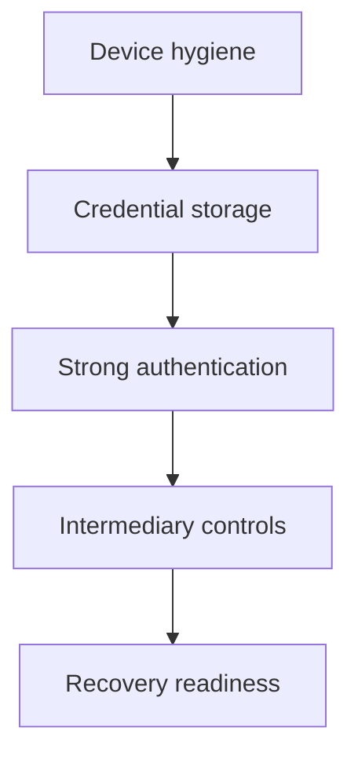

Every investment account is a door, and the holder is responsible for the lock, the keys and the spare key. The intermediary controls the building. This division is uncomfortable, because the consequences of a weak lock fall on the account holder even when the door itself was built to the intermediary's specification. Security hygiene is the practice of managing that shared responsibility deliberately: strengthening the way access is granted, shrinking the surface that can be reached with a stolen credential, and rehearsing what happens when access is lost.

## The account is the perimeter

A household's investment access runs through a chain of layers, and a chain is only as strong as the point where an attacker can enter it.

The useful property of this chain is that the layers are additive. A password manager that generates a unique password removes the reuse risk from every account at once. A second factor stops a leaked password from being sufficient. Alerts at the intermediary shorten the window between an attempt and a response. Nothing in the list is exotic, and none of it depends on technical skill.

## How accounts actually get taken over

Account takeovers in retail finance are, overwhelmingly, exercises in obtaining trust rather than in defeating cryptography. The recurring channels are these, described here so they can be recognised rather than performed.

- **Deception for credentials.** A message, call or website that imitates the intermediary and asks for a password, a code or an approval. The request is usually urgent, usually cites a deadline, and usually arrives through a channel the intermediary does not use for that purpose.
- **Social engineering of the second factor.** The attacker already has a password and now wants the code. This is why the instruction never to share a code, and never to approve a request that was not personally initiated, is a security control and not a formality.
- **Reused and breached passwords.** A password reused across a shopping site and a broker is compromised the moment the weaker site is. The credential is not stolen from the broker; it is carried over.
- **Number and message interception.** Contact details registered for recovery and for one-time codes can be diverted, which is why the registered mobile number and email address are themselves assets to be protected.
- **Remote-access and screen-sharing tools.** Requests to install a tool so that a "support agent" can help are a recurring pattern in retail payment fraud, and the installation hands over the session.
- **Insider and process failure.** Not all failures are external. A payout instruction that changes without verification, or a support process that accepts incomplete identification, is a control weakness rather than an attack.

The payment system's own regulators and operators publish fraud typologies precisely because the patterns are recognisable in advance. The correct reference for what an intermediary will and will not ask for is the intermediary's own published material, not an incoming message.

## Authentication that resists takeover

Authentication is where the leverage is greatest, because it is the step a takeover must pass.

- **Use a long, unique password for each account.** Length beats complexity, uniqueness beats both. A password that appears in no other context cannot be carried over from a breach elsewhere.
- **Use a password manager to hold them.** It removes the reuse habit, makes long random passwords practical, and gives one place to change everything after an incident.
- **Turn on the strongest second factor offered.** A code generated in an application, or a hardware key, is stronger than a code sent by text message, which travels over a channel with known interception weaknesses. Use the strongest option the intermediary provides.
- **Never share a code, and never approve a prompt you did not start.** No legitimate intermediary needs a code from the customer. Treat a request for one as evidence about the caller.
- **Change credentials after any suspicion**, and change them at the intermediary, not through a link provided in a message.
- **Do not reuse the same password for the trading account, the demat account and the bank account** that settles the trades. Those three sit behind one payout route and should not share a single point of failure.

## Device and session hygiene

The device that reaches the account is part of the account's security boundary.

- **Keep the operating system and financial applications updated.** Updates exist to close known weaknesses, and an unpatched device is a known-open door.
- **Install financial applications only from the intermediary's published source**, and check the publisher before granting permissions. A lookalike application is a credential-collection mechanism.
- **Use a screen lock and biometrics**, and keep the device with the customer rather than shared with the household.
- **Avoid public and shared computers for financial access.** A session on a machine that retains data is a session that can be resumed by someone else.
- **Log out of sessions rather than leaving them open**, and review the list of active sessions or trusted devices wherever the intermediary exposes one, removing anything unrecognised.
- **Be cautious on rooted or modified devices**, which step outside the protections the operating system provides to other applications.
- **Review application permissions periodically** and withdraw access to contacts, messages or screen overlays for anything that does not need it.

## Credential storage, and the email master key

The email address registered with a broker, a depository or a fund house is the most powerful credential in the household, because it is where identity recovery, password resets and confirmations are sent. Whoever controls that mailbox can begin a reset on any account that uses it. Protecting the email account is therefore not a side task; it is the first task.

- **Put the strongest available second factor on the email account itself**, before worrying about any downstream account.
- **Keep recovery email and phone details current** on the mailbox, and remove old addresses that are no longer controlled.
- **Store passwords in a password manager, not in documents, notes applications or chat messages.** A credential stored where it can be read is a credential that has already leaked.
- **Store recovery codes offline**, in a place that is physical and private, and not in the same mailbox the codes recover.
- **Do not forward financial mail to a shared household inbox** that others can read or that is itself less protected.
- **Note the access and recovery arrangements in the household's investment policy document**, so that a second adult could act if the first were incapacitated. Writing this down is a security measure and an estate measure at the same time.

## Intermediary-side safeguards

Some controls live on the intermediary's side of the chain, and they are easy to switch on once and forget.

- **Check the registered mobile number and email address** on every account, and correct anything out of date. An obsolete contact detail blocks legitimate recovery and can plausibly help someone else.
- **Turn on transaction and login alerts**, and read them. An alert that nobody reads shortens nothing.
- **Keep the payout route deliberate.** A single, known bank account used for settlements makes an unexpected change visible, and it contains the damage if the route is ever redirected.
- **Check the setting that governs where a payout account change request can come from**, and treat any unsolicited message about re-verifying bank details as suspect.
- **Disable products and services the household does not use**, since every enabled facility is a surface. This includes margin, derivatives permissions and any standing instruction that is no longer required.
- **Reconcile contract notes, statements and holding statements** against expectations. Discrepancies are the earliest signal that something changed on the record.
- **Keep a copy of the account identifiers** — demat account, folio numbers, registered contact points — outside the applications that display them.

## Payments hygiene, and the new rails

Retail payments and market settlements have converged. Regulators and the payment system have added unified-payments-interface rails to market transactions, so a payment handle that a household uses for everyday transfers is now part of the same access surface as its investment accounts. The practical rules carry across.

- **Read the identity of the party before approving a payment or a collect request**, and reject anything not personally initiated. A collect request is a request to take money, and approving one is the transaction.
- **Treat refund offers that require an action with suspicion.** A genuine refund arrives through the original channel.
- **Do not screen-share while handling money or credentials**, whatever the caller's explanation.
- **Keep the payments application updated and limited to the intended number**, since a payments handle is a credential in its own right.
- **Note that reporting a payment fraud is time-sensitive**, which is another reason to know the official reporting channel before it is needed.

## Recognising a live attempt

An attempt in progress usually has a shape, and the shape is more informative than the content.

- **Urgency.** A deadline measured in minutes, an account about to be frozen, an offer that expires today.
- **A channel mismatch.** A request for credentials or codes arriving by a channel the intermediary does not use for that purpose.
- **An unexpected inbound request.** The intermediary initiating contact and asking the customer to do something.
- **Payment instructions.** Any direction to move money to a "safe", "verified" or "government" account.
- **A link or application supplied by the messenger.** The legitimate route is the intermediary's own application or a bookmarked address.
- **Pressure to keep it private.** Genuine processes do not require secrecy from family or from the intermediary's own official channel.

The stopping rule is simple in principle: verify out of band. Hang up, open the intermediary's own application or call the number published on its official material, and check. A legitimate request survives being verified through a second channel.

## Recovery when access is lost

Recovery is faster if the steps are known before they are needed.

1. **Stop the bleeding first.** Contact the intermediary and the bank through official published channels and ask for the account and the payout route to be blocked or frozen.
2. **Reset from a clean device.** Use a device that is known to be uncompromised, and change the password of the email account as well as the financial accounts.
3. **Revoke sessions and trusted devices**, and remove any application or tool that was installed on request.
4. **Review the history.** Statements, contract notes, alerts and holding statements, reconstructed in date order, tell the intermediary and the bank what to look for.
5. **Report through the official channel.** The national cyber-fraud reporting mechanism and the relevant regulator are the correct destinations; the exact numbers and portals should be taken from official sources at the time, not from this article.
6. **Check the credit record for facilities you did not open.** Unauthorised borrowing in the household's name surfaces there, and it is a separate problem from the brokerage account.
7. **Write it down.** A timestamped timeline of what was noticed, when, and what was done is the document every subsequent conversation depends on.

## Explain simply

An investment account is protected by a password and, usually, a second step such as a code. Almost every takeover happens because someone obtained those credentials by deception, or because the same password was already stolen from a weaker website. So the practical defences are to use a long password that is used nowhere else, to turn on the strongest second step the broker or bank offers, to keep the registered email and mobile number current and well protected, and to read the alerts. If access is lost anyway, the recovery is quickest if it has been thought through in advance: call the intermediary's official number, get the account and the payout account blocked, then reset everything from a device you trust.

## Worked example

The following is an illustrative calculation, not observed data. It does not estimate the probability of a takeover, which depends on the household's own practices.

Suppose an account holding an illustrative ₹5,00,000 is frozen while a takeover is investigated, and the money is inaccessible for 30 days. If the same money would otherwise have been invested at an illustrative 6 per cent a year, the opportunity cost of the freeze is:

$$ 5,00,000 \times 0.06 \times \frac{30}{365} \approx 2,466 $$

So roughly ₹2,466 on these illustrative figures, before any tax treatment is considered.

The number is the least important part of the exercise. The cost of a takeover is not bounded by foregone interest, because the exposure is the balance itself, not its return; some portion may be irrecoverable; and the administrative effort, credit-record repairs and time all sit outside the calculation. What the arithmetic does establish is that a freeze of even a month has a real cost attached to it, which is the case for spending the setup time now rather than afterwards.

## What this does not tell you

- **It is not a guarantee of safety.** Following every practice here reduces the probability and the cost of an incident; it does not eliminate either. The intermediary's controls are outside the account holder's direct control.
- **It does not audit any specific intermediary.** The features described here are general; whether a particular broker, bank or depository offers them, and where, must be checked in that institution's own material.
- **It does not cover business or joint accounts**, family-office structures or accounts operated under a power of attorney, each of which has additional governance requirements.
- **It does not quantify risk.** Nothing here gives a probability of loss for any household, and no such figure would be meaningful without the household's specific practice.
- **It does not describe attacks.** Details are deliberately omitted, because the purpose is recognition and defence rather than replication.

## Open questions

- How much of retail account-takeover loss is eventually recovered, and how does that vary between banks, brokers, depositories and payment channels?
- Will application-based or hardware second factors become the default across Indian retail financial intermediaries, or remain one option among several?
- How should intermediaries balance a fast recovery process against the risk that the recovery path becomes the weakest link in the chain?
- Are account-security settings presented as part of the customer relationship, with periodic confirmation, or left inside application menus that most holders never open?
