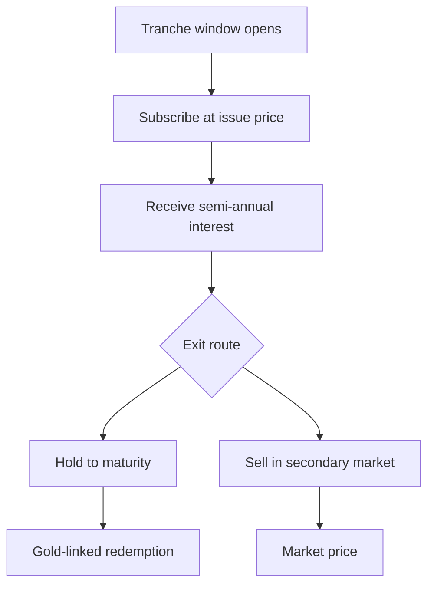

Sovereign gold bonds occupy a unusual position in the Indian gold market: they are government securities, but they are denominated in gold. The holder owns a claim on the government, not a coin in a safe, and the claim pays interest while also rising and falling with the price of metal. That combination — sovereign credit, an income stream and gold exposure in one instrument — is what makes the bond the most efficient route to gold for many buyers, and it is also what makes the details matter. This article sets out the structure, the issuance pattern, the interest component, the redemption terms and the secondary market, and it flags the one figure a buyer most wants that this article cannot supply.

## Explain simply

A sovereign gold bond is an IOU from the Government of India, but instead of promising to repay rupees, it promises to repay an amount linked to the price of gold. You buy it in grams, the government pays you interest twice a year, and at the end you get back whatever the gold is worth at that time. You never take delivery of metal, you never pay a making charge, and you never worry about purity or storage. The trade-off is that your money is locked in for the term, and the amount you get back depends on where the gold price is when the bond matures. It is the simplest way to own gold, and the details — when you can buy, what it pays, and how you get out — are what this article is about.

## The structure: a government security denominated in grams

A sovereign gold bond is a government security denominated in grams of gold, issued by the Reserve Bank of India on behalf of the Government of India in occasional tranches. The denomination in grams is the key feature: the holder's principal is a weight of metal, not a rupee amount, so the rupee value of the principal moves with the price of gold. The bond carries the sovereign's credit quality, which means the default risk on the principal is the default risk on the government itself, not the storage, purity or counterparty risk of holding physical metal.

The structure has two return components, and they are different in kind. The first is the interest: a fixed rate of interest paid semi-annually, which is a contractual cash flow in rupees. The second is the redemption value, which is linked to the price of gold at maturity and is therefore a market-dependent amount. The interest is known in advance; the redemption value is not. This is the crucial distinction: the bond is part fixed-income security and part gold exposure, and the two components respond to different forces. The interest is set by the issuer at the time of the tranche; the redemption value is set by the gold market at the time of maturity.

## Issuance: tranches, windows and the open-or-closed question

Sovereign gold bonds are not issued continuously. The RBI issues them in tranches, each with a subscription window, an issue price and a set of terms. Once the window closes, that tranche is closed to new primary subscription, and a buyer who wants exposure must either wait for the next tranche or buy in the secondary market. The status of each tranche as open or closed is published, and it is the first thing a buyer must check: the assumption that a sovereign gold bond can be bought at any time, like a mutual-fund unit, is wrong.

The issuance pattern matters for a second reason. Because each tranche has its own issue price and its own terms, two sovereign gold bonds bought at different times are not identical products. The issue price of a tranche is set by the RBI with reference to the prevailing gold price, and the interest rate is fixed for that tranche. A buyer comparing two tranches is comparing two different instruments, and the comparison must be made on the terms of each, not on the general reputation of the scheme. The RBI Retail Direct platform provides a route for retail investors to subscribe to government securities, including sovereign gold bonds, in the primary market, and the account-opening conditions and bidding mechanics are part of the subscription process.

## The interest component: structure without a verified rate

The interest component is the part of the bond that behaves like a fixed-income security. The rate is fixed, it is paid semi-annually, and it is a contractual obligation of the issuer. The structure is clear; the specific number is not. The packet behind this article does not carry the current coupon rate, and the rate is set per tranche, so there is no single rate that applies to all sovereign gold bonds. The scheme notifications and issue terms published by the RBI and the Ministry of Finance carry the rate for each tranche, and that is where the figure must be verified.

This is the one place where a buyer's natural question — what is the interest rate — cannot be answered in this article without fabrication. The honest answer is: the rate is fixed per tranche, it is paid semi-annually, and the current rate for any specific tranche must be read from that tranche's issue terms. Any figure quoted from memory, from a news report or from a different tranche is a guess, and a guess about a contractual rate is a bad basis for a decision. The structure is the substance; the rate is a detail that must be verified at the point of purchase.

## Redemption: maturity, premature exit and the gold link

At maturity, the bond redeems at a value linked to the price of gold at that time. The redemption terms and any exemptions on maturity gains are as specified in the issue terms and tax law, so the exact mechanics — the reference price, the calculation, the timing — are matters of the specific tranche's terms and the prevailing tax rules, not of this article. What can be said structurally is that the redemption value is market-dependent: the holder receives the gold-linked value plus the accumulated interest, and the gold-linked value can be higher or lower than the issue price depending on where the metal price has moved.

Premature redemption is possible during the bond's life, subject to the conditions in the issue terms, but it is not the same as the maturity redemption. A bond sold before maturity fetches whatever the market will pay for it in the secondary market, which may be more or less than the gold-linked value, and the tax treatment of a sale before maturity may differ from the treatment at maturity. The lock-in is the price of the structure: the holder gives up the ability to redeem at will in exchange for the interest stream and the gold exposure, and the exit before maturity is a market transaction, not a contractual right to the gold-linked value.

## The secondary market

Sovereign gold bonds are listed on the exchanges, so a holder can sell before maturity through the secondary market. The secondary market solves the lock-in problem, but it introduces a new one: price discovery. The traded price of a bond in the secondary market may differ from the gold-linked value, because the market is pricing the bond's remaining interest stream and its gold exposure, and the liquidity may be thin. The secondary-market availability of any specific tranche must be checked with the exchanges rather than assumed, and the price obtained may be better or worse than the gold-linked value depending on the market at the time of sale.

The diagram is the life of the bond. The holder subscribes during the window, receives interest, and then chooses between holding to maturity for the gold-linked redemption or selling in the secondary market for the market price. The two exit routes have different risks and different tax treatments, and the choice between them is a market decision, not a structural one.

## Worked example: an illustrative SGB versus physical comparison

The following is an illustrative calculation, not a forecast and not a live quote. It shows how the bond's structure compares with physical metal.

Suppose a buyer purchases an illustrative ten grams of gold exposure. In physical form, the buyer pays the metal value plus an illustrative 5 per cent premium, so ₹70,000 of metal costs ₹73,500, and stores it at an illustrative ₹500 a year for five years, a total of ₹2,500. In bond form, the buyer subscribes at the issue price of ₹70,000, receives an illustrative 2.5 per cent interest paid semi-annually, and pays no storage and no premium. The interest, compounded semi-annually, is:

$$ 70000 \times (1 + 0.025/2)^{10} - 70000 = 9031 \text{ rupees} $$

At the end of five years, suppose the gold price is unchanged. The physical buyer sells at the metal value less an illustrative 1 per cent deduction, so ₹70,000 less ₹700, or ₹69,300, and has spent ₹2,500 on storage, for a total outlay of ₹76,000 and proceeds of ₹69,300, a loss of ₹6,700. The bond holder redeems at the gold-linked value of ₹70,000 and has received ₹9,031 in interest, for a total of ₹79,031 on an outlay of ₹70,000, a gain of ₹9,031. The difference between the two is the premium, the storage, the haircut and the interest, and it is entirely structural: it does not depend on the gold price moving, only on the price not falling by more than the interest earned.

The comparison is not always this favourable to the bond. If the gold price falls, the bond's gold-linked redemption falls with it, and the interest may or may not offset the fall. If the gold price rises sharply, the physical buyer and the bond holder both gain, but the bond holder also has the interest. The bond's advantage is the absence of friction — no premium, no storage, no haircut — and the presence of a contractual income stream. Its disadvantage is the lock-in and the dependence of the redemption on the gold price at maturity.

## What this does not tell you

- **No current coupon rate.** The rate is set per tranche and is not carried in the packet; it must be verified from the issue terms.
- **No current issue price or tranche status.** The issue price and the open-or-closed status change with each tranche and must be checked with the RBI or the exchanges.
- **No live gold price.** The metal value is illustrative and must be checked against the prevailing rate.
- **No tax position.** The treatment of the interest and of any gains on redemption or sale is outside this article and belongs to the dated tax reference on this site.
- **No forecast.** The gold-linked redemption is not projected, because a projection would be speculation dressed as arithmetic.

## Open questions

- How does the semi-annual interest on a sovereign gold bond compare, on a risk-adjusted basis, with the yield on a government security of similar maturity?
- How liquid is the secondary market for sovereign gold bonds in practice, and what is the typical gap between the traded price and the gold-linked value?
- What happens to the gold-linked redemption if the bond is sold in the secondary market before maturity rather than held to redemption?

## The sovereign gold bond checklist

Before acting, work the questions in this order:

1. **Availability.** Is a tranche currently open for subscription, or must the purchase happen in the secondary market?
2. **Terms.** What is the issue price, the interest rate and the maturity of the specific tranche, and where are they published?
3. **Interest.** What is the semi-annual interest, and how does it compare with a government security of similar maturity?
4. **Exit.** What are the redemption terms at maturity, and what are the conditions and tax treatment of a premature sale?
5. **Comparison.** What would the same money buy in physical metal, and what is the difference in round-trip cost?
6. **Verification.** Have the rate, the price and the tranche status been confirmed from the primary source, not from memory or a news report?
