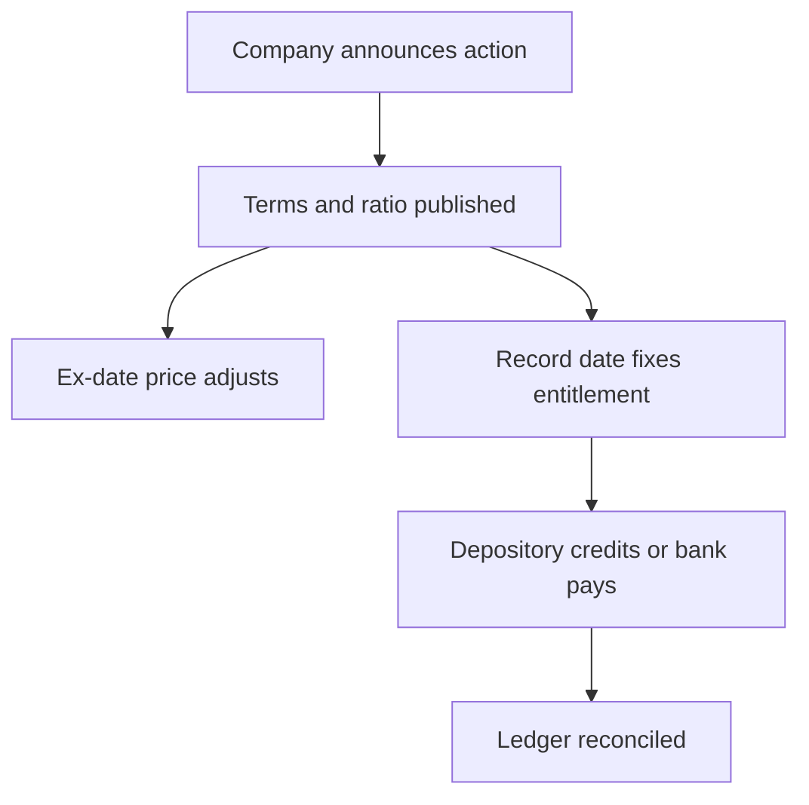

A portfolio is not a list of names. It is a set of positions whose quantity, denomination and sometimes identity change without any instruction from you. A bonus doubles the share count, a split cuts the face value, a dividend deposits cash, a rights issue asks for money and a merger replaces the security entirely. Each of those events is recorded somewhere, and if your own record is not updated at the same time, the version you carry in memory quietly stops matching the version at the depository.

This article in the Equity Mastery series sets out the corporate-action calendar, the sources that have to agree, and a reconciliation procedure that keeps a holdings record correct through the actions a listed company can throw at it.

## Why a holdings record drifts

Drift begins with how a purchase is remembered. Most holders recall the price they paid and the number of shares they bought. A corporate action changes neither of those facts but invalidates both as current figures: the price paid stops being on the same scale as the current price, and the quantity bought stops being the quantity held. If only one of the two fields is updated, the recorded value of the position is wrong immediately.

Three more sources of drift are common. A scheme of arrangement replaces your shares with shares of a different company, so the old line has to be closed rather than adjusted. A rights issue that you choose not to subscribe to changes nothing in the demat account, which is exactly the problem — the position is correct and your proportionate claim in the company is not. And a dividend leaves the share position untouched but changes your return, which most ledgers omit entirely.

## The corporate-action calendar

Listed companies announce corporate actions with dates attached, and the same set of date names recurs.

- **Announcement date.** The board or the company states the intention, subject to any approvals required.
- **Record date.** The register of holders is fixed on this date, and entitlement runs from it.
- **Ex-date.** The date from which the market price is adjusted for the action, so trades on or after it settle without the entitlement.
- **Credit or payment date.** The shares are credited through the depository, or the cash is paid through the banking system.

The notification issued by the exchange, drawn from the company's disclosure, is the document that states these dates and the terms for a specific event. The pair that causes the most error is the record date and the ex-date: an investor who buys the day before the record date but on or after the ex-date does not receive the entitlement, because the trade settles without it.

## The three records that must agree

A position is trustworthy when three independent sources tell the same story.

1. **The transaction record** — contract notes and your own ledger — states what you bought, sold and paid.
2. **The depository record** — the balance in the demat account and the periodic consolidated account statement issued through the depositories — states what you hold now, identified by ISIN.
3. **The corporate-action notice** states what should have happened in between.

Reconciliation means forcing these three to agree, and investigating any difference rather than assuming it is a rounding matter. A disagreement between the ledger and the depository statement is information: it may be an uncorrected corporate action, an off-market transfer, a pledge, a small delivery shortfall, or a scheme replacement that was never recorded.

## Dividends

A dividend is the simplest action to record precisely because it leaves the share count alone. The company pays the cash to the account registered for the purpose, and the entitlement is determined from the record date holding.

Two checks are worth running each time. First, the cash received should equal the holding on the record date multiplied by the stated dividend per share, with any deduction applied on top. Second, the dividend should be recorded as part of the return, not treated as an incidental credit — a share position whose price has gone nowhere can still have delivered a return through dividends, and leaving them out of the ledger understates it. Amounts that remain unclaimed for a statutory period are moved out of the company and recovered through a prescribed process, so a missed dividend is not simply lost forever, but the route is administrative and worth avoiding.

## Bonus issues and splits

These two actions change the quantity and the price scale, and they must be recorded on the credit date, not when the announcement is read. The mechanics are set out in the related article on bonus issues and share splits. For record-keeping the rules are short.

- Update the quantity by the action's ratio.
- Restate the recorded price per share by the reciprocal of the ratio if you want the scale to remain comparable.
- Restate every per-share figure already in the ledger — earnings per share, dividend per share, purchase price per share — or flag the break in the series.
- Leave the total amount invested unchanged. The money you put in did not change; only the number of units it is spread across did.

Skipping the restatement produces the most common ledger error there is: a position that shows a large gain because the price was never adjusted, or a large loss because the quantity was never updated.

## Rights issues

A rights issue offers existing holders the chance to buy new shares, usually at a price below the market, in proportion to their holding on the record date. It is the one routine action that requires a decision and a payment from you.

Three outcomes are possible, and each belongs in the record. You subscribe, in which case the cash outflow and the additional shares both appear. You renounce the entitlement in favour of someone else, in which case the consideration received appears. Or you do nothing, in which case the entitlement lapses and your proportionate ownership falls, which is a real change in your position even though the demat balance looks untouched.

Because the subscription is below the market price, the theoretical price after the issue blends the old price with the subscription price across the enlarged share base.

$$\text{theoretical ex-rights price} = \frac{\text{old shares} \times \text{price before} + \text{new shares} \times \text{subscription price}}{\text{old shares} + \text{new shares}}$$

That is an arithmetic restatement of the position and not a prediction of the traded price. The value of the entitlement itself is the difference between the theoretical ex-rights price and the subscription price, which is why rights entitlements are tradable separately during the renunciation window.

## Buybacks

A buyback reduces the number of shares outstanding. It may run as a tender offer to holders as of a record date, in which case an entitlement ratio determines how many of your shares the company accepts, or as purchases in the market. In the tender route your holding falls by the accepted quantity and cash arrives; in the market route only the cash from sales you actually made appears. In both cases the share count in the ledger should reduce in step with the cash received, and the per-share figures for the remaining holding should be restated on the smaller base. A holder who does not participate in a tender buyback ends up with a slightly larger proportionate stake, which is a change worth noting even though the demat quantity is unchanged.

## Schemes of arrangement

A merger, demerger or amalgamation is not an adjustment to a position; it is a replacement of one security by another. The shares of the company you held are cancelled and shares of the resulting company are issued to you in a ratio stated in the scheme, on dates set by the scheme and the regulators, usually under a new ISIN.

For record-keeping this means closing the old line and opening the new one, with the exchange ratio applied to the quantity. Two consequences are easy to miss. The new security has its own price history, so the old series cannot simply be continued. And the split of your original cost between the resulting entities, which matters for capital-gains computation on a later sale, is governed by tax provisions rather than by the scheme's ratio, and should be verified against current tax material.

## A reconciliation procedure

A workable routine, run after every action and at least once a quarter.

1. Download the current depository statement or consolidated account statement and list positions by ISIN with quantities.
2. List the corporate actions announced for each holding over the period, with their record dates and terms.
3. Apply each action in date order to the quantity, and restate per-share figures as you go.
4. Compare the resulting computed quantity with the depository quantity for each ISIN.
5. Reconcile cash: match each dividend and any buyback or renunciation receipt against the holding on the relevant record date.
6. Investigate every difference to its cause rather than writing it off, and note the cause in the ledger.
7. Where a security has been replaced under a scheme, confirm that the old ISIN is closed and the new one is recorded with its own price history.

## Explain simply

Companies do things that change your holding without asking you. A bonus gives you more shares, a split makes each share smaller, a dividend sends cash, a rights issue asks you to pay for more, and a merger swaps your shares for different ones. Because these happen quietly, the position you remember drifts away from the position you actually own. The fix is to keep a written record with the security code, the quantity and the dates, update it whenever the company announces an action, and check it against the statement the depository sends you. If the two ever disagree, the difference is a question to answer, not a rounding error to ignore.

## Worked example

An illustrative ledger for a fictional holding, using round numbers to show the mechanics.

| Date | Event | Quantity after | Price per share | Cash | Amount invested |
| --- | --- | --- | --- | --- | --- |
| Jan | Bought | 100 | ₹600 | -₹60,000 | ₹60,000 |
| Jun | Dividend ₹6 per share | 100 | — | +₹600 | ₹60,000 |
| Jul | 1:1 bonus | 200 | ₹300 | — | ₹60,000 |
| Nov | Dividend ₹3 per share | 200 | — | +₹600 | ₹60,000 |
| Dec | Two-for-one split | 400 | ₹150 | — | ₹60,000 |

Read across the final row. The holding is 400 shares at ₹150, worth ₹60,000, against ₹60,000 invested. The dividends received total ₹1,200, so the return over the year is the ₹1,200 of cash plus any change in the value of the position. Every per-share figure in the middle of the year was restated as the actions occurred, which is why the arithmetic never breaks.

Now consider the same holding recorded by memory alone. The remembered facts are 100 shares bought at ₹600. At the end of the year the price is quoted at ₹150, and a holder relying on memory would read that as a loss of three-quarters of the investment, when in fact the position is four times larger and roughly unchanged in value. That gap between the remembered position and the actual one is precisely what this procedure removes.

## What this does not tell you

Maintaining an accurate record does not tell you whether a holding is worth keeping, whether a scheme's exchange ratio is fair, or whether a buyback price is attractive. It is a bookkeeping discipline, and its value is that it stops you making decisions from wrong numbers.

Two limits matter. First, the procedure depends on the notices being read: a corporate action that is announced and never recorded will not reconcile itself, and the sequence of dates is the part that most often goes wrong. Second, some of the consequential questions that arise — how the cost of a replaced security is apportioned for tax, how a rights entitlement is treated if renounced — are tax questions with their own rules, and they should be verified against current tax material rather than inferred from the depository statement or the scheme document.

## Open questions

- How much value do holders lose in aggregate by letting rights entitlements lapse rather than renouncing them, and is that loss measurable?
- Do scheme exchange ratios, taken across a large sample, systematically advantage one side of the transaction?
- How often do depository records and issuer records diverge temporarily around a scheme, and what mechanism resolves the difference?
