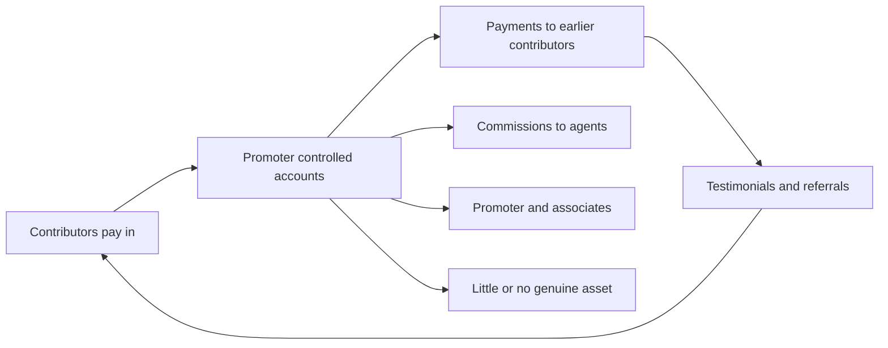

Pooling other people's money is not, by itself, a wrong. Banks do it, mutual funds do it, and so do thousands of ordinary businesses that sell shares or borrow from many lenders. In India what decides whether a pooled arrangement is lawful is not the story on the brochure but whether the structure has been registered under the regime that governs it. When money is collected from many people, managed centrally, and each contributor is offered a return on it, the arrangement has the shape of a collective investment scheme — and such a scheme may be launched only after obtaining a certificate of registration from SEBI.

This article is about that gap: how unregistered schemes are assembled, which wrappers they use, how to test one in a few minutes, and what enforcement can and cannot recover. It describes patterns so that they can be recognised. It names no scheme, company or individual.

## Explain simply

A collective investment scheme is an arrangement in which you and many other people hand money to one promoter, the promoter manages the combined pot, and you expect a return from it. Indian law permits such pooling only with a certificate of registration from SEBI. The common trick is to avoid the words "scheme" and "investment" altogether and describe the product as something else: a plot of agricultural land, a plantation you supposedly own, a timeshare week, a franchise, a trading programme, a profit-sharing arrangement. The money still flows the same way — under the promoter's control — and the return still depends on the promoter's promise, or on there being enough new contributors to pay the earlier ones. Registration is the document that stands between you and a bare promise, so the check is worth more than the pitch.

## What turns a pool of money into a collective investment scheme

Four features do the work. Money comes from more than one investor. It is pooled rather than kept in separate, individually managed accounts. A promoter or manager makes the decisions about how the pool is used. And each contributor is passive — they expect income, profit or a return from the common activity without running it themselves.

When those features are present, registration obligations attach to the structure, not to the label on the marketing material. Enforcement actions in this area have consistently targeted schemes structured nominally around land, plantations, teak, timeshares or e-commerce that promised returns while operating as unregistered collective investment schemes. The wrapper changes the sales story. It does not change the legal shape of the arrangement, and it does not remove the registration requirement.

Registration is not a formality. A registered vehicle carries prescribed disclosures and a supervisory relationship with the regulator, which means there is an authorised document to read and an institution accountable for what it says. An unregistered operator carries none of this by design.

## The boundary cases: mutual funds, companies, registered chits and partnerships

Almost every category of Indian financial product is a pool of somebody's money, so it helps to see the boundary clearly.

- **A mutual fund** is a pool, but it is operated inside a regulated structure with published unit values, an independent custodian and a trustee layer. The investor holds units of a trust rather than a promise from a promoter.
- **A company issuing shares** is a common pool too, governed by company law and, for offers to the public, by a disclosure regime designed to make the promoter state what the money is for.
- **A registered chit fund** is a defined savings-and-borrowing arrangement: members contribute periodically to a common fund, the pooled amount is auctioned or allotted to one member each period at a discount, and distribution rotates until every member has received a draw. It is regulated by the state and capped by the Chit Funds Act, and the foreman carries statutory security obligations. The term "chit" or "committee" is widely misused by collections that offer deposit-like returns without any of this. If it is unregistered, the protections are absent.
- **A partnership or limited liability partnership** with a handful of active partners is an ordinary business, because the participants are not passive contributors to a promoter-managed pool.

The line is drawn by the facts — passivity of contributors and central management — and, in borderline cases, by the regulator and the courts. That is why an investor should not rely on the promoter's own classification of what it is selling.

## The wrappers operators choose

The recurring wrappers are worth knowing because each carries a built-in answer for the sceptical question.

**Land and plot schemes** sell "ownership" of a parcel, often unregistered, sometimes undivided, with a buy-back or development promise. **Plantation and agro-forestry schemes** sell trees or acreage — teak, timber, orchards — with a projected harvest income that arrives years later, long after the money has moved. **Timeshare and resort memberships** sell weeks or "holiday units" with a rental-income promise. **E-commerce and click models** sell a "vendor slot" or a "task" that supposedly generates a monthly commission. **Service agreements and franchise arrangements** sell a share of a business's "profit" while leaving all control with the promoter.

Each defines an asset you can picture, which is the point: a tangible story suppresses the question of who is managing your money and under what authority. Two features recur. First, the return is contractual and fixed, but is described as business income that the promoter has "never failed" to pay. Second, the exit is controlled by the promoter, priced by the promoter, and usually discouraged.

## How the money moves

Every pooled scheme has an inflow and an outflow. In a lawful one the two sit inside an audited, registered entity. In an unregistered one they sit in ordinary accounts controlled by the promoter or by associates, and often in several of them.

Where the operating business does not generate the promised return, the only way to keep paying is with the money of later contributors. That is the structure of a Ponzi scheme: returns paid to earlier investors out of money contributed by later ones, sustained only by continuous new inflows until it collapses. The accounting can be made to look healthy for years, because the person showing you the numbers is also the person producing them.

The movement of money also determines recovery. Proceeds routed through multiple accounts, converted into assets held in others' names, or moved across jurisdictions are hard to trace even when the scheme is identified. The reporting entities in the formal financial system carry record-keeping and reporting obligations, and there is a legal mechanism to attach proceeds — but attachment depends on tracing, and tracing is slow relative to the speed at which money leaves.

## Five questions before you contribute a rupee

1. **Is there a SEBI certificate of registration for this scheme?** Not for the group, not for a sister company, not for a different activity — for this scheme.
2. **Whose account receives the money?** A scheme account of a registered entity, or a personal or associate account. The second is the answer that matters most.
3. **What instrument do you receive?** Units, shares, a registered title, a partnership deed, or a booking form and a service agreement. The last group leaves you a contractual promise and typically nothing else.
4. **Where does the return come from?** The operating business, or new subscriptions. If the promoter cannot answer this precisely, the answer is the second.
5. **What is your exit, who prices it, and what would you own if the promoter stopped answering the phone?**

A scheme that survives all five is unusual. Most unregistered schemes fail at question two.

## How to check registration and alerts in minutes

SEBI maintains registers of the entities it has authorised and publishes alerts about entities found to be operating without authorisation. Three checks are quick.

- **Search the register for the exact legal name** of the entity that will receive your money, not the brand name on the advertisement. Names are chosen to be close to well-known ones; the register match is exact.
- **Look for the entity and its promoters in SEBI's investor alerts**, which exist precisely for unauthorised entities and guaranteed-return pitches.
- **Check the scope of any registration produced.** An entity registered in one capacity is not thereby authorised to run a pooled scheme, to manage money, or to advise you. Registration is permission for a defined activity.

A fourth check costs nothing and is often the most revealing: search SEBI's published orders for the entity's name, its directors and its promoters. Enforcement orders state findings of fact, and patterns of past findings are public.

## Worked example: what a fixed monthly coupon really requires

Consider an illustrative arrangement, not a description of any real one. A promoter promises 3% a month to every contributor, paid monthly, with the principal returned at the end of the term. Suppose fresh contributions arrive at ₹1 crore a month, and the coupon is paid out of that inflow.

The coupon due each month is $0.03 \times B$, where $B$ is the outstanding principal base. For coupon payments alone to be covered by an inflow $I$:

$$ 0.03\,B \le I \quad\Longrightarrow\quad B \le \frac{I}{0.03} \approx 33.3\,I $$

So a 3%-a-month coupon can be serviced from a steady ₹1 crore of monthly contributions only while the installed base stays at or below roughly ₹33 crore. That base is itself built entirely from past contributions, so at ₹1 crore a month it takes about 33 months to reach the ceiling. Before that point the scheme has slack; after it, every month is a shortfall unless the inflow grows.

Now add redemptions. Any contributor who asks for their principal back converts a coupon obligation into a repayment obligation, and the inflow must then cover coupons *and* capital returned. The required growth accelerates, which is why collapse is usually triggered not by a quiet month but by the first month in which redemptions exceed new money.

A variant worth recognising is the **money multiplier** pitch: pay to enter a "trading programme" or "matrix", and be paid from the entry fees of later participants. The promised mechanism is fictional — the arithmetic is that of a chain letter — and several such schemes have been prosecuted in India as unauthorised collective investment schemes and money circulation schemes.

The calculation above is illustrative arithmetic, not a forecast, and it assumes no genuine investment activity at all. Its purpose is structural: a promised coupon is a liability that grows with the base it is promised on.

## Enforcement, winding up and why recovery is partial

SEBI can investigate, restrain and pass orders against unregistered schemes, and its enforcement record is public. For unregistered collective investment schemes, prescribed adjudication and winding-up processes apply, under which the assets that can be located are collected and distributed.

The realistic outcome is worth stating plainly. By the time an order arrives, the money has often been spent, transferred or converted into assets held by others, and the process that follows ranks claims rather than guaranteeing them. Insolvency and recovery proceedings typically impose a moratorium on individual actions, rank creditors in a statutory order, and distribute whatever is realised — which means an unsecured contributor is often well behind other claimants. Asset attachment of traced proceeds is possible, but only if tracing reaches the money before it is gone. Where the harm was mis-selling or a misleading representation, a consumer commission route exists as well, with its own limits.

## Where a complaint goes

Three routes run in parallel, and a contributor need not choose only one.

**The securities regulator.** SEBI's investor-protection machinery, including the SCORES grievance-redressal portal, is the route for complaints about a scheme or an intermediary, and its escalation path is published. Complaints about an entity that appears on an unauthorised-entity alert are especially straightforward to file.

**The police.** Investment fraud is also a criminal matter — cheating and criminal breach of trust fall under the criminal law that has applied since July 2024 — and states maintain specialised Economic Offences Wings that investigate these cases. Complaints under the Banning of Unregulated Deposit Schemes Act and the Prize Chits and Money Circulation Schemes (Banning) Act are typically registered with an Economic Offences Wing, and they run parallel to, or instead of, proceedings before SEBI or a consumer forum.

**The receiving bank.** If contributions went into an account at a bank, that bank is a party to the trail and can act on a complaint. Time matters here more than anywhere else.

Whatever the route, the documentary trail is the complaint. Agreements, receipts, statements showing the receiving account, agent identities and the full message history are what convert an account of a loss into an actionable record.

## What this does not tell you

It does not tell you whether any particular scheme is registered, because registrations change and only a check at the time of dealing is valid. It does not quantify how much money these schemes take or how many exist; those figures need data that is not cited here. It does not establish that registration equals safety — a registered vehicle can still be mismanaged — and it does not resolve borderline classifications, which are for SEBI and the courts. Finally, recognising a wrapper is not the same as proving an intent to defraud, and you do not need to prove it: not contributing is the decision that protects you.

## Open questions

Three questions are left open by this article. Where exactly should the line fall between a genuine agricultural or real-estate venture with a handful of active participants and a collective investment scheme that required registration? How much of the recovery gap reflects money that was genuinely dissipated, versus money that was traceable but reached too late? And how effectively do official warning lists reach the audiences that are actually recruited into these schemes, which are often offline and language-specific? The companion articles in this series take up the verification and reporting mechanics in more detail.
