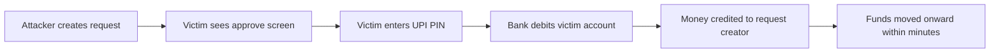

Payment apps solved a real problem and created a new one. Moving money between two people is now a few taps and a four-digit secret, and that convenience has been packaged so tightly that the screen no longer tells you which way the money is moving. In a collect-request fraud, nothing is hacked. The victim reads a request that looks like a receipt, approves it, and the money leaves in the direction the app always intended.

Unified Payments Interface, run by the National Payments Corporation of India, is one of the highest-volume retail payment systems in the world, and NPCI publishes both its volumes and its typologies of retail-payment fraud. The direction confusion described here is a published typology, not an exotic one. What follows is how the pattern is assembled, how to test a request in two seconds, and what to do in the hour after an approval you regret.

## Explain simply

A payment request is a message from someone asking to be paid. When you approve it with your UPI PIN, you are authorising your bank to take money out of your account and send it to them. Receiving money never works this way. If someone genuinely wants to send you money, they authenticate, and the money arrives without you doing anything. So any message that says you must approve something — a request, a link, a QR code, a "verification" — in order to receive money is describing a step that does not exist. The safe rule is simple: decline every request you did not initiate, then check what it was about through a channel you opened yourself.

## One word, two directions

The English word "request" hides the whole problem. In payments, a request is not a neutral notification. It is an offer with a direction: one party asks another to pay. Approving it moves money from the approver to the requester.

That is the entire mechanism of this fraud family. The attacker creates a request against the victim. The victim believes they are accepting a credit — a refund, a prize, a settlement, a payment for something they are selling — and approves it. Approval is authorisation. The app then does exactly what it was told, and the victim discovers the direction only from the debit message that arrives seconds later.

The pin authorises a debit. It never authorises a credit, and no design of any bank app makes it possible to receive money by entering it.

## Why the direction is easy to miss

Several design features that exist for good reasons combine badly in this one moment.

- **The amount is the most prominent element on the screen.** The amount is identical in either direction, so it carries no information about direction, but it captures attention.
- **The action word is generic.** Buttons are labelled with words like approve, accept, confirm or continue. None of them is the word "pay", and none of them names the debited account.
- **The counterparty name is truncated, abbreviated or unfamiliar.** Requests arrive from identifiers, not from names you recognise, and the app has limited space to display them.
- **The authentication step is identical.** Whether you are paying or being asked to pay, the final screen asks for the same secret in the same way, so muscle memory carries you through it.
- **The approach arrives with a story attached.** The request is rarely the first message. It is preceded by context — a refund that could not be processed, a payment for an item you listed, a "registration fee" for a job, a verification for an investment platform — and the story supplies the meaning that the screen withholds.

None of this is a defect that a single design fix removes. It is the reason the direction test below has to become a habit rather than a reading exercise performed carefully once.

## The lie that does the work

Four stories recur, and each is worth recognising because the story is the attack:

1. **The refund.** A purchase, a failed transaction or a subscription needs to be "returned" to you, and you must approve the request to receive it.
2. **The sale.** You are selling something on a classifieds site; the buyer "pays" via a request, and asks you to approve it to confirm.
3. **The fee.** A job, a loan, a government benefit or an investment platform needs a small processing amount, and the request formalises it. This is where collect-request fraud meets investment fraud: the same request can be dressed as a subscription to a "guaranteed-return plan".
4. **The verification.** Your account supposedly needs to be "verified" by approving a zero or one-rupee request, which is used to test that the account is live and that the victim will approve anything.

The common thread is that each story explains why the wrong action looks correct. That is why verifying the story instead of the request is a trap. The story can be perfectly consistent and still false.

## The direction test

Two questions, asked before any approval, resolve the direction with certainty.

1. **Which account is being debited?** The screen must name the account money will leave. If it does not, treat the request as a debit to you.
2. **Who receives it, and did I start this?** If the counterparty is unfamiliar, or the process was initiated by someone else's message rather than by something you set in motion, decline.

The default is decline. Declining costs nothing — a request that is refused simply creates no debit. There is no version of a legitimate payment where a real sender is harmed by your declining a request you did not expect; if the request was genuine, they can send the money directly, which requires no action from you at all.

Two secondary habits are worth adding. First, never approve a request on the basis of a screenshot or a forwarded message; open your own app and look at the pending request there. Second, treat a small unexpected credit as suspicious rather than reassuring, because a genuine payment is cheap and it is used to establish trust before a large request follows.

## What happens after you approve

Approval does not merely queue a payment. It authorises it, and authorisation moves the money.

The debit leaves your account and is credited to the account behind the request creator's identifier. In fraud cases that account is frequently a rented one — opened in someone else's name and handed over for a fee — and the funds are moved onward quickly, often split and forwarded through further accounts. The banking system's record-keeping obligations mean the trail exists in principle, and there is a legal mechanism to attach proceeds that are traceable, but tracing is slow relative to the speed of the transfers. Recovery is therefore a race that the complainant usually enters late.

This is why the direction of the first hour matters more than anything else in this article. A complaint that names the receiving identifier while the money is still one hop away is a different proposition from a complaint filed three days later.

## Worked example: the first hour

An illustrative containment routine, not a statement of any bank's procedures or timings. Suppose you have approved a collect request you now believe was fraudulent.

- **Minute 0 — capture.** Screenshot the request, the approval and the debit message. Note the transaction reference, the amount, the receiving identifier and the timestamp. Do not delete the chat or the messages.
- **Minute 2 — call the bank.** Use the number printed on your card, passbook or in the official app's help section — never a number supplied by the person who contacted you. Report an unauthorised or erroneous transaction on the specific reference, ask what blocking is appropriate, and insist on a written complaint reference.
- **Minute 10 — report in parallel.** Lodge a police complaint. Cheating and forgery are offences under the criminal law in force since July 2024, and state Economic Offences Wings handle financial fraud. Include the receiving identifier and the reference number; the police complaint is what equips the banks and the payment system to act on the trail.
- **Minute 30 — close the other doors.** Check for further unauthorised debits, change the UPI PIN and banking passwords, and revoke any device or session access you did not set up. If the contact involved installing an app or sharing a screen, remove it.
- **Minute 60 — escalate and preserve.** If the bank has not resolved the matter, note the escalation path rather than relying on a phone call: under the Reserve Bank – Integrated Ombudsman Scheme, 2026, in force from 1 July 2026, a complaint may go to the RBI Ombudsman once 30 days pass without a reply or as soon as an unsatisfactory reply arrives. The complaint to the bank must already have been made, so the reference number from Minute 2 is what makes escalation possible. Keep copies of everything, including the reference numbers, because the trail is the case.

Each step matters because each one acts on a different part of the chain: the bank can act on its own account, the police complaint can act on the beneficiary trail, and the escalation acts on the bank's own process. Waiting for one to finish before starting the others wastes the only resource that is actually scarce.

## Where to report

Three channels, run together rather than in sequence. The **bank** is the first, because the debit sits on its books and it holds the receiving side's details; a written complaint with a reference number is what creates a record. The **police** are the second, because this is a criminal offence, and Economic Offences Wings exist for financial fraud cases of this shape. The **RBI** is the third. A complaint against any regulated entity — banks, NBFCs and other system participants — goes through the centralised complaint portal at cms.rbi.org.in; complaints sent by e-mail or post are addressed to the Centralised Receipt and Processing Centre at crpc@rbi.org.in, and the RBI's toll-free number 14448 gives information and status but cannot receive a complaint. The governing framework is the Reserve Bank – Integrated Ombudsman Scheme, 2026, in force from 1 July 2026, which replaces the 2021 scheme; complaints received before that date, appeals arising under the 2021 scheme and execution of its awards continue under the 2021 scheme. Two requirements gate escalation. First, the customer must approach the entity first, and that complaint to the entity must itself have been made before the limitation period under the Limitation Act, 1963 expired. Second, escalation is available only if there is no reply within 30 days — or the higher period set by RBI, NPCI or card-network guidelines, whichever is higher — or if the reply is unsatisfactory, and it must be filed within 90 days from that deadline or from the last communication, whichever is later. Filing is free, there is no cap on the disputed amount, and compensation may reach Rs 30 lakh for consequential loss and Rs 3 lakh for time, expenses and harassment. An appeal against an Award lies to the Appellate Authority within 30 days, extendable by up to a further 30 days for sufficient cause. The earlier written complaint is therefore not merely good practice; it is the precondition for escalation.

Where the approach was dressed as an investment — a "plan", a return promise, an advisory service — a fourth channel becomes relevant. SEBI publishes alerts about unregistered advisers, tip providers and guaranteed-return schemes, and the investment-shaped story is usually the part that can be reported to it in addition to the police.

## What this does not tell you

This article does not describe any particular bank's screens, button labels or recovery procedure, because those differ and change. It does not quantify how much of this fraud occurs or how much is recovered; those figures require data that is not cited here, and any confidently quoted number should be treated as unsourced unless it can be traced. It does not establish that a particular transaction was fraudulent, since the same request mechanism is used for entirely legitimate collections. And it does not make recovery likely: the honest position is that the odds improve sharply with speed and remain uncertain even then, because the money moves faster than any complaint.

What it does establish is that the direction of a payment is knowable before approval, and that knowing it is enough. The fraud depends on that knowledge arriving after the tap rather than before it.

## Open questions

Three questions remain open. Would a mandatory plain-language sentence on every collect request — naming the account to be debited and the account to be credited — reduce this category measurably, or would users continue to approve reflexively out of habit? How much more is recovered when the first complaint reaches both banks within minutes rather than hours, and is that difference large enough to justify changes to how complaints are captured? And do the rented accounts used to receive these transfers get closed quickly enough to matter, or does the money always move before any bank can act? The companion article on [OTP phishing and account takeover](/library/otp-phishing-and-account-takeover) takes the case where the victim's own credentials, rather than their reading of a screen, are what the attacker obtains.