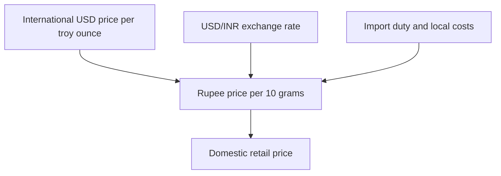

Gold is one of the few assets that rises when nothing seems to happen. There is no earnings report, no dividend, no coupon, and no single news flow that explains the move. Yet the price moves, often persistently, and the moves are not random. They are the visible result of a small number of forces working on an asset that pays no income. This article names those forces, shows how they combine into the price an Indian buyer actually pays, and separates the drivers that matter from the noise that does not.

## Explain simply

Gold does not pay interest. That single fact explains most of its price behaviour. When interest-bearing assets pay a good real return, holding gold is expensive because you are giving up that return, so the price tends to fall. When the real return on bonds and deposits is low or negative, the cost of holding gold falls, and the price tends to rise. On top of that, gold is priced in dollars, so the rupee price also moves with the exchange rate: if the rupee weakens, the local price rises even if the dollar price is unchanged. Add steady buying by central banks and by investors through funds, and you have the four forces that move the price. None of them is a headline, which is exactly why gold moves when nothing seems to happen.

## The real-interest-rate channel

The most important driver of the dollar price of gold is the real return on interest-bearing assets, typically proxied by the real yield on government bonds. The logic is opportunity cost. A bond pays a coupon; gold pays nothing. When the real yield on a bond is high, an investor demands a high return to hold gold instead, and the only way gold can deliver that is by falling in price. When the real yield is low or negative, the opportunity cost of holding gold shrinks, and the price rises. This is why gold often falls when real rates rise and rises when they fall, and why the metal is described as a hedge against the erosion of real returns rather than against inflation in any single month.

The distinction between nominal and real rates matters here. A nominal bond yield of seven per cent with inflation at six per cent is a real yield of one per cent, and gold finds that far more attractive than the same nominal yield with inflation at two per cent. The RBI's database on the Indian economy carries the inflation, policy-rate and G-sec-yield series needed to compute real yields, and the IMF's cross-country data supplies the global interest-rate backdrop. The packet does not carry a current real-yield figure, so none is stated here; the mechanism is the point, and the current number must be computed from the primary series when it is needed.

## The currency channel: why rupee gold differs from dollar gold

Gold is priced internationally in US dollars per troy ounce. The troy ounce is the unit of mass used in international precious-metal markets, equal to 31.1034768 grams, slightly heavier than the everyday ounce of 28.35 grams. Indian traders convert the dollar price to rupees per ten grams, the domestic convention. Confusing the two ounces misprices gold by about 9.7 per cent, which is why the distinction matters even though the difference looks trivial.

The conversion means the rupee price is the product of the dollar price and the exchange rate. If the dollar price is flat and the rupee depreciates, the rupee price rises. If the dollar price rises and the rupee is flat, the rupee price rises. If both move together, the rupee price moves twice as much. This is why Indian gold buyers can see the local price climb during a period when the international price is quiet, and why the rupee is a driver in its own right, not just a translation. The RBI database carries the exchange-rate series, and the World Bank's long-run data can be used to sanity-check magnitudes, but no current rate is stated here.

## Investment demand and exchange-traded funds

The macro forces set the tide, and investment demand is the wave on top. When investors buy gold through exchange-traded funds, coins and bars, they add demand that can amplify a macro move or, at times, dampen it. A gold exchange-traded fund is a mutual-fund scheme whose units are listed on the exchanges and whose net asset value tracks the domestic price of physical gold, achieved by holding gold or gold-related instruments as permitted under SEBI's regulations. Investors get exchange liquidity and no vaulting costs or purity risk, at the cost of annual expenses and, for some products, custody and insurance charges. Price discovery in the ETF can deviate modestly from the underlying gold price, and investors should compare tracking difference across products.

The practical point is that investment demand is a flow that responds to price expectations, so it is partly a follower and partly a leader. When the macro case for gold is strong, fund inflows add to the price move; when it weakens, outflows subtract. The packet does not carry current ETF flow figures, so none are stated here, but the mechanism — a listed, liquid, spot-referenced vehicle that lets investors express a view on gold without holding metal — is what makes the flow possible.

## Central-bank buying

Central banks have been net buyers of gold for years, accumulating the metal as a reserve asset. This demand is structural rather than tactical: central banks buy over long horizons, are largely price-insensitive, and add a steady bid under the market. The effect is to support the price during periods when investment demand is weak, and to remove a source of support when accumulation pauses. The RBI's handbook of statistics on the Indian economy carries long-run series on household financial savings and the composition of financial assets, which frame how gold fits into the broader savings landscape, and the IMF's sovereign-risk discussion supplies the context in which central banks hold reserves. No current central-bank purchase figure is carried in the packet, so none is stated here.

## The domestic price formula

The rupee price an Indian buyer pays is not the international price translated at the exchange rate. It is that translation plus a wedge. The wedge is the import duty on gold, which the central government prescribes and adjusts in the Budget and by notification. Gold and silver imports attract customs duty, including any applicable cess, which drives a wedge between international and domestic prices. The duty level is a key input to jewellers' pricing, to smuggling incentives and to the local premium or discount on the metal. Domestic futures and ETF prices embed this duty, so they do not track international quotes rupee-for-rupee.

The diagram is the whole model. The international price and the exchange rate combine to give the landed rupee price, the duty and local costs add the wedge, and the result is the price in the domestic market. A buyer who understands the model can look at a local price move and ask which of the three inputs moved, and a buyer who does not will be surprised by a local price that rises while the international price is flat.

## Worked example: an illustrative currency decomposition

The following is an illustrative calculation, not a forecast and not a live quote. It shows how the currency channel works.

Suppose gold is an illustrative 2,000 US dollars per troy ounce and the exchange rate is an illustrative ₹85 per dollar. The rupee price per ten grams is:

$$ 2000 \times 85 \times 10 / 31.1034768 = 54656 \text{ rupees per 10 grams} $$

Now suppose the dollar price is unchanged but the rupee depreciates to an illustrative ₹87 per dollar:

$$ 2000 \times 87 \times 10 / 31.1034768 = 55941 \text{ rupees per 10 grams} $$

The rupee price has risen by an illustrative ₹1,285 per ten grams, about 2.4 per cent, with no change in the international price. The entire move is currency. Add a change in the dollar price and the two effects compound; add a change in the import duty and the wedge widens or narrows. The decomposition is the tool: when the local price moves, the first question is which input moved, and the answer determines whether the move is a global gold event, a currency event or a policy event.

## What this does not tell you

- **No current gold price.** The dollar and rupee prices are illustrative and must be checked against live quotes.
- **No current real yield.** The real-rate mechanism is described, but the current figure must be computed from the primary series.
- **No current import duty.** The duty is set by the government and changes; the current rate is not stated here.
- **No central-bank or ETF flow figures.** These are not carried in the packet and are not stated here.
- **No forecast.** The drivers are described, but no projection of the gold price is made, because a projection would be speculation dressed as arithmetic.

## Open questions

- How much of the long-run rise in the gold price is a real-rate story and how much is a currency story, and does the answer differ between the dollar and the rupee price?
- How sensitive is Indian gold demand to the local premium created by the import duty, and what happens to that premium when the duty changes?
- If central-bank accumulation pauses, how much of the price support it provided must investment demand replace?

## Reading gold price news

The next time the gold price moves and no single headline explains it, work the model:

1. **Real rates.** Did the real yield on government bonds move? That is the macro tide.
2. **Currency.** Did the rupee move against the dollar? That is the translation.
3. **Investment demand.** Did funds or retail buyers add or subtract? That is the wave on the tide.
4. **Central banks.** Did official accumulation continue or pause? That is the structural bid.
5. **The wedge.** Did the import duty change? That is the local premium.

If none of the five moved, the move is noise, and the correct response is no response at all.
